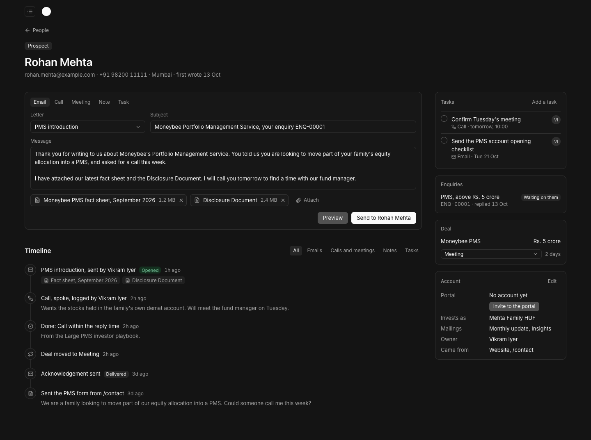
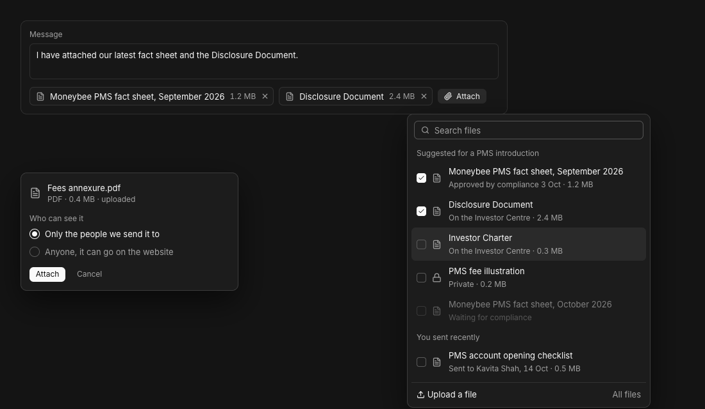
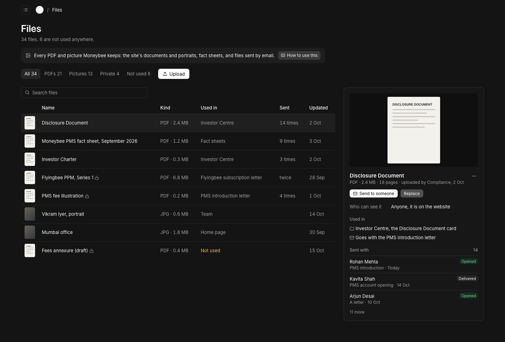
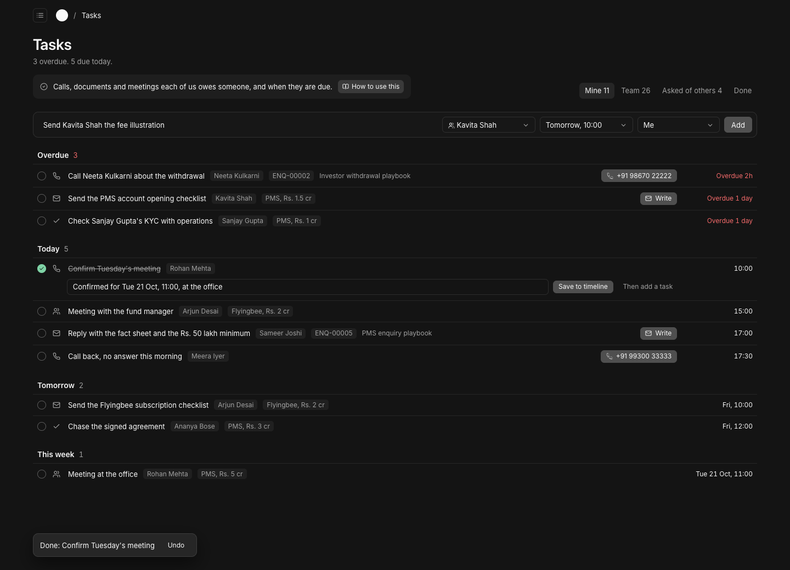
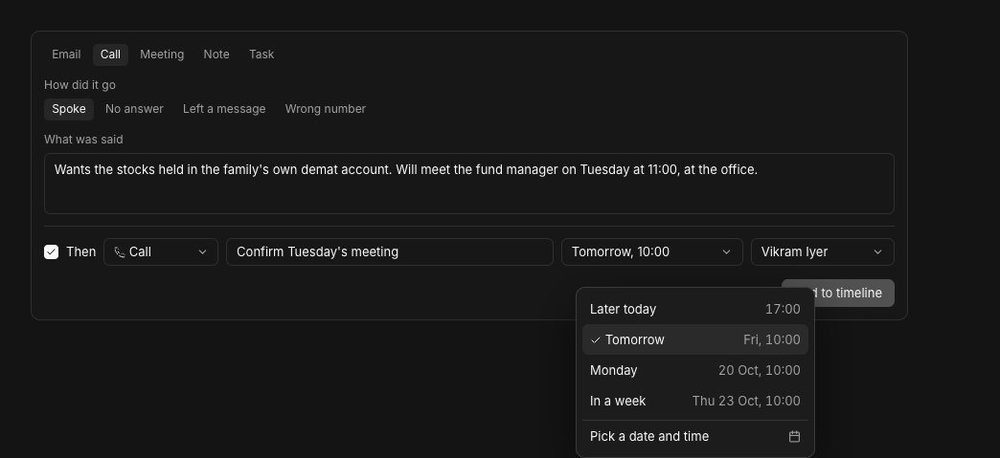
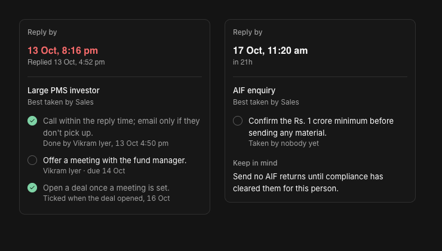
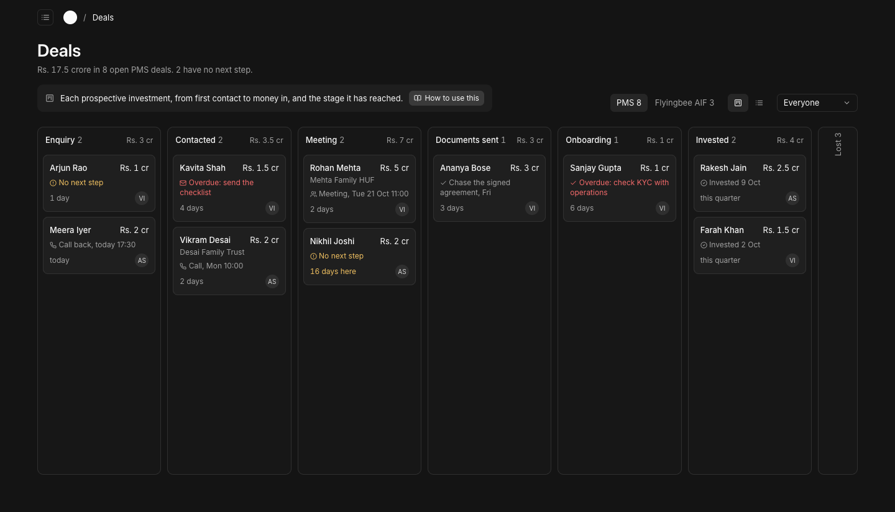
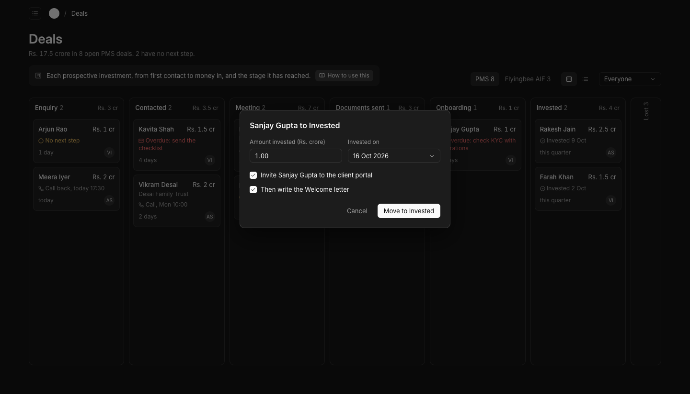

# Finish the admin: no dead ends

**Problem.** Several screens end where the work should start. A person in People is a bare form: no emails, no timeline, nothing to do next. Files is a list of uploads that nothing outside the site can use. Tasks can be read on Today but never added. Deals is an empty list. A client account can be made, but the investor is never told. Entities are kept and read nowhere.

**Result.** Every screen leads somewhere. From a person you write, log, plan the next step, move their deal or invite them to the portal, each from the place that thing lives. Any email can carry a file, and every file says where it is used and who it was sent to. Tasks come out of the work itself (calls, playbooks, deal moves) and each one can be done from its row. Deals move on a board that shows which ones have no next step.

**Proof.** Every picture below is a mock built in the admin's own tokens, read from the running enquiry and inbox screens (page #141414, panels #171717, 10% white borders, Inter 13px, Fluid buttons 29px and 23px). The layouts reuse the enquiry screen and the Enquiries list, as you asked: same header, same side panels, same tabs and rows.

## 1. Walk-through: what each screen does today

| Screen | Today | Dead end? | Fix (section) |
| --- | --- | --- | --- |
| Today | Due enquiries, fact sheets to approve, tasks | Tasks never appear, nothing makes them | 4 |
| Enquiries | Reply, notes, open a deal, timeline | No | Attach files to a reply (3); playbook steps become tasks (4) |
| People | Payload's data form | **Yes**: no emails, timeline, tasks or next step | 2 |
| Deals | Empty list, deal is a data form | **Yes** | 5 |
| Hiring | Full stage flow | No | Attach files to HR emails (3) |
| Emails | See, edit, send | No | Attach files when sending; each letter's "Goes with" files (3) |
| Pages, Team, Documents, Case studies, Openings, Office details | Edit the site | No | |
| Fact sheets, Products | Monthly figures with approval | No | |
| **Files** | Upload list | **Yes**: no "used in", not usable in email | 3 |
| Playbooks, Desk settings, Staff, Audit log | Settings | No | Playbook steps get a due time (4) |
| **Client accounts** | Make a login with a password you type | **Yes**: the investor is never told; not tied to the person | 6 |
| Entities (no screen) | Kept on a person | **Yes**: read nowhere | 7 |

## 2. A real person screen

The row of seven buttons is gone. Each action sits with the thing it changes, as on the enquiry screen:

| Action | Where it lives |
| --- | --- |
| Write to them | The composer's **Email** tab, open by default when they have an email |
| Log a call, a meeting or a note | The composer's **Call**, **Meeting** and **Note** tabs (the enquiry timeline's Note, Call, Meeting control, grown by two) |
| Add a task | The composer's **Task** tab, or **Add a task** in the Tasks panel |
| Move or open a deal | The **Deal** panel: a stage menu when there is one, the enquiry's "Turn into a deal" form when there is not |
| Give portal access | **Invite to the portal** in the Account panel (section 6) |
| Edit details | **Edit** on the Account panel turns its rows into fields in place |

- **Email tab:** pick the letter (the enquiry letters when they have an open enquiry, the 12 client letters, or a letter in your own words), its facts, the subject and message, files, then Preview or Send. It is the same email the Emails page draws, and the enquiry's Reply gets the same file row.
- **Timeline:** every email to and from them with what happened to it (sent, delivered, opened, not sent) and the files it carried; every form, call, meeting, note, task done and stage change. Filters: All, Emails, Calls and meetings, Notes, Tasks.
- **Side panels:** Tasks (open ones, tick to finish), Enquiries, Deal, Account (portal, invests as, mailings, owner, where they came from).
- The enquiry's Person panel links here instead of to the data form.

## 3. Files

### Attaching a file to any email

Every place an email is written gets the same file row: the person screen, an enquiry's Reply, HR's emails to applicants and the Emails page.

- **Attach** opens a picker with search at the top, then **Suggested** for this letter, then **You sent recently**, then **Upload a file** and **All files**. Dropping a file anywhere on the composer attaches it too.
- **Suggested** comes from the letter itself: compliance sets what each letter goes with on the Emails page (for example, the PMS introduction goes with the latest approved PMS fact sheet and the Disclosure Document), so those are already attached when the letter is picked. Staff remove or add files for that one send.
- A fact sheet waiting for compliance shows, greyed, with "Waiting for compliance", and cannot be attached.
- Each attached file is a chip with its name, size and a remove cross. The email lists them in its Documents box.
- **Limit:** Resend takes 40 MB per email after encoding, about 30 MB of files. Past that, the picker says how much is over and Send stays off.
- **Upload a file** (left of the picture) asks one question: only the people we send it to (the default), or anyone, so it can go on the website.

**Private files.** The Flyingbee PPM, fee illustrations and anything for one client must never sit at a public web address (AIF private placement, AIF MC 3.2.1). Files today are all public. Private files go in a private Blob store (`@vercel/blob` 2.3.1 supports private storage; Payload's adapter does not, so I add a small private collection beside Files). Staff open them signed in; emails carry them as attachments, never as links. They move to the client's AWS in Mumbai with everything else at go-live.

### The Files screen

- Laid out like Enquiries: a count line, tabs (All, PDFs, Pictures, Private, Not used), then rows with a preview, name, kind and size, where it is used, how many times it was sent, and the date.
- Clicking a row opens it on the right: a preview, who can see it, **Used in** (the page, team portrait, document card, fact sheet or letter that uses it, each a link), and **Sent with** (to whom, which letter, when, and whether it was opened).
- **Send to someone** asks who, then opens their person screen with the file already attached. **Replace** takes a new upload in place of this one: everything that uses it shows the new file, and emails already sent keep the copy they carried. It says how many places will change first. The **more** menu holds Download, Copy link (public files only) and Delete.
- A file used nowhere says **Not used**; its panel offers Send to someone, Make it a document card (public PDFs) and Delete. A file still in use cannot be deleted; the panel says where to remove it first.

## 4. Tasks

A task is something one of us owes someone, with a time. Most are made by the work itself, so nobody has to remember to add them:

| Made by | What it creates |
| --- | --- |
| Logging a call | **Then** row under the note, filled by the outcome: No answer adds "Call again", next working day 10:00; Left a message, in two working days; Spoke or Wrong number add nothing unless ticked (picture below). |
| Logging a meeting | "Send the meeting follow-up", an email task for that letter, today 17:00. |
| Ticking a task done | An optional line on what happened (saved to their timeline), and **Then add a task**. |
| A playbook | When someone takes an enquiry, its playbook steps become their tasks. Compliance gives each step a time on the playbook: with the reply, next working day, in three working days, in a week, or **not a task**, for a rule to keep in mind. A step can tick itself when its event happens: a reply sent, a call logged, a deal opened. |
| Moving a deal | Meeting asks when and adds the meeting; Documents sent adds "Chase the signed documents" in three working days (section 5). |
| By hand | The Task tab, the Tasks panel, the bar at the top of Tasks, or **T** on any admin screen (with the person filled in when you are on their screen). |

- **Each task has** a title, a kind (Call, Email, Meeting, To do), a time, an owner, and the person it is for; an enquiry and a deal are optional. An email task can name its letter.
- **Times** are picked, not typed: Later today, Tomorrow (Monday on a Friday), Monday, In a week, or a date and time. All in IST, 10:00 by default.
- **Doing it from the row:** a Call task shows the number to call; an Email task has **Write**, which opens the person's composer on that letter, and sending it ticks the task. Ticking shows Undo for a few seconds.
- **Desk › Tasks:** Mine, Team (grouped by owner, with each person's overdue count), Asked of others, Done. Grouped Overdue, Today, Tomorrow, This week, Later. The menu item shows how many of yours are overdue or due today.
- **Reminders:** a weekday 9:00 email to each person with what is overdue and due that day (none is sent on an empty day); an email when someone gives you a task. Both are new letters in the catalogue, in the same frame.
- **Today** lists your overdue and today's tasks with the same tick.
- The enquiry's playbook panel shows the steps as these tasks (above, left); rules sit under **Keep in mind** (right).

## 5. Deals board

Desk › Deals keeps the Enquiries list's header, tabs and rows, and adds a board:

- **Tabs:** PMS and Flyingbee AIF, on equal footing; a Board or List switch; Everyone, or one person. The count line gives the money in open deals and how many have no next step.
- **Columns:** Enquiry, Contacted, Meeting, Documents sent, Onboarding, Invested (this quarter). Each shows its count and total in Rs. crore. Lost is folded at the end and opens on click.
- **Each card:** the person (and the entity they invest through), the amount, the next task (red when overdue), **No next step** in amber when there is none, days at this stage (amber after 14), and the owner.
- **Moving:** drag a card, or focus it and press **M** for a Move to menu. Some moves ask one thing first:
  - Meeting: when and where; adds the meeting task and offers the Meeting confirmation letter.
  - Documents sent: which went (taken from what their last emails carried); adds the chase task.
  - Invested: the amount and date; offers the portal invitation and the Welcome letter (below).
  - Lost: why (went elsewhere, below the minimum, not eligible, not now, stopped replying, other) and a note; closes the deal's open tasks.
- Each move is a line on the person's timeline. A card opens the person; Back returns to the board where you were.
- **List** is the Enquiries table: person, product, stage, amount, days at stage, next step, owner; arrow keys or j/k and Enter.

## 6. Client accounts from the person

**Invite to the portal** on a person makes their client account and sends a new **Portal invitation** email with a set-password link (7 days), so nobody types a password for an investor. Client accounts lists each one with its person, status (Invited, Active, Disabled) and last sign-in.

## 7. Entities

Shown and changed on the person ("Invests as"). When a Flyingbee enquiry says HUF, family office or company, the desk offers to make the entity. A deal can name the entity as the investor, and its card shows it.

## 8. Order, and what waits

Build order, each shown to you working before the next:

1. Person screen with the composer and the file row (2, and the attach half of 3).
2. Files screen and private files (rest of 3).
3. Tasks, with playbook steps, reminders and the T key (4).
4. Portal invitation (6).
5. Deals board (5).
6. Entities (7).

Data changes: tasks gain a kind, letter, outcome and where they came from; playbook steps gain a time and an event; emails record the files they carried; letters gain "Goes with"; deals gain the invested date and a lost reason list; a private files collection. Each comes with a migration, and frozen data where a migration fills rows.

Waits, as before: client statements (CSCRF, India hosting), distributor logins (needs your answer on what a distributor sees), the AI features (gateway credits), the mailing desk for mailings to a list. Tracked private links for the PPM (each viewer, opens and downloads, an expiry) are possible later; for now private files go as attachments.

### Sources that changed a decision

- HubSpot, [Create tasks](https://knowledge.hubspot.com/tasks/create-tasks): "select the Create a To-do checkbox" at the bottom of the call or note editor, and the follow-up prompt on completing a task. That is the **Then** row and the done flow.
- Attio, [Tasks](https://attio.com/help/reference/productivity-collaborating/tasks): **T** anywhere, Home shows "overdue or due today or tomorrow", "a daily reminder of tasks due". That is the T key, the grouping and the morning email.
- Twenty CRM's task list is the plain list we are avoiding: `groupBy(tasks, ({ status }) => status)` (`packages/twenty-front/src/modules/activities/tasks/components/TaskGroupsContent.tsx`, line 69), so nothing is ordered by when it is due.
- Resend [attachments](https://resend.com/docs/dashboard/emails/attachments): "no larger than 40MB (including attachments after Base64 encoding)". That is the 30 MB limit.
- Papermark's schema (a document with versions, one primary) and Notion backlinks: Replace keeps the record; Used in is worked out from what points at the file.
- HubSpot's deal board: column totals and asking for required details on a move.
- Research notes: `research/crm-patterns.md`, `research/file-ux.md`.
