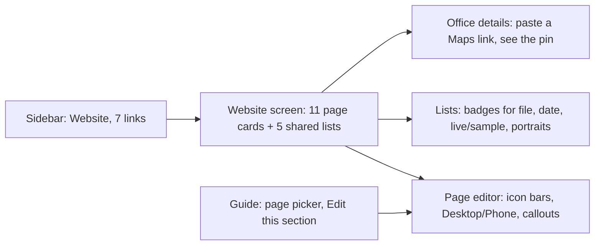
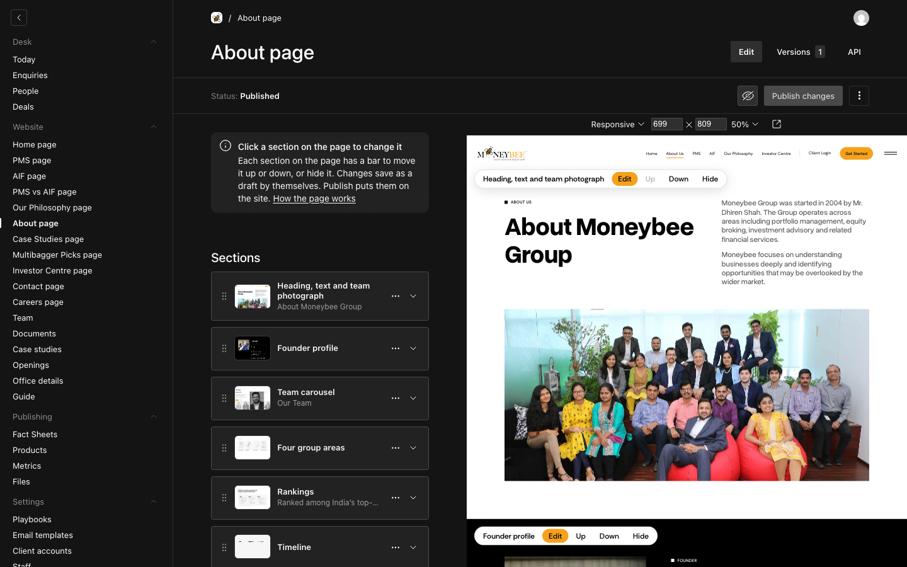
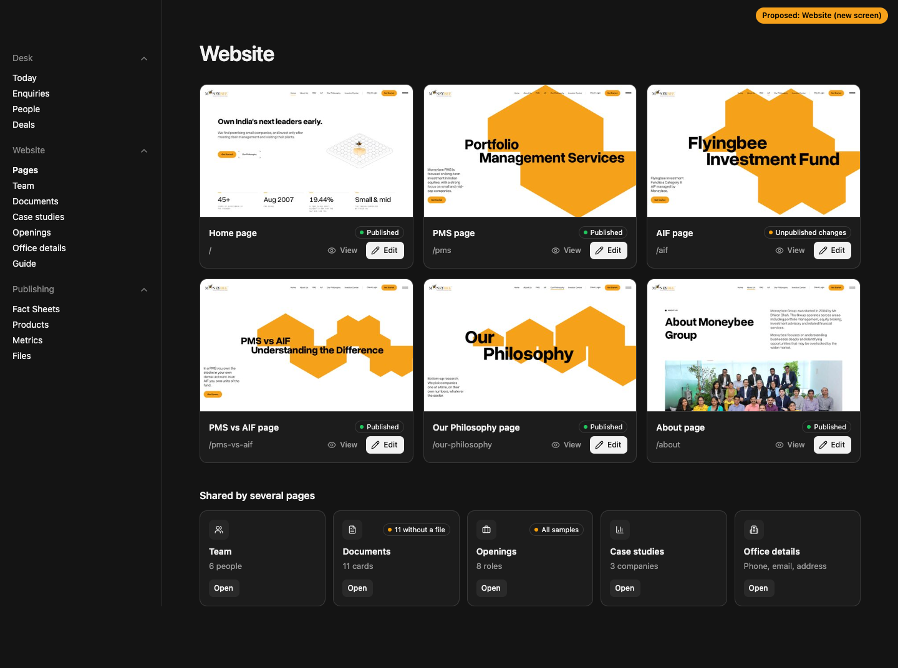
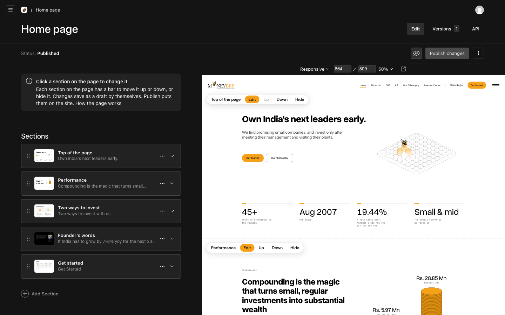
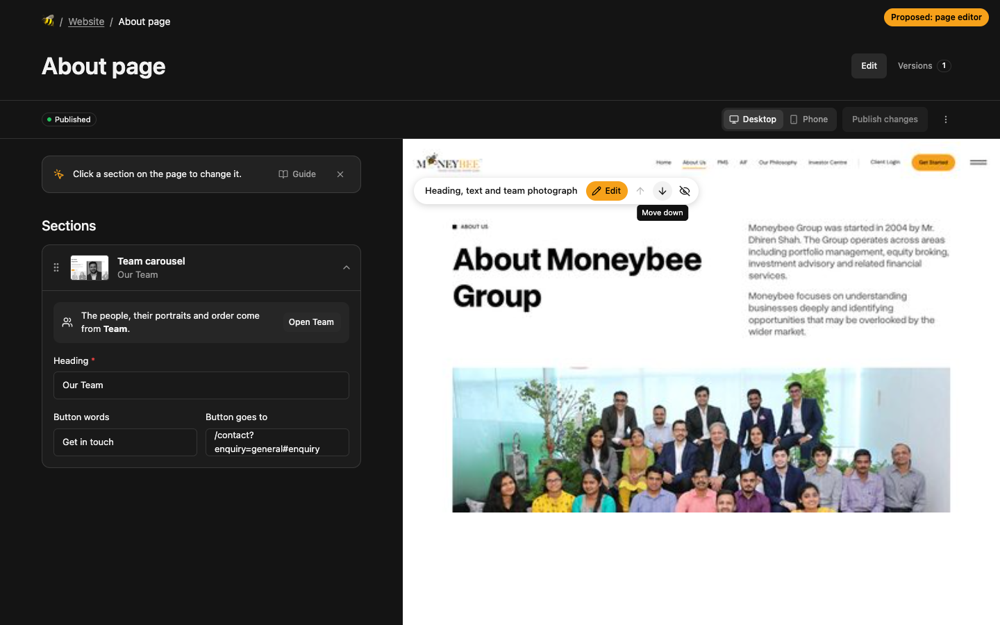
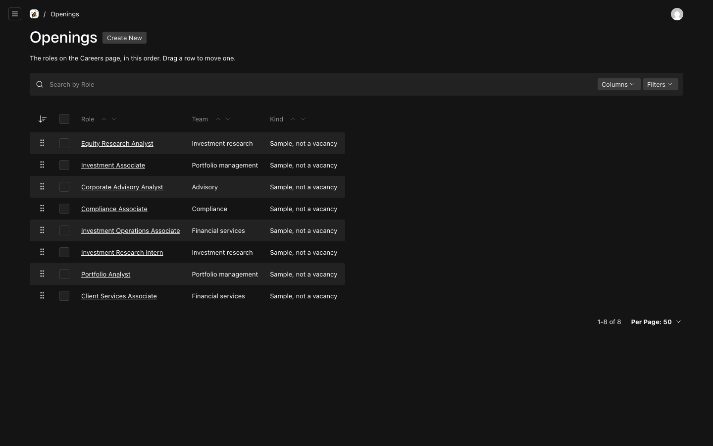
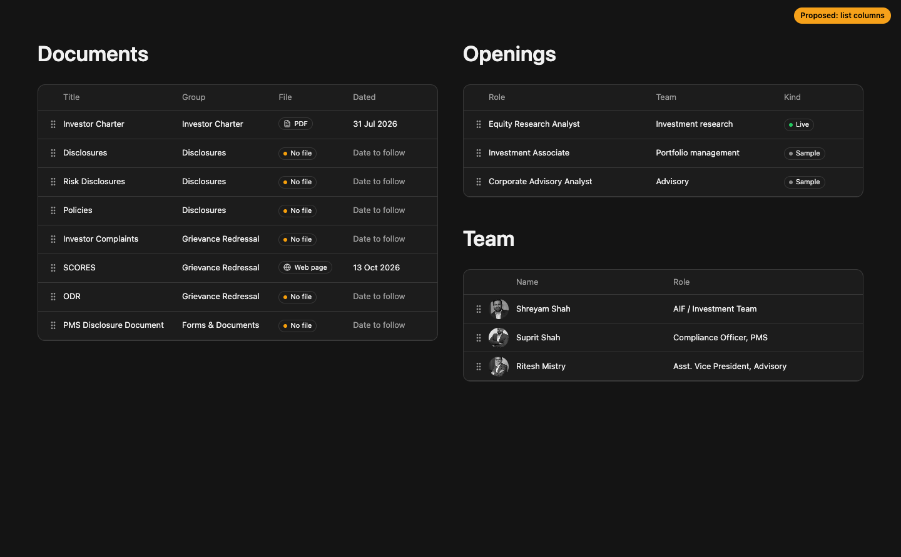
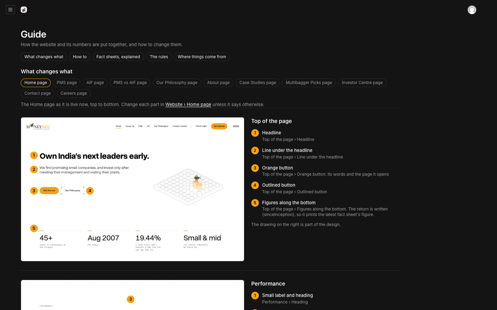
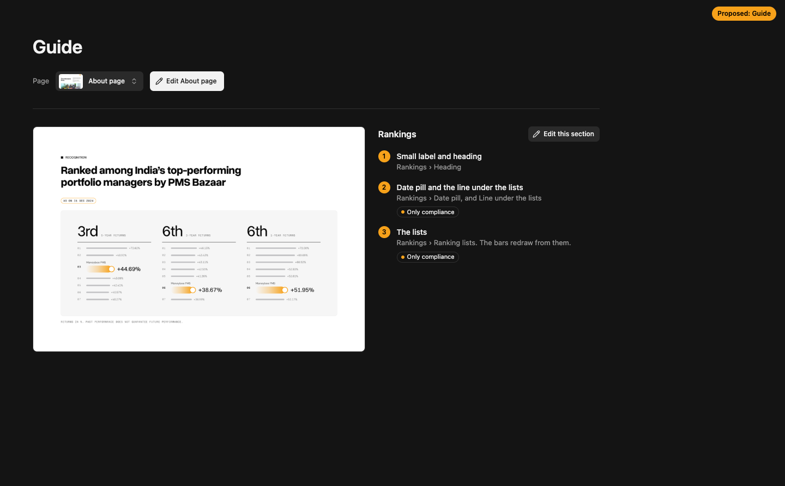
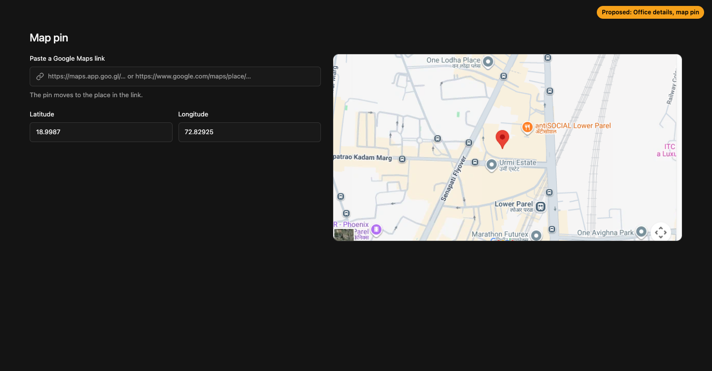

# Admin: buttons and icons where text is doing their job

**Problem.** The admin explains itself in sentences where a button or an icon would do. The sidebar lists 17 "… page" links. Every preview bar is four text buttons. The preview toolbar shows width, height and zoom numbers nobody needs. Notes inside sections are paragraphs with a link in the middle. List columns print `<No File>` and "Sample, not a vacancy". The map pin is two bare numbers.

**Result.** One Website screen to start from, icon buttons with tooltips on the preview bars, a Desktop/Phone switch, one callout style with a real button for "edited elsewhere", status badges in lists, a Guide that opens the section you are reading about, and a map pin you set by pasting a Google Maps link.

**Proof.** Previews below are static mock-ups at 1440×900, built from real screenshots and data (`preview/preview.html`). After approval each change is checked in the running admin at the same size.

## 1. What changes

### A. Website screen (new) and a shorter sidebar

Current: 17 text links under Website.

Proposed: the sidebar's Website group becomes **Pages, Team, Documents, Case studies, Openings, Office details, Guide**. Pages opens a new screen: a card per page with the top of the live page, its status (Published, or Unpublished changes in amber), and **View** and **Edit**. Under it, the five shared lists with an icon, a count, and an amber badge when something needs doing ("11 without a file", "All samples").

- Page pictures are still shots of each page's top, taken like the section pictures and retaken with them when a layout changes. They show the layout, not today's words.
- View opens the page in a new tab. No up-right arrow icon anywhere; the button uses an eye.

### B. Page editor

Current: text bar, technical toolbar, paragraph banner, paragraph notes, API tab.

Proposed:

- **Preview bar:** section name, orange **Edit** with a pencil, then icon buttons for move up, move down and hide/show, each with a tooltip ("Move down", "Hide on the site"). Disabled when it cannot move.
- **Toolbar:** Payload's Responsive menu, width, height and zoom are replaced by one **Desktop / Phone** switch. Zoom keeps fitting itself, as now.
- **Status:** Published or Unpublished changes as a badge.
- **Banner:** one line, with a **Guide** button and a close button. Closed stays closed for that person.
- **Breadcrumb:** Website / About page, so there is a way back to the Website screen.
- **API tab:** removed from every page, list and Office details. Staff never need it.
- **"Edited elsewhere" notes:** one callout style everywhere (team, documents, case studies, openings, office details, closing cards, AIF returns): an icon, one line, and a button that opens the place ("Open Team", "Open Office details", "Open Products").

### C. Lists

Current: raw text.

Proposed cells (the table itself stays Payload's; only the cells change):

- Documents: **File** shows a PDF or Web page chip, or an amber **No file** badge; **Dated** shows the date or a muted "Date to follow". The first and sixth rows show what a filled card would look like; today all eleven read No file.
- Openings: **Live** (green) or **Sample** (grey) badge.
- Team: the portrait beside the name.
- Case studies: the initials badge beside the name.

### D. Guide

Current: 11 pills and plain "where" lines.

Proposed:

- One page picker with each page's picture, beside **Edit About page**.
- Each section gets **Edit this section**, which opens the editor with that section already open.

### E. Office details: map pin

Current: two number boxes and a sentence about right-clicking in Google Maps.

Proposed: paste any Google Maps link (short links too) and the latitude and longitude fill themselves; the map beside it shows the pin as visitors will see it.

### F. Fact sheet footer

The line "0 of 16 returns filled, 16 left empty (N/A) · nothing to check · no PDF yet" becomes three chips with icons: filled count, numbers to check (amber when any), PDF attached or missing.

## 2. Files

| Area | Before | After |
|---|---|---|
| Website screen | none | `components/admin/website/website-view.tsx` (server), registered as `/admin/website` in `payload.config.ts`; page pictures in `public/site-pages/` |
| Sidebar | `components/admin/nav-links.tsx` lists 17 links | 7 links; Pages → `/admin/website` |
| Preview bar | `components/site-editor/preview-section.tsx`, text buttons | icon buttons with tooltips (lucide) |
| Editor chrome | `components/admin/site-editor/preview-bridge.tsx` | adds Desktop/Phone (`setBreakpoint`), status badge, breadcrumb (`useStepNav`), one-line banner, opens `?section=N`; `admin.css` hides Payload's size and zoom controls |
| Callouts | `team-note.tsx`, `closing-doors-note.tsx`, `page-notes.tsx` | one `SourceNote` in `components/admin/site-editor/source-note.tsx`; the notes use it |
| API tab | shown | `admin.hideAPIURL` on page records, lists and Office details |
| List cells | stock | `components/admin/cells/*.tsx` (file, date, kind, portrait, initials) |
| Guide | `components/admin/guide/guide-view.tsx` | page picker, Edit this section links |
| Map pin | two number fields | `components/admin/site-details/map-pin.tsx` ui field; a server action follows short Maps links |
| Fact sheet footer | text line | chips in `fact-sheet-screen.tsx` |

## 3. Left out

- Payload's own form fields, tabs and buttons keep their look. This changes what we built and the cells, not Payload's design.
- The CRM screens (Today, Enquiries) are not in this round.
- The previews are static: hover, tooltips and the Desktop/Phone switch are drawn, not working. The working versions are checked after approval.
- No new libraries: lucide icons and the Fluid Functionalism components are already installed.
