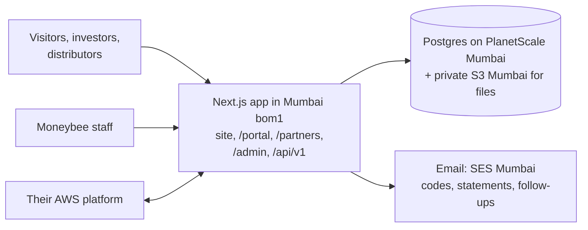
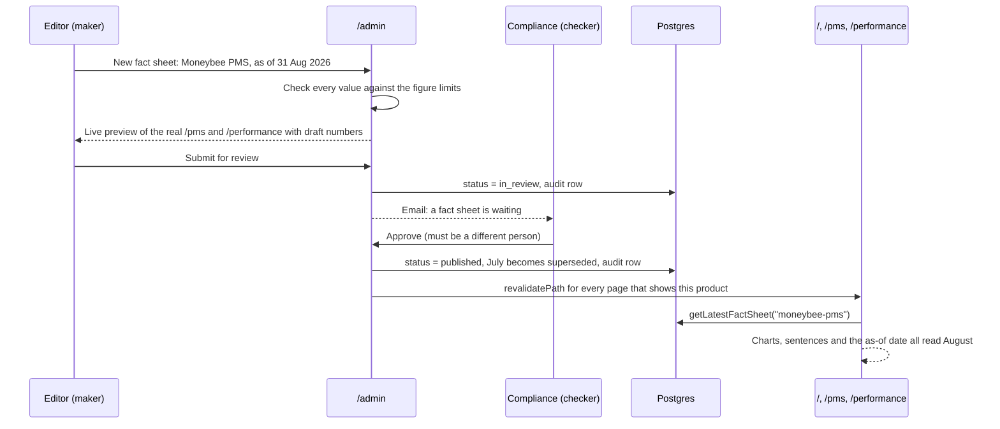
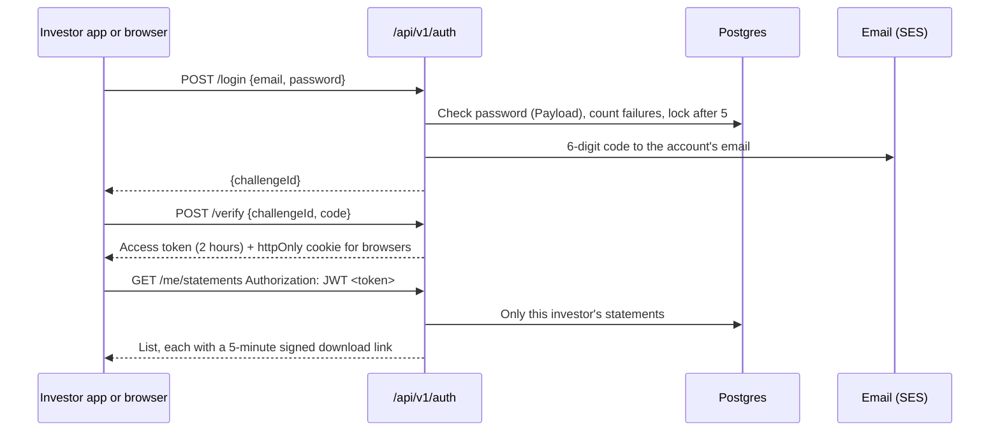
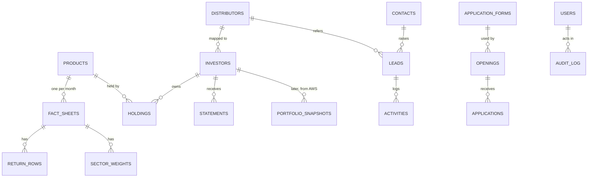

# Moneybee backend: how it is arranged

Revision 2. This revision adds what you asked for in review:

- The investor and distributor portals.
- An API Moneybee can use, with email-and-password login.
- The database and how it is run.
- How the client keeps all of this up to date every month without us.

Nothing is built yet. Research notes sit beside this file in `research-regulation.md` and `research-stack.md`.

## 1. Goal

- **Problem.** Every number, list and form on moneybee.in lives in code (`lib/*.ts`). The client cannot publish a month's returns, add a product or team member, review 1,000 applicants, follow up a lead, or give investors their statements without a developer. Their "Client Login" still points at the old `moneybee.in/register.php`.
- **Result.** One backend inside this Next.js app, with the data in Mumbai.
  - Staff work in an admin at `/admin`.
  - Investors and distributors sign in to their own portals with email and password.
  - Moneybee's own systems use a documented API with the same login.
  - The site reads everything from the database, and every illustration redraws from the stored numbers.
- **Proof.** The August fact sheet scenario in section 2 runs end to end. Compliance enters the figures and sees the real charts in preview. A second person approves. /pms, /performance and the homepage show August, and July stays in history. That slice is built and shown to you before anything else.

## 2. How it fits together



### Scenario 1, the proof: the August 2026 fact sheet



### Scenario 2: an investor, or Moneybee's AWS platform, signs in



A system account, such as their AWS platform, has an email and password like everyone else. For unattended jobs it also gets an API key, generated from its account page in the admin, so a script never has to read an emailed code.

## 3. Why this stack

| Decision | Choice | Evidence |
|---|---|---|
| Where data lives | India only | SEBI CSCRF circular SEBI/HO/ITD-1/ITD_CSC_EXT/P/CIR/2024/113 (20 Aug 2024) is addressed to "All Alternative Investment Funds" and "All Portfolio Managers" and says "SEBI REs shall ensure that processing and storage of data is done within legal boundaries of India". Read in the PDF from sebi.gov.in. Investor statements are squarely the data it covers. |
| Database | Postgres on PlanetScale, AWS ap-south-1 Mumbai | Your PlanetScale region list shows `ap-south`, Mumbai, `postgresql_supported: true`. It has automatic backups and point-in-time recovery to any moment up to 5 minutes ago (planetscale.com/docs/postgres/backups). |
| Compute | Vercel functions pinned to `bom1` | Vercel's region table: `bom1`, ap-south-1, Mumbai. Default is `iad1` (US), so the pin matters. |
| Files and email | Private S3 and SES in ap-south-1 | Same region as the database. |
| Not Convex | Rejected | Convex regions are us-east-1, eu-west-1, ap-southeast-2 and ca-central-1 only (docs.convex.dev/production/regions). |
| Not Neon (Vercel's Postgres) | Rejected | Neon's regions are US East, US West, Frankfurt, London, Singapore, Sydney and São Paulo. There is no India region, and a project's region cannot change later (neon.com/docs/introduction/regions). The other India option is RDS Postgres in their own AWS account in ap-south-1. That is more for them to run, and has no branches for staging. |
| Admin, login, API base | Payload 3, installed into this app, version pinned at `3.89.0` | See the list after this table. |

What Payload 3 provides, from its docs:

- Several login collections side by side, of which one opens the admin. Here that is staff in the admin, and investors and distributors in the portals only.
- Lockout after failed logins (`maxLoginAttempts`, `lockTime`), token expiry, email verification, forgot and reset password, refresh tokens, and `Authorization: JWT <token>`.
- API keys per account.
- Roles per collection and field.
- Drafts and version history with restore.
- S3 uploads.
- Generated TypeScript types.
- Live preview.

`@payloadcms/next@3.89.0` accepts our Next 16.2.12. `3.90.2` needs 16.3.3, and Payload 4 is only a canary, so 3.89 is the base until a planned upgrade.

What we build on top of Payload:

- The emailed login code. Payload has no two-factor; we add it through its custom auth strategies.
- Maker-checker approval.
- The audit log.
- Figure limits.
- The CRM pipeline and follow-ups.
- The applicant review screen and the form builder.
- Both portals.
- `/api/v1`.
- Analytics.
- Webhooks.

## 4. Accounts and login

One login system with four kinds of account. Every account signs in with email and password.

| Account | Where it signs in | Who creates it | Second step |
|---|---|---|---|
| Staff (Admin, Editor, Compliance, Sales, HR) | `/admin` | Admin invites | Emailed code on every sign-in |
| Investor | `/portal` and the API | Staff invite one by one, CSV import, or their AWS platform through the API. No public sign-up. | Emailed code on a new device, and at least every 30 days |
| Distributor | `/partners` and the API | Staff only | Same as investors |
| System (their AWS platform, scripts) | The API | Admin | API key for unattended jobs, limited to the Integration role |

Rules for every account:

- Passwords are at least 12 characters, checked against known breached passwords.
- After 5 wrong attempts the account locks for 10 minutes.
- Tokens last 2 hours, with a refresh.
- Reset links expire in 30 minutes.
- Every sign-in, failure and download is written to the audit log.
- The account owner gets an email on a sign-in from a new device.

The admin's account list doubles as the access list Shreyam asked for.

## 5. What the client manages

Everything below supports create, edit and delete, with full history. Deletions go to a trash for 30 days. Whatever exists shows on the site with no deploy.

| Module | Collections | Who edits | Notes |
|---|---|---|---|
| Products | Products, Benchmarks | Admin, Compliance | A product is one PMS strategy or one AIF scheme. It holds the name, slug, type, SEBI number, inception date, benchmark, minimum, terms list and page template. /pms and /aif stay bespoke. New products use one shared template. |
| Fact sheets | FactSheets | Editor makes, Compliance approves | One per product per month. It holds return rows (period, ours, benchmark, null prints N/A), the wealth growth figures, sector weights, and their monthly PDF. Old months are kept. |
| Numbers in sentences | Metrics | Editor, Compliance | Named numbers such as `founderYears 45`, `pmsStocksMin 15` and `sectorCap 30`. The prose stays in code and reads them. |
| Site content | TeamMembers, CaseStudies (with yearly financials), PickTiers, ResearchStages, Rankings, Faqs, InvestorDocuments, Links, SiteSettings | Editor | Investor documents become real PDFs with dates, replacing "Available on request". |
| Blog | Posts | Editor writes, Compliance approves | Drafts, scheduled publish and a LinkedIn-ready excerpt. Off the site behind a switch until they are ready. |
| CRM | Contacts, Leads, Activities, Tasks, EmailTemplates | Sales | One contact per email or phone, so website, offline, portal and distributor-referred leads merge. Stages, owner, next follow-up, notes, emails sent from the admin, CSV import and export. |
| Careers | Openings, ApplicationForms, Applications | HR | Openings have draft, open and closed states. Forms are built from steps and questions. Applications get a rating, stage, tags and notes, plus bulk shortlist or reject with emails that carry an interviewer's booking link. Built for over 1,000 applicants per post. |
| Investor portal | Investors, Holdings (product and client code per investor), Statements, ServiceRequests | Operations staff | See section 6. |
| Distributor portal | Distributors, DistributorMaterials, CommissionStatements | Sales, Compliance approves materials | See section 6. |
| Analytics | Events and daily rollups | Read only | Page views and clicks on /pms, /aif, /careers and the CTAs. No cookies. |
| Platform | Users, AuditLog, LoginChallenges, Media, ApiKeys, Webhooks | Admin | |

## 6. The portals

The investor portal at `/portal` replaces the link to `register.php`. It works from day one on what Moneybee already produces each month, and grows into live data when their AWS platform is ready. It has two phases:

1. **Now: statements.**
   - Staff drop the month's PDFs into one bulk upload, such as performance appraisal, transaction and AIF unit statements. Files are named by client code, for example `MB1234_2026-08_PAS.pdf`, and match their owner automatically.
   - Anything that does not match is listed for a person to fix.
   - Each investor gets an email: "Your August statement is ready".
   - In the portal, investors see their statements by month, the year-end audited statements, the fact sheets and documents for the products they hold, and a request form for address changes and similar. Requests go to the CRM as service requests.
   - The grievance details (SCORES, ODR) are on every page.
2. **Later: live numbers.**
   - Their AWS platform pushes monthly portfolio snapshots through `/api/v1`: holdings value, own return and benchmark per investor.
   - The portal draws them with the same chart components the site uses.
   - We never call their system live, so the portal works even when theirs is down.

The distributor portal at `/partners` is for existing distributors only. It is behind login and never linked publicly, which keeps to the client's "do not look like we are hunting distributors". Distributors see:

- The investors mapped to them.
- Compliance-approved materials, such as fact sheets and presentations.
- Their commission statements, uploaded the same way as investor statements.
- A referral form that creates a lead tagged to them.

What we keep out of the portals: no transactions, no money movement, no KYC uploads. Those stay with their platform and custodian.

## 7. The API

`/api/v1` is the contract we give Moneybee. It is versioned, documented and stable. Collections can change inside the admin without breaking their integrations, because v1 maps them to fixed shapes. Payload's own REST at `/api/<collection>` stays staff-only for the admin. Next matches the fixed `v1` folder before Payload's catch-all; the slice checks this, and if the two overlap, Payload's routes move to `/cms-api`.

| Who | Endpoints |
|---|---|
| Anyone | `GET /products`, `GET /fact-sheets/latest?product=`, `GET /openings`, `POST /enquiries`, `POST /applications` |
| Any account | `POST /auth/login`, `POST /auth/verify`, `POST /auth/refresh`, `POST /auth/logout`, `POST /auth/forgot`, `POST /auth/reset`, `GET /me` |
| Investor | `GET /me/statements`, `GET /me/statements/:id/download`, `GET /me/holdings`, `POST /me/requests` |
| Distributor | `GET /me/clients`, `GET /me/materials`, `GET /me/commissions`, `POST /me/referrals` |
| Moneybee systems (Integration role) | `GET/POST/PATCH /leads`, `GET /applications`, `POST/PATCH /investors` (create sends the invite), `POST /statements`, `POST /portfolio-snapshots`, `GET/POST /webhooks` |

Conventions:

- JSON, with ISO dates.
- Cursor pagination with `?updated_since=` for syncing.
- An `Idempotency-Key` on every POST, so a retried upload is not stored twice.
- One error shape: `{ "error": { "code", "message" } }`.
- Rate limits per account.
- Every call is written to the audit log.
- Webhooks go out signed: `lead.created`, `application.created`, `factsheet.published`, `request.created`.

Documentation: request and response shapes are ArkType schemas. Those same schemas validate input at runtime and generate the OpenAPI file at `/api/v1/openapi.json`. A readable reference at `/api/v1/docs` sits behind staff login. A breaking change means a `/api/v2`, while v1 keeps working.

Site pages do not use HTTP at all. They call `lib/data/*` in-process through Payload's Local API, stay static, and are refreshed with `revalidatePath` on publish. `cacheTag` would need the site-wide `cacheComponents` flag (checked in the Next 16.2.9 source), which this repo does not have.

Scheduled work runs on Vercel Cron calling Payload's job runner, because Payload's autoRun does not work on Vercel. The jobs are:

- Follow-up reminders.
- Scheduled publishing.
- Statement emails.
- Daily digests.
- The data-retention purge.

## 8. The database



- **Schema.** The collection files are the schema. Payload turns them into Postgres tables through migrations committed to the repo (`payload migrate:create`, `payload migrate`), and CI runs them before deploy.
- **Branches.** `main` is production, a highly available branch with a replica. `staging` gets every change first, paired with a Vercel preview, so new fields are tried on a copy, never on live data.
- **Backups.** PlanetScale's automatic backups plus point-in-time recovery. We also take a manual backup before every migration, and do a restore drill each quarter. The drill restores to a new branch and checks the latest fact sheet and statement counts.
- **Files.** Statements, resumes and documents live in one private S3 bucket in Mumbai. Encryption is on and public access is blocked. Files are reached only through 5-minute signed links.
- **What we never store.** PAN in full, bank details, Aadhaar, or passwords in plain text. Payload hashes passwords.

## 9. Easy to run month after month

For Moneybee staff, who will use it constantly:

- **The admin is grouped by job, not by table:**
  - **This month:** fact sheets per product, statements uploaded against investors, unmatched files.
  - **Leads:** new today, follow-ups due.
  - **Hiring:** applicants waiting per opening.
  - **Website.**
  - **Accounts.**
- **The dashboard shows what is left to do.** For example: "Moneybee PMS August: in review. Statements: 212 of 240 matched."
- **Plain labels in fields.** Units sit beside each field (%, Rs. crore), and errors say what is wrong in words. For example: "The 5-year return is 412%. The chart allows up to 200%."
- **Nothing breaks the live site by accident.** There is preview before publish, approval for anything with numbers, a version history with restore, and a 30-day trash.
- **Bulk tools are built in:** CSV import for offline leads and investors, the statement bulk upload, and bulk actions on applicants.
- **Daily email digests** go to the owner of each queue.
- **A one-page guide for each recurring task** is linked from the admin: the monthly fact sheet, monthly statements, adding a team member, opening a role.

For whoever maintains the code:

- **One repo, typed end to end.** `payload-types.ts` is generated from the collections, and the v1 schemas are shared by validation, types and docs.
- **Tests only on the parts that cost money or trust:**
  - Approval rules, including no self-approval.
  - Figure limits.
  - Lockout and the login code.
  - An investor only ever sees their own statements.
  - The API role boundaries.
- **Error alerts and an uptime check** on the site, `/portal` and `/api/v1`.
- **A small control CLI**, `pnpm mb`, for the jobs agents and developers repeat: health, seed staging, create a staff account, re-send an invite, export, and replay a webhook.
- **A runbook** covering: monthly update, add or remove staff, rotate API keys, restore from backup, and the breach steps.
- **Pinned versions** (Payload 3.89, Next 16.2) with one planned upgrade window per quarter.

## 10. Numbers and illustrations

- Every illustration takes its numbers as props from the record. No figure imports a constant from `lib/` any more.
- Each figure has one limits module, used by the admin validation and by the component's prop type.
- The edit screen shows the real page with the draft numbers through Payload's live preview.
- Sentences that contain numbers are built from fields, including the as-of date, which today is typed into 8 places.
- **Figure fixes found in the audit:**
  - The homepage wealth stack's box grows with the value. Today it overflows at about Rs. 42 Mn.
  - The picks pyramid builds from the number of tiers. Today it is fixed at 5.
  - The case grid builds from the number of years. Today it is fixed at 5.
  - The /pms ring reads `sectorCap`.
  - The hero, the AIF card and the stack caption read Metrics.
  - Rankings handle negative returns.

## 11. Compliance built in

- **Maker-checker** on fact sheets, products, blog posts and distributor materials. The approver must be a different person. A published version is never edited in place. A correction creates a new version with a stated reason, and all versions stay.
- **Performance rules (PMS Master Circular, 16 Jul 2025, §4.5.3).** The site shows the "not verified by SEBI" and past-performance disclaimers automatically wherever returns appear. The as-of date and benchmark are required. The benchmark comes from the product.
- **AIF returns.** Each product has a `showPerformancePublicly` switch, set off for the AIF until compliance decides. AIFs are private placement, and the AIF Master Circular (7 May 2024, §16.3.6) requires the benchmarking agency's report beside past performance in marketing. Investors who hold the AIF still see it in their portal.
- **DPDP Rules 2025** (G.S.R. 846(E), most duties from 13 May 2027):
  - Each form, and the portal sign-up invite, gets its own plain notice.
  - A named contact person is published.
  - The admin has an erase-by-email action.
  - Logs are kept at least one year.
- **Security.** Emailed codes, lockout, least-privilege roles, private files behind signed links, an append-only audit log, backups, and a breach runbook for the 72-hour report.

## 12. Files before and after

| Before | After |
|---|---|
| `app/*` holds pages and the root layout | `app/(frontend)/*` holds the same pages, moved with `git mv`, URLs unchanged (Payload's install docs require this). `app/(payload)/*` holds Payload's admin and internal REST, generated and never edited. |
| `lib/performance.ts`, `lib/insights.ts`, `lib/aif.ts`, `lib/team.ts` and the rest hold data | `collections/*.ts`, one per collection. `lib/data/*.ts`, the only reads pages use. `lib/*` keeps prose only. |
| Figures read constants | Figures take props, with `figures/<name>/limits.ts` beside each. |
| Contact and careers forms open `mailto:` | Server actions store a Lead or an Application. |
| Client Login links to `register.php` | `app/(frontend)/portal/*` and `app/(frontend)/partners/*`. |
| none | `app/(frontend)/api/v1/*` (route handlers), `lib/api/schemas/*.ts` (ArkType), `lib/auth/*` (login code, account kinds), `payload.config.ts`, `lib/revalidate.ts`, `lib/audit.ts`, `scripts/mb.ts`, `vercel.json` (regions `bom1`, crons), `docs/runbook/*.md` |
| Generated | `payload-types.ts`, `migrations/*`, `/api/v1/openapi.json` |

## 13. Code that carries the decisions

The fact sheet collection, with approval, history and the refresh.

```ts
// collections/FactSheets.ts
export const FactSheets: CollectionConfig = {
  slug: "fact-sheets",
  versions: { drafts: true, maxPerDoc: 0 }, // keep every version
  access: {
    read: ({ req }) => (req.user ? true : { status: { equals: "published" } }),
    create: hasRole("editor", "compliance", "admin"),
    update: ({ req, data }) => canMoveTo(req.user, data?.status), // only compliance may publish
    delete: () => false, // superseded, never deleted
  },
  hooks: {
    beforeChange: [rejectSelfApproval, checkFigureLimits],
    afterChange: [writeAudit, supersedePreviousMonth, revalidateProductPages],
  },
  fields: [
    { name: "product", type: "relationship", relationTo: "products", required: true },
    { name: "asOf", type: "date", required: true },
    { name: "status", type: "select", options: ["draft", "in_review", "published", "superseded"], defaultValue: "draft" },
    { name: "returns", type: "array", fields: [periodField, nullableNumber("ours"), nullableNumber("benchmark")] },
    { name: "wealth", type: "group", fields: [/* start, ours, benchmark, from */] },
    { name: "sectors", type: "array", fields: [/* name, weight */] },
    { name: "pdf", type: "upload", relationTo: "media" },
  ],
};
```

An investor account. Portal only, no admin.

```ts
// collections/Investors.ts
export const Investors: CollectionConfig = {
  slug: "investors",
  auth: { tokenExpiration: 7200, verify: true, maxLoginAttempts: 5, lockTime: 600_000, useAPIKey: false },
  access: {
    read: ({ req }) => isStaff(req.user) || { id: { equals: req.user?.id } }, // an investor sees only themself
    create: hasRole("operations", "admin", "integration"),
  },
  fields: [/* name, phone, clientCodes, distributor, status */],
};
```

A v1 route: the contract is the schema, not the collection.

```ts
// app/(frontend)/api/v1/me/statements/route.ts
export const GET = v1Route({ account: "investor", response: StatementList }, async ({ user, payload }) => {
  const { docs } = await payload.find({ collection: "statements", where: { investor: { equals: user.id } }, sort: "-period" });
  return docs.map(toStatementV1); // fixed shape, independent of collection fields
});
```

## 14. Build order

1. **The slice, which is the proof.**
   - Install Payload 3.89 and move pages into `(frontend)`.
   - Add Users with roles and the emailed code, AuditLog, Products, FactSheets and Metrics.
   - /pms, /performance and the homepage read from the database, and their figures take props.
   - Add approval, revalidation and live preview.
   - Seed July 2026 from today's `lib/` values so the site looks identical.
   - Run the August scenario and show it to you, with before and after screenshots of the three pages.
2. **CRM and the API foundation.** The contact form writes to Leads. Add offline entry and merge, follow-ups through SES, CSV, then `/api/v1` with its login, roles, docs and webhooks. Leads are the first thing their systems will sync.
3. **Careers.** Openings, the form builder, the multi-step apply flow on /careers, the review screen with rating and bulk actions, and booking-link emails.
4. **Portals.** Investors, statements bulk upload and emails, `/portal`, service requests, then `/partners`. Snapshots wait for their AWS platform.
5. **The rest of the content.** Team, case studies, tiers, research stages, rankings, FAQs, documents, links and settings. Then analytics and its dashboard, and the blog behind its switch.

## 15. Left out on purpose

- AI, which comes after compliance sign-off.
- Transactions, KYC and WhatsApp, which belong to their AWS platform. We provide the API bridge.
- A public distributor enquiry flow.
- A newsletter.
- A self-hosted calendar. Interviewers paste a booking link instead.
- Convex.
- A Next upgrade, which gets its own change.

## 16. Open evidence and risks

- The regulation research was partial. Not read: the DPDP Act s.8(7), any 2026 PMS master circular update, and the PM Regulations 2020. Retention periods for leads, applicants and statements need the compliance officer.
- Vercel reroutes traffic to the next closest region during a regional outage. Function failover is Enterprise only. This is a short window where processing could leave India, and we should tell compliance.
- Payload has no built-in maker-checker or two-factor. Both are our code, and the slice tests the first. The login code comes in step 2.
- Moving `app/*` into `(frontend)` touches every route path on disk. The slice includes a build and a visual check of all 12 pages.
- Statement matching depends on how their back office names files. We need one sample month to fix the pattern.

## 17. Decisions I need from you

1. **Where it runs. Decided in review (2026-10-08): Vercel and Neon while we build, then migrate.**
   - **While building:** Postgres on Neon through Vercel. Files go in Vercel Blob. Emails are logged, not sent. Only seed and test data, never real leads or investor files.
   - **Before go-live:** once the whole platform is done, we move to PlanetScale Postgres in Mumbai, with S3 and SES in Moneybee's AWS in ap-south-1, and functions pinned to `bom1`.
   - **How the move works:** `pg_dump` and `pg_restore`, then copying the files, then a connection-string switch.
   - **Kept easy to move:** the database uses Payload's plain `@payloadcms/db-postgres` adapter, not a Neon-specific one, and file storage sits behind Payload's storage adapter. The move is configuration plus a copy, with no code changes.
2. **AIF returns in public and first on /aif?** I recommend asking compliance (Suprit, Pournima) first. Until then the switch stays off on the site, and holders see it in the portal.
3. **Portal scope.** I recommend phase 1 as written: statements, documents, requests, and the distributor view. Live holdings wait for their AWS platform. Say if distributors should see less.
