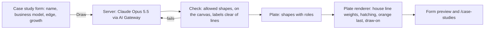
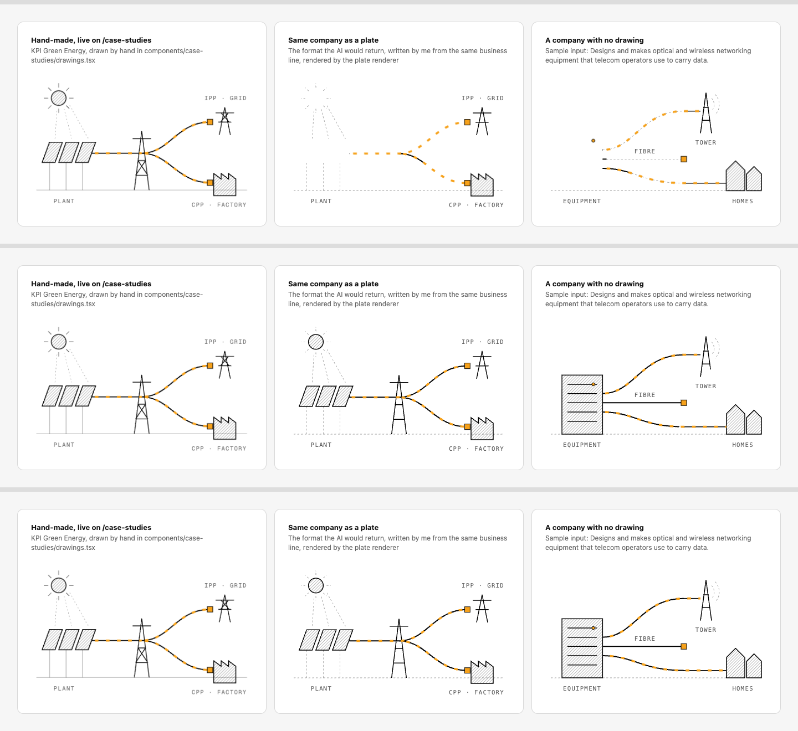
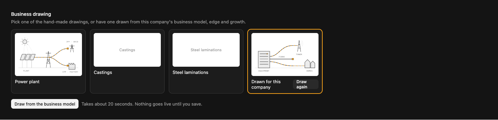

# Business drawings drawn by AI from the company's own words

**Problem.** A case study's business drawing is picked from three hand-made drawings (power plant, castings, steel laminations). A new company gets one that is wrong for it, as in your screenshot, and a new drawing needs a developer.

**Result.** In the case study form, **Draw from the business model** sends the company's name, business model, competitive edge and growth prospect to Claude. Claude returns a drawing in the site's own line-art language, which appears animated in the form. **Draw again** if it is not right; Save puts it on /case-studies. The three hand-made drawings stay as choices.

**Proof.** The question that could sink this is whether an AI-made drawing can look and move like the hand-made ones. Below, the drawing is described as data in the format Claude would return, and rendered by a prototype of the renderer. The two plates were written by me from the business lines, standing in for the model, because the AI Gateway refuses every model on this account until it has paid credits (see the decision at the end).

## 1. How it works

Claude never writes SVG. It returns a **plate**: shapes on the same 240×150 canvas as the hand-made drawings, each tagged with a role, plus short uppercase labels.

| Role | Drawn as |
|---|---|
| construction | faint dashed hairline, there at rest |
| line | ink stroke that draws itself on, in order |
| solid | hatched fill with an ink outline |
| accent | orange, arriving last (the thing the business delivers) |
| flow | orange dashes moving along a route, once drawn |

The renderer owns every style choice: weights, hatching, colours, label type, timing, reduced motion. So every drawing reads as part of the same set, however Claude composes it. The output is checked before anyone sees it: only these shapes, path data made of drawing commands and numbers, everything on the canvas, labels not crossing lines. A plate that fails goes back to Claude, up to twice.

## 2. Proof: does a plate hold up beside a hand-made drawing?

Left: the hand-made KPI Green Energy drawing, live on /case-studies. Middle: the same company as a plate. Right: a company with no drawing (sample input: "Designs and makes optical and wireless networking equipment that telecom operators use to carry data").

Draw-on, top to bottom: at rest, partway, finished.

What it shows: the plate matches the hand-made drawing's language and motion closely. The differences: hand-made drawings can do things the five roles cannot, such as the spinning rotor or the molten pour, and the sample's first try put a label on a line (now caught by the check). Runnable: `preview.html`.

## 3. In the form

- The field shows the four choices as pictures: the three hand-made drawings and **Drawn for this company**.
- **Draw from the business model** works once the business model is filled in. It takes about 20 seconds; the drawing animates in place.
- **Draw again** replaces it. Nothing goes live until Save.
- (Static mock-up: the two empty cards stand in for the castings and laminations pictures.)

## 4. Files

| Area | After |
|---|---|
| Data | `collections/CaseStudies.ts`: Business drawing gains "Drawn for this company"; a hidden `plate` JSON field holds the drawing. Migration adds both |
| Format and check | `lib/case-studies/plate.ts`: the plate type, the zod schema Claude fills, and the checks |
| Drawing it | `lib/case-studies/draw-plate.ts` (server action, staff only): `generateObject` with `MODELS.write` (Claude Opus 5.5) through `lib/ai/gateway.ts`, tagged `feature:drawings` in the spend report. The prompt carries the five roles, the composition rules and the three hand-made drawings written as plates, as examples |
| Rendering | `components/case-studies/plate-drawing.tsx`: plates through the drawing kit (`Draw`, `Hatch`, `tr`), same `on` and `dark` props as the hand-made ones; `case-study-sections.tsx` uses it for "Drawn for this company" |
| Form | `components/admin/case-studies/drawing-field.tsx`: the four-card picker and the Draw buttons |

No new libraries: `ai`, `zod` and the gateway are already installed.

## 5. Left out, and the decision I need

- **Not a picture generator.** An image model gives a flat picture that cannot draw itself on or match the line style. Plates can.
- **No flag.** The existing AI switches cover features that send personal data. This sends only public facts about a listed company, and runs only when staff click.
- **Hand-made stays better for signature drawings.** Motion like the spinning rotor stays with the developer.

**Decision: AI access.** The AI Gateway on the Vercel team is on the free tier, which allows no Claude model. This is the same block as the enquiry triage. Either:
1. **Add paid credits to the AI Gateway** (recommended): one path for every AI feature, zero data retention, spend by feature. This also unblocks triage.
2. **An Anthropic API key** in the project instead, only for drawings.

Until one exists, everything above can be built and tested with the plates written here, and the Draw button explains why it cannot run.
