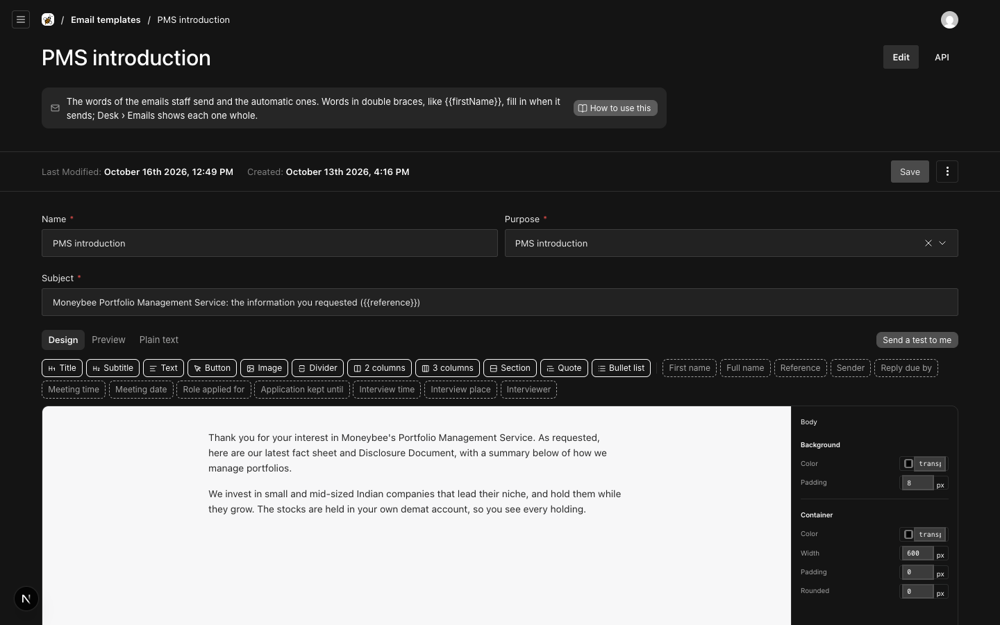
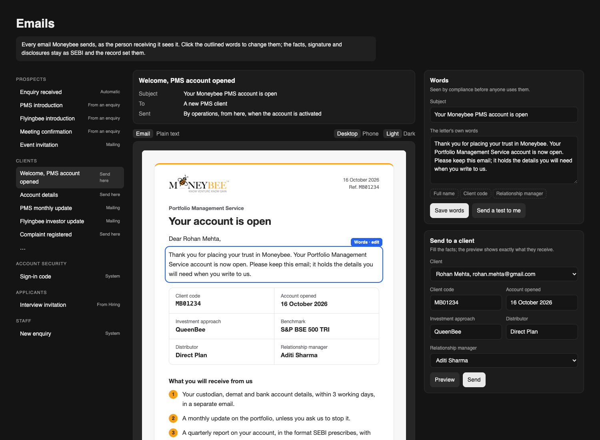

# One Emails page, where every letter is a template staff can use

**Problem.** There are two places: Desk › Emails shows each email whole but changes nothing, and Settings › Email templates edits only 12 emails, in a block editor that shows two bare paragraphs instead of the email. The 25 new letters (welcome, account details, notices, complaint letters, updates) cannot be edited or sent by anyone.

**Result.** One page, Desk › Emails. You open an email and see it as the client gets it; the words you may change are outlined in the email itself. Change them beside it and the email redraws. Letters operations sends to one client can be sent from the same page: pick the person, fill the facts, preview, send.

**Proof.** Mock below, built with the real rendered Welcome email.

## 1. The page

| Today: the template editor | Proposed: one page (mock) |
| --- | --- |
|  |  |

Left, every email by who gets it, each marked with how it goes out: Automatic, From an enquiry, From Hiring, Send here, Mailing, or System. Middle, the email as received, its words outlined and labelled "Words · edit". Right, the words (subject, the letter's own paragraphs, merge fields such as Full name or Client code) with Save words and Send a test to me, and, for letters sent from here, Send to a client.

## 2. What each email becomes

| How it goes out | Emails | Words editable | Sent from |
| --- | --- | --- | --- |
| Automatic | Enquiry received, Application received | Yes | Sends itself, as today |
| From an enquiry | Reply, PMS introduction, Flyingbee introduction, Meeting confirmation, Meeting follow-up, PMS account opening, Flyingbee subscription | Yes | The enquiry's reply box, as today |
| From Hiring | Interview invitation, Offer, Not taken forward | Yes | The Hiring desk, as today |
| Send here | Welcome, Account details, Funds received, Quarterly report, Fee statement, Statement ready, Withdrawal, Notice of change, KYC or nomination due, Complaint registered, Complaint resolved | Yes (new) | This page (new): pick the person, fill the facts, preview, send. It goes on their timeline. |
| Mailing | PMS monthly update, Flyingbee investor update, Insights, Event invitation | Yes (new) | Send a test to me now. Sending to a list waits on the mailing desk with compliance approval, the next build. |
| System | Sign-in code, Set your password, Password changed, New browser, the six staff alerts | No: their words are the safety and duty lines | Sends itself |

27 emails get editable words, 15 of them new. The 11 "Send here" letters become usable today.

## 3. Changes

- Settings › Email templates leaves the sidebar. Its records stay as where the words are kept, so playbooks, the reply box and Hiring keep working; links to it open the Emails page.
- 15 new template purposes, one per new letter, with starter words (each letter's opening paragraph, which today sits in code). A migration adds them; nothing existing changes.
- The block editor is replaced on this page by plain words: paragraphs, line breaks and merge fields. Headings, buttons and columns inside the words are dropped, since the frame already draws them; no saved template uses them.
- Who may edit is unchanged: compliance and HR (HR the applicant letters). Anyone on the desk can open the page and send a test to themselves.
- Send to a client records the email on the person's timeline and in Emails, like a reply, and shows "Not sent, email not connected" until Resend is set up.

## 4. Not in this, and limits

- Mailings to many people: the next step, a mailing desk with an audience, compliance approval and unsubscribe.
- The facts for "Send here" letters are typed in by operations until the back office feeds them.
- The mock is a picture; the live page draws the outline from the email itself.
