# Moneybee email templates, revised

Changes since your notes: the register is now formal throughout ("Dear Rohan Mehta,", "Yours sincerely,", a signature block, the date and reference set as on a letter), and the set now covers what a PMS and an AIF manager send prospects and investors, not only what the website sends today.

**Problem.** Moneybee sends 13 kinds of email today, five of them as plain text, and none show the reference, the facts of the case, or what happens next. Nothing exists yet for the letters a portfolio manager actually writes: the first reply to a prospect, the account opening checklist, the monthly update, the AIF investor update, complaint letters, fee statements and notices.

**Result.** One Moneybee letter frame and a set of blocks in React Email, and 38 emails built from them, grouped by where the reader is: prospect, client, account security, applicant, staff. Every one shows its facts in the same way, and the figures and disclosures SEBI requires travel with them. Staff edit the words in /admin; code draws the facts and disclosures, so an edit cannot remove them.

**Proof.** Seven emails are built and rendered: the three from the first round, now formal, plus a PMS introduction, the PMS monthly update, the Flyingbee investor update, and a complaint acknowledgement. Each is shown at desktop (680) and phone (375); all seven also pass at 320 with no sideways scroll.

## 1. How it fits together

```
words staff edit in /admin  ─┐
                             ├─►  email component (frame + blocks)  ─►  render()  ─►  html + plain text  ─►  Resend
facts from the record       ─┘    enquiry, client, fact sheet, complaint, application
```

The monthly and AIF updates read their figures from the fact sheet compliance has approved (the FactSheets collection already has returns by period, sector weights, the PDF and the approve step). So the email, the website and what is filed with SEBI show the same numbers.

## 2. The proof

All images: Proposed preview, rendered by `proof/render.mjs` in headless Chromium. Figures are the decks' as of 31 July 2026 (group profile p12, Flyingbee p9 and p10). People and messages are samples. Paragraphs marked [Lorem] are what the investment team writes each month.

### PMS introduction, the first reply to a prospect

| Desktop | Phone |
| --- | --- |
| 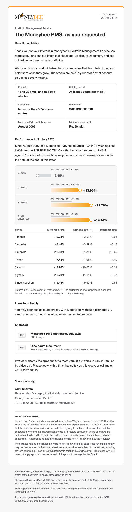 | 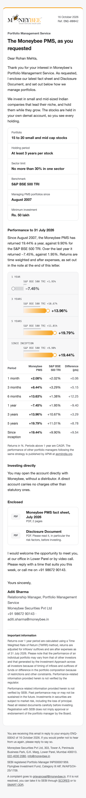 |

The relationship manager's letter, in this order: why we are writing, how we invest (15 to 20 stocks, 3 years, 30% sector limit, benchmark, since 2007, Rs. 50 lakh), performance, investing directly, what is enclosed, a proposed meeting, signature, disclosures.

Four lines are there because SEBI asks for them in material that shows performance or reaches prospects: the direct onboarding option (PMS Master Circular 2.3.2), relative performance against other managers through APMI (5.6.4), the deck's method note, and SEBI's own sentence "Performance related information provided herein is not verified by SEBI" (4.5.3.6).

The returns chart is the /pms chart rebuilt in email tables: thin grey benchmark bar with its value above, our bar fading to orange with the ringed knob, the negative year running left in grey. Outlook gets solid orange instead of the fade. The full table follows, with the difference against the benchmark.

### PMS monthly update, to clients

| Desktop | Phone, dark |
| --- | --- |
| 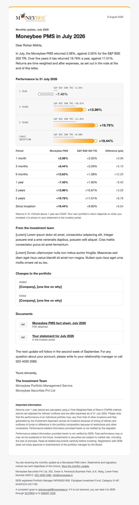 | 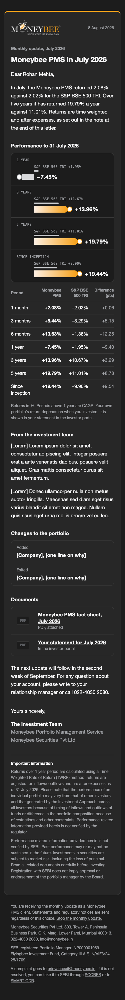 |

It leads with the month's result in one sentence, with the basis stated in the text (after Buoyant Capital's factsheet, which does the same), then the chart and table, the investment team's letter, changes to the portfolio, documents, when the next update comes, and the disclosures. Peers put a long market essay first; the reader's result comes first here.

It is the one mailing with an unsubscribe link, because it is optional. Statements and notices say they are sent regardless.

### Flyingbee investor update, to unit holders

| Desktop | Phone |
| --- | --- |
| 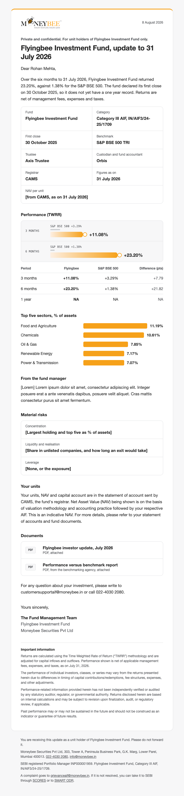 | 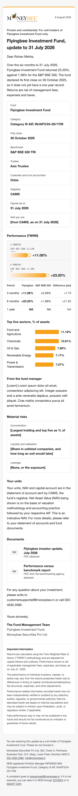 |

Marked private and confidential, for unit holders only, as AIF material must be. It states that the fund is under a year old instead of showing empty long periods as returns. Then fund facts with the trustee, custodian, registrar and NAV per unit, performance (TWRR), top five sectors, the fund manager's note, material risks (SEBI's investor charter asks for them within 60 days of quarter end), where to find units with SEBI's indicative NAV sentence, documents, and the deck's AIF disclaimer verbatim. Bracketed fields are what operations fills in from CAMS and the portfolio.

### Complaint registered

| Desktop | Phone, dark |
| --- | --- |
| 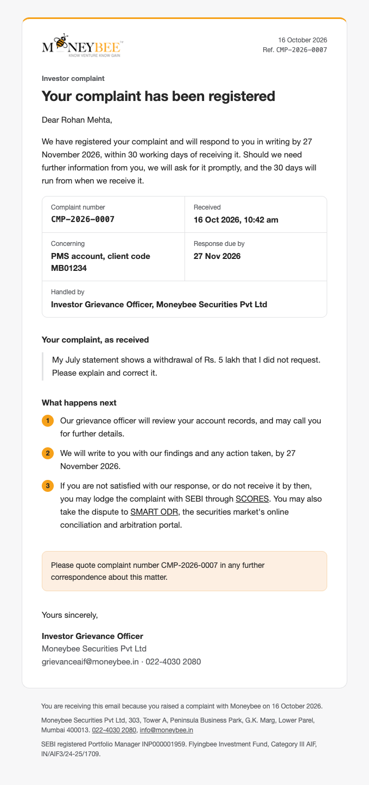 | 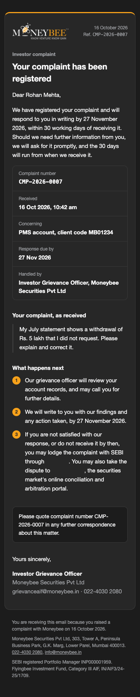 |

Complaint number, received, account, response due by, who handles it, the complaint as received, and the route if they are not satisfied: SCORES, or SMART ODR. The deadline follows the rule for the product: 30 working days for a PMS complaint made to us directly (PMS MC Annexure 4B item 30), 21 days for the AIF (AIF MC Annexure 4), 21 calendar days for one raised on SCORES. No rule sets a time to acknowledge, so the letter promises none. Its footer drops the complaint line, since the letter sets the route out in full.

### The first three, now formal

| Enquiry received | Sign-in code | New enquiry (staff) |
| --- | --- | --- |
| 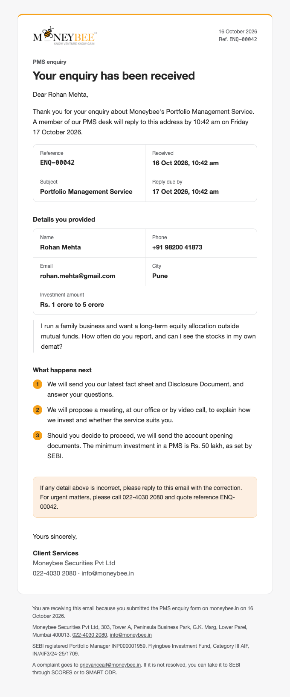 | 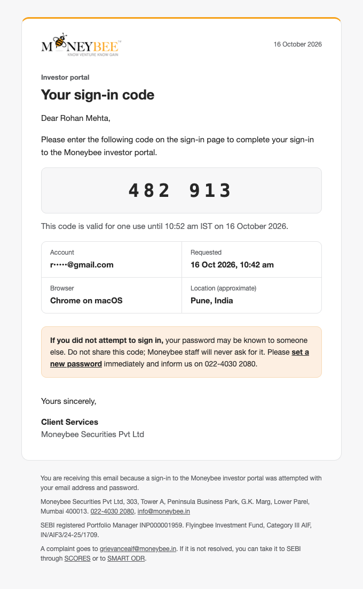 | 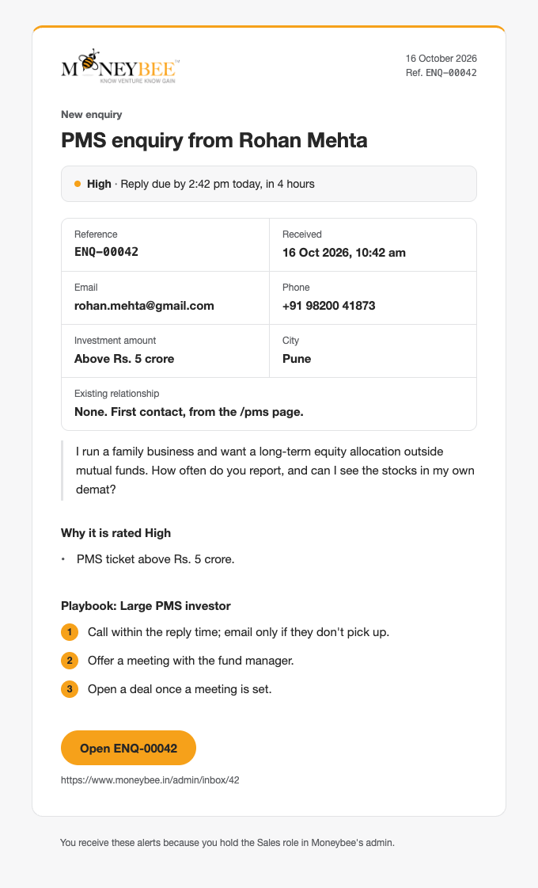 |

Today's versions for comparison: `proof/out/shots/*.current.crop.png`. Every view (desktop and phone, light and dark): `proof/out/shots/`. Plain text: `proof/out/*.txt`.

## 3. The whole set

Built means rendered in the proof. "Sends today" is code that already exists and changes to the new email; "new" needs the sending part as well as the template.

Status: **Built** is in the proof. **Today** is sent by code that exists and switches to the new email. **New** needs the template and the step that sends it.

**Prospects**

| Email | Sent by, when | Shows | Rule | Status |
| --- | --- | --- | --- | --- |
| Enquiry received | Automatic, on the form | Reference, received, subject, reply due by; the details given; next steps for that form; correction line | | Built |
| Reply to an enquiry | Staff, from the enquiry | Their words, name and role; the original enquiry quoted with its reference | | Today |
| PMS introduction | Relationship manager, first reply | How we invest, returns with the method note, relative performance through APMI, investing directly, DD and fact sheet enclosed, a proposed meeting | PMS MC 2.3.2, 4.5.3.6, 5.6.4, Annexure 2A | Built |
| AIF introduction | Relationship manager, first reply | Eligibility first (investor type, Rs. 1 crore minimum), "private placement, proposed investors only", terms from the deck, no returns unless the agency report is enclosed, PPM after eligibility, with acknowledgement | AIF MC 3.2.1, 3.2.2, 22.5.1 | New |
| Meeting confirmation | Relationship manager | Date and time (IST), place with map or video link, who attends, agenda, what to bring, calendar file | | New |
| Meeting follow-up | Relationship manager | Points discussed, documents enclosed, agreed next steps with dates; no performance claims | Annexure 2A | New |
| PMS account opening checklist | Relationship manager or operations | Documents needed, DD to read before signing, fees annexure to sign separately, direct option, where to send, "we never change bank details by email" | PMS MC Annexure 4B item 28, 4.3.4, 2.3.2 | New |
| AIF subscription checklist | Relationship manager or operations | Contribution agreement, KYC, FATCA and CRS, eligibility, PPM acknowledgement, the fund's bank account as in the PPM, same bank warning | AIF MC 3.2.2 | New |
| Event invitation | Mailing to opted-in contacts | Event, date, time, place or link, speakers, agenda, reply by; recording afterwards | AIF content to eligible investors only | New |

**Clients**

| Email | Sent by, when | Shows | Rule | Status |
| --- | --- | --- | --- | --- |
| Welcome, PMS account opened | Operations | Client code, investment approach, benchmark, activation date, distributor or Direct Plan, relationship manager, portal sign-in, what reports come and when, agreement copy | | New |
| Account details | Operations, within 3 working days of opening | Custodian, demat account number, bank account holding the client's funds | PMS MC Annexure 4B items 16, 29 | New |
| Funds received, units allotted | Operations | PMS: amount and date received and invested. AIF: contribution, units, NAV per unit, statement from CAMS | | New |
| PMS monthly update | Mailing to PMS clients, from the approved fact sheet | Built | PMS MC 4.5.3, 5.6 | Built |
| PMS quarterly report | Operations, each quarter | Cover note: quarter, client code, approach, benchmark, distributor or Direct Plan, change-of-facts contact; the report PDF in SEBI's Annexure 5D sections A to E | PMS MC 5.5.1, Annexure 5D | New |
| Fee statement | Operations, each charge | Period, management fee, performance fee, hurdle, high-water mark before and after, expenses | PMS MC 6.1.3.6 | New |
| Flyingbee investor update | Mailing to unit holders | Built, with NAV and material risks | AIF MC Annexure 4 Part C (risks within 60 days of quarter end), 11.4.4, 22.5.2 | Built |
| Statement ready | Operations | Which statement, period, link to the portal | | New |
| Withdrawal received, then paid | Operations | Amount, account, expected credit date; then the credit details | | New |
| Notice of change | Compliance | What changes, from when, why, and what the client can do; for the AIF, the exit option, at least one month to dissent, exit within three months | AIF MC 13.1.1; DD changes | New |
| KYC or nomination due | Operations | What is due, by when, how to send it | | New |
| Complaint registered | Grievance officer | Built | PMS: 30 working days (Annexure 4B item 30). AIF: 21 days (Annexure 4). SCORES: 21 calendar days | Built |
| Complaint resolved | Grievance officer | Findings, action taken, and the route if they are not satisfied: SCORES review, then SMART ODR | SCORES circular 2023/156 | New |
| Insights | Mailing to opted-in contacts | Title, summary, link, unsubscribe | Annexure 2A | New |

**Account security**

| Email | Sent by, when | Shows | Status |
| --- | --- | --- | --- |
| Sign-in code | Automatic | Built | Built |
| Set your password | Automatic, on request | Button, the link written out, valid until, requested at, not you | Today |
| Password changed | Automatic | When, browser, not you | New |
| New browser signed in | Automatic, first sign-in on a browser | When, browser, approximate place, not you | New |

**Applicants**

| Email | Sent by, when | Shows | Status |
| --- | --- | --- | --- |
| Application received | Automatic | Reference, role, received, resume file, the must-haves answered, what happens next, kept until | Today |
| Interview invitation | HR | Date and time, place with map, who you will meet, HR's words, calendar file | Today |
| Offer | HR | HR's words with the terms, role, reply by | Today |
| Not taken forward | HR | HR's words, role, reference, kept until and how to ask for deletion | Today |

**Staff**

| Email | Sent to, when | Shows | Status |
| --- | --- | --- | --- |
| New enquiry | Sales, operations, compliance | Built | Built |
| New application | HR | Name, role, must-haves met and which were answered no, notice, city, resume, link | Today |
| Fact sheet waiting | Compliance | Product, month, who submitted it and when, link to approve or send back | Today |
| New complaint | Grievance officer, compliance | Complaint number, investor, product, the deadline that applies and days left | New |
| Mailing waiting | Compliance | The mailing, its audience and size, who wrote it, link to approve | New |
| Staff password reset | Automatic | As the investor one, for /admin | Today |
| Template test | The staff member | The template in the frame, filled with sample values, marked as a test | Today |

## 4. Files

| File | Change |
| --- | --- |
| `emails/frame.tsx` (new) | The letter frame, footers by reader, dark and phone CSS |
| `emails/blocks.tsx` (new) | Facts, Quote, Steps, Bullets, Code, Notice, Severity, Action, Signature, ReturnBars, ReturnTable, Weights, Documents, Disclosure |
| `emails/<group>/<email>.tsx` (new, 38) | One per row of section 3, each with sample props |
| `emails/index.ts` (new) | Every email: name, reader, when it is sent, sample, required disclosures |
| `emails/emails.test.mjs` (new) | Renders all 38; fails on an unfilled `{{field}}`, a missing reference, figures without their disclosure, an em dash, or a page wider than 320 |
| `public/email/logo.png`, `logo-light.png` (new) | The logo at 2x; Gmail and Outlook drop SVG |
| `lib/crm/mail.ts` | `sendCrmEmail` takes a rendered email; the hand-built `emailHtml` goes |
| The 9 files that send today (enquiries, hiring, portal sign-in, password, fact sheet workflow, template test) | Pass the record to the matching email instead of building text inline |
| `lib/crm/starter-content.ts` | Templates keep only the words; facts move to code. New starter templates for the one-to-one letters |
| `lib/auth/portal.ts` | Reads browser and approximate city for the sign-in code email |
| `package.json` | `react-email@6.11.1` as a direct dependency (already installed by the template editor, same version) |

## 5. Decisions for you

1. **Build order.** I suggest three steps. (a) The frame, all 38 templates, and an /admin screen that shows every one with sample data, so you and compliance can read the whole set now. (b) Switch the 13 emails that send today, and add the one-to-one letters staff send from an enquiry (introductions, meeting, follow-up, checklists). (c) The mailings that need a new sending feature: monthly and AIF updates, events and insights through a broadcast desk with compliance approval and unsubscribe; complaints through a complaint register; fee statements and notices once that data exists. Each step is usable on its own.
2. **Reply-by time shown to the visitor.** I recommend yes; it is a promise, so compliance should see it.
3. **Flyingbee performance to unit holders.** SEBI's AIF circular (22.5.2) asks for the benchmarking agency's report alongside performance shown to existing investors. The proof lists it as an enclosure. Does that report exist yet for Flyingbee? If not, the update should leave performance out until it does.
4. **Who signs.** The proof signs updates as "The Investment Team" and "The Fund Management Team", and letters with the relationship manager's name. Should the monthly letter carry the fund manager's name?
5. **Fee basis of the PMS returns.** The deck's note says returns are "after expenses". SEBI asks marketing material to show returns net of all fees and expenses, including taxes (PMS MC 4.5.3.2). The emails keep the deck's words, so they claim no more than the deck. Compliance should confirm the figures are net of fees and taxes, and then the sentence can say so.
6. **Grievance address.** The site and the proof use grievanceaif@moneybee.in for both PMS and AIF complaints. Is there a separate PMS address?

## 6. Not in this plan, and what is not yet proven

- Real inboxes are not tested: Gmail, Outlook desktop and Outlook.com, Apple Mail, the Gmail app. Production has no Resend key yet. The check so far is the Chromium render at 320, 375 and 680, light and dark.
- Dark mode is what Apple Mail, iOS Mail and Outlook for Mac do with `prefers-color-scheme`. Gmail ignores it and inverts on its own; every box has a border so it survives that.
- The returns chart's fade needs `linear-gradient`, which Outlook desktop ignores; it shows solid orange there.
- Fonts are Helvetica Neue, Helvetica, Arial. Overused Grotesk is not loaded in email; Helvetica is the face it imitates.
- Research that changed the work: emailcn's OTP block (the code box), Apple's receipt in React Email's demo (label over value), Buoyant Capital's Jan 2024 factsheet (the fee basis sentence, and leading with the result), Unifi's Blend Fund 2 factsheet (the private and confidential line for unit holders). From SEBI: the PMS and AIF master circulars and the SCORES circular, read by a research worker (deadlines, Annexure 5D, the 22.5.2 report rule, the 60-day risk disclosure, no acknowledgement deadline), and SEBI's investor site for SMART ODR covering portfolio managers and AIF managers (investor.sebi.gov.in/smart_orr.html). Not read: the PM Regulations 2020 and AIF Regulations 2012 themselves, APMI's fee formats, and the DPDP rules on email consent. Notes: `research/sebi-communications.md`, `research/peer-letters.md`.
