# Finish the doc's missing sections

**Problem.** The site covered 90% of the client's Content & Visual Plan. Sections were missing on Home, About, AIF, Careers, Contact and the nav, and the /case-studies card scroll was unwanted.
**Result.** Every gap except Investor Centre (built later) and the performance data (client) is closed. Coverage goes from 90% to 96%.
**Proof.** Captures at 1440 and 390 below, taken from the running app. Type check and lint pass. No horizontal overflow at either width. The Home enquiry link opens /contact with that option selected.

Status: **implemented in the working tree, uncommitted.** Annotate anything and I revise; approve and I commit.

## What changed

| Page | Gap | Now | Coverage |
|---|---|---|---|
| Nav | No Insights, no Investor Centre in the bar | Both in the bar from 1200px, in the menu below that | 83% → 100% |
| Home | Black "Let's talk" band | Get Started section: the four enquiry options as line cards with their drawings, then the phone and email | 97% (no business image) |
| About | No company timeline | Plain dated timeline: 2004, Aug 2007, Oct 2025 | 88% → 100% |
| PMS | Intro's second sentence missing | Beside "Why Moneybee PMS?" | 91% → 100% |
| AIF | No structure diagram, intro's second sentence missing | Names-only diagram after Why Category III; sentence beside Strategic Opportunity | 73% → 100% |
| Case Studies | Card scroll you don't want | Cards removed; their three lines now sit in each company's section | 94% (logos still initials) |
| Careers | One photo, doc asks for two | Boardroom photo beside the team photo | 95% → 100% |
| Contact | No phone or email icons | Icons on the hero's Phone and Email, both now links | 89% → 100% |
| Insights | No page | /insights shell: hero plus six lorem line cards | new |

One correction to my earlier table: I had read "Explore PMS / Get Started" as two buttons. It is one orange button with either label, and /pms and /aif already have Get Started, so I added nothing there.

Still open: Investor Centre (84%, to build), performance dated 31 July and 2 Years N/A (client data), case-study logos (need approved files).

## Home: Get Started (revised)

Your note: "get started is bad but others are good." You picked four line cards, so the photograph and list are gone. Each card is the /careers line card holding the drawing made for that option in `components/contact-v2/glyphs.tsx` (nothing used those drawings before): an account with holdings in your own name, investors pooling into one fund, a question answered with a tick, a conversation. "Enquire" opens `/contact?enquiry=<id>#enquiry` on that option. The phone and email sit under the cards. Without the photograph, Home stays at 97% on the doc: the separate business image is still missing.

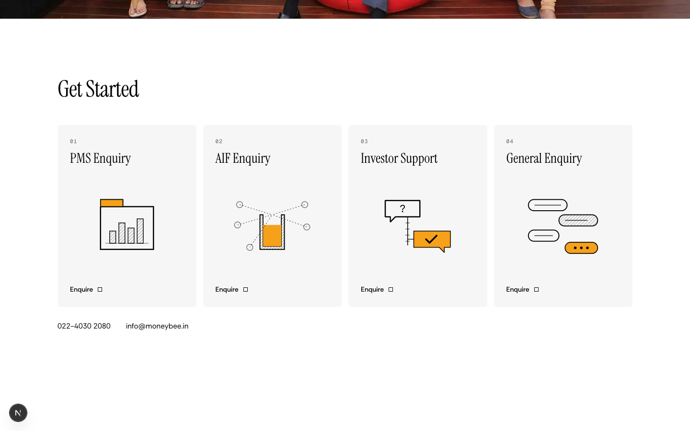
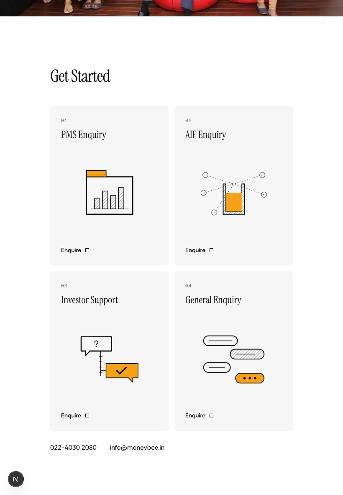
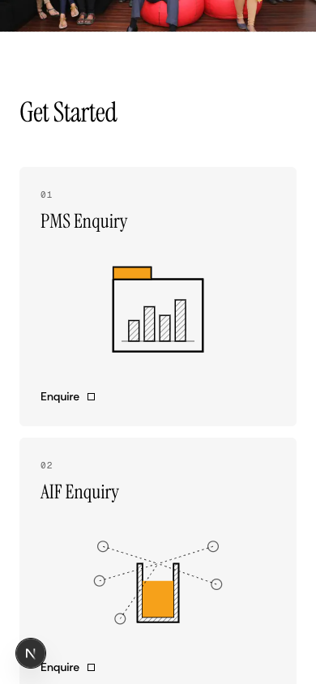

## About: Timeline

The dates are the ones the removed timeline carried (doc §1, §2, AIF deck first close). The doc says the client must approve them. On a phone the line runs down the left edge. Story becomes 05.

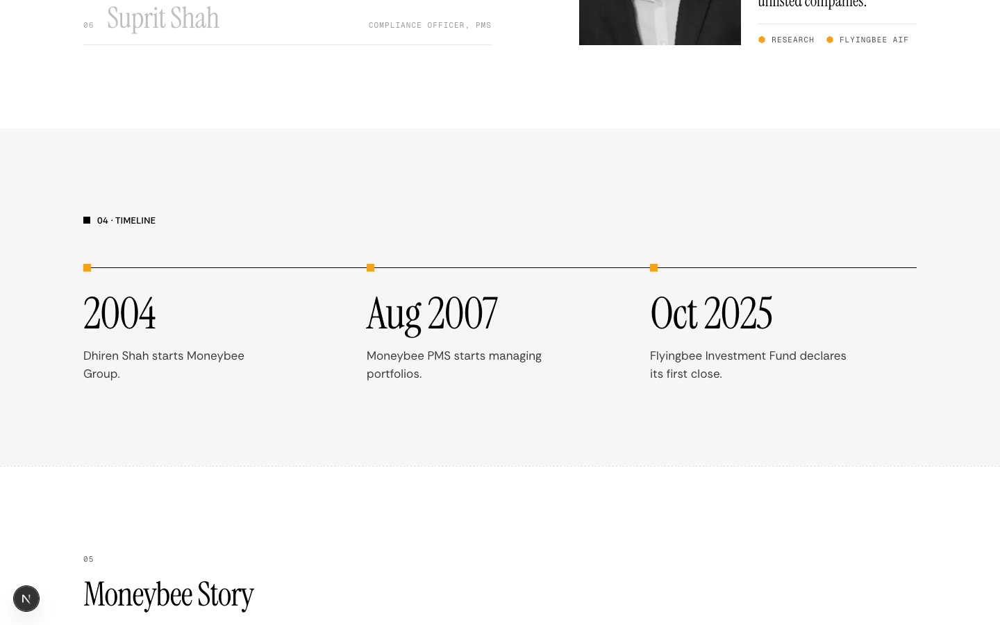
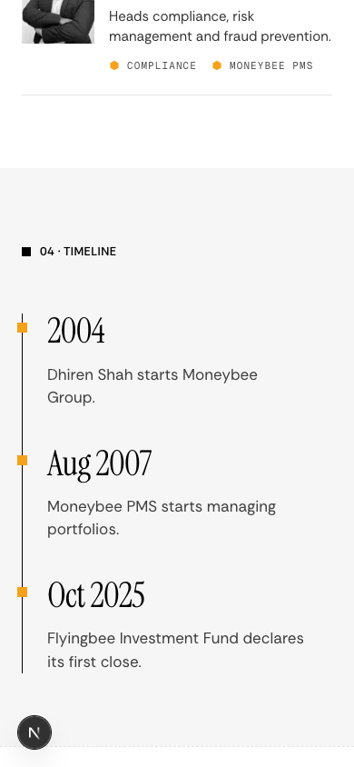

## AIF: Flyingbee Structure

Names only, so nothing repeats the Category III text above it. The connectors draw in order when the section scrolls into view. On a phone the four parties sit in a tray under the fund.

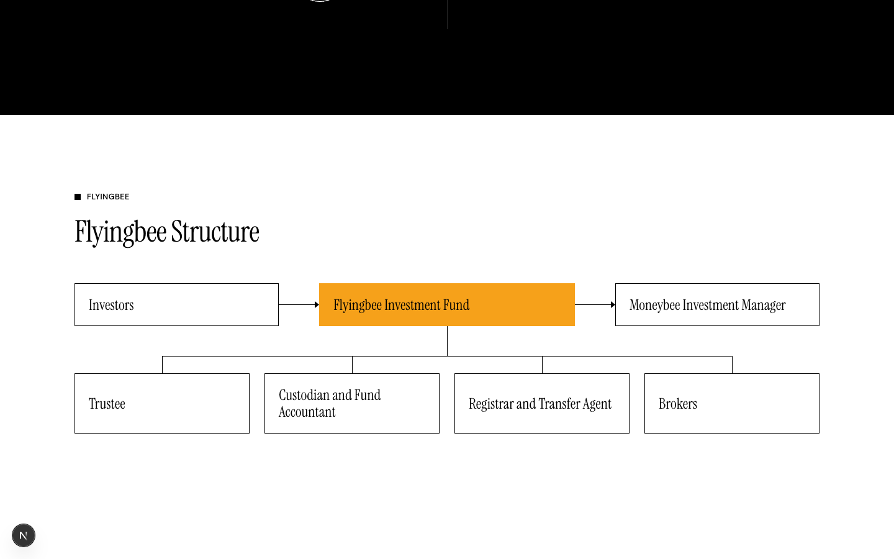
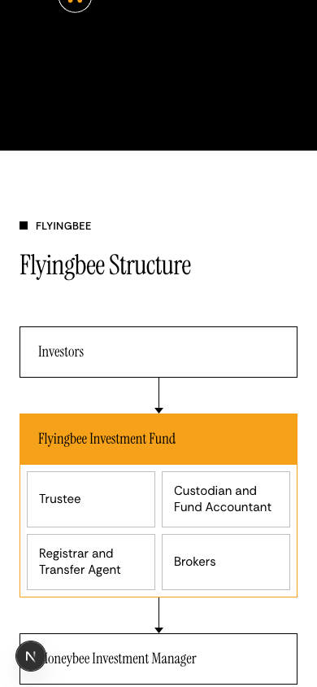
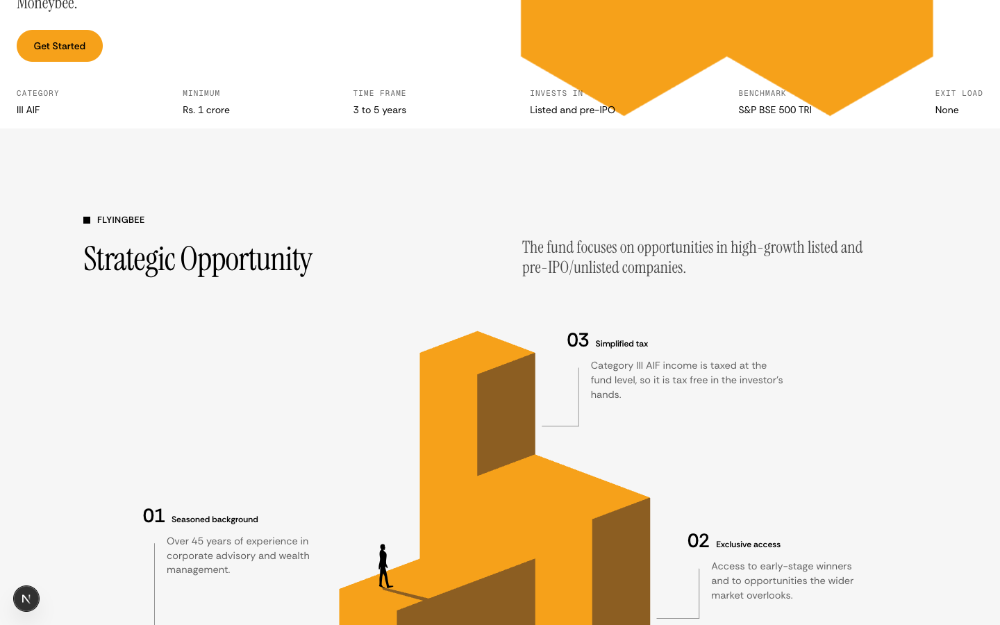

## PMS: intro sentence

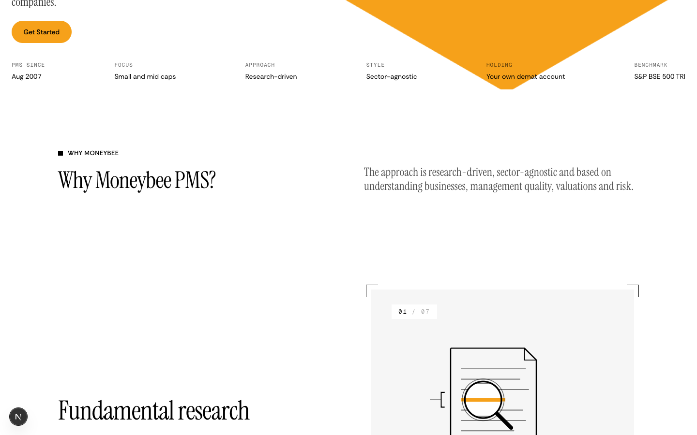

## Careers: second photograph

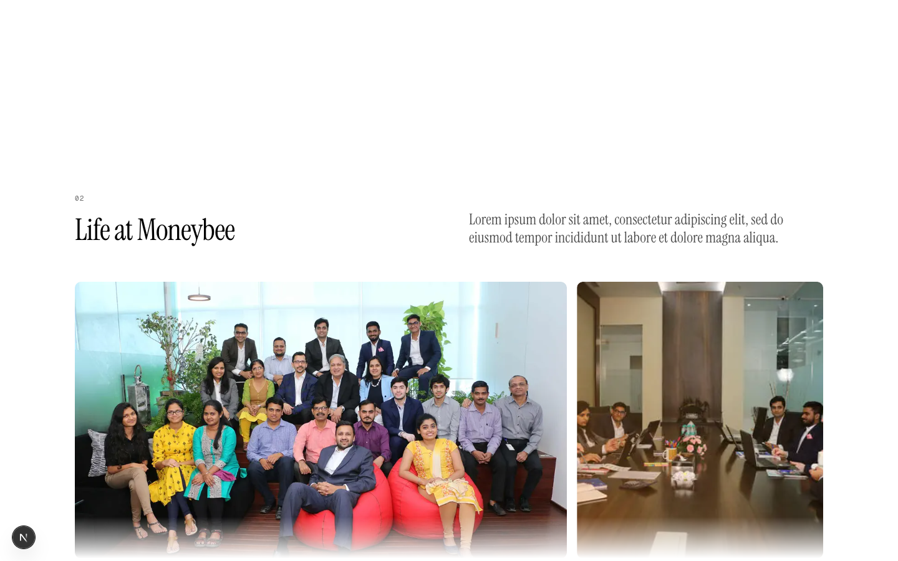

## Contact: icons

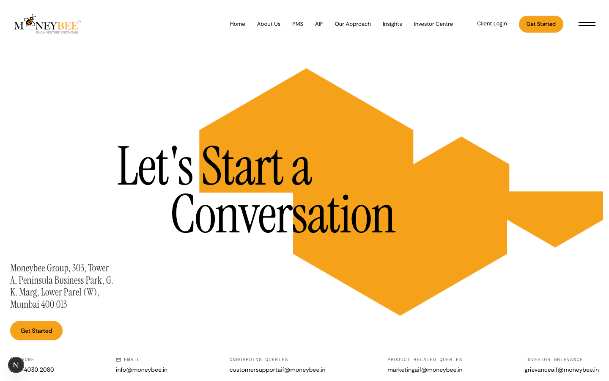

## Insights shell

Mark: three equal cells in a row, from the same honeycomb family as the other page marks. The hero sentence and every card are lorem until the client says what Insights publishes. The four hero figures are deck facts. The cards are the /careers line cards with no links.

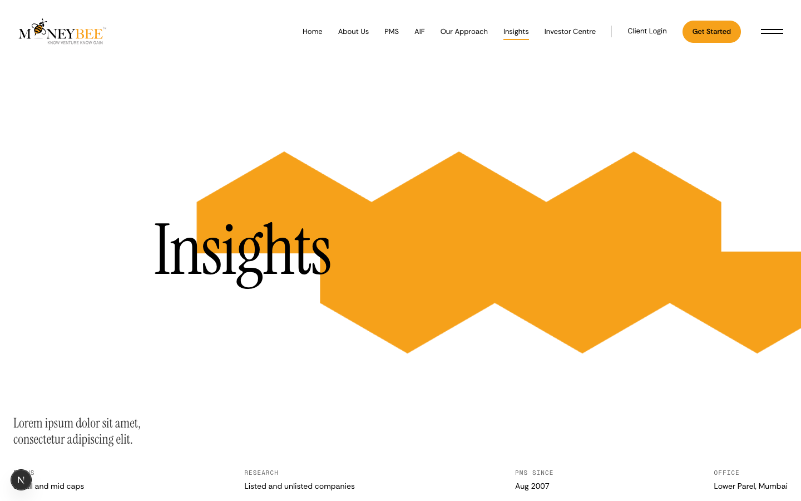
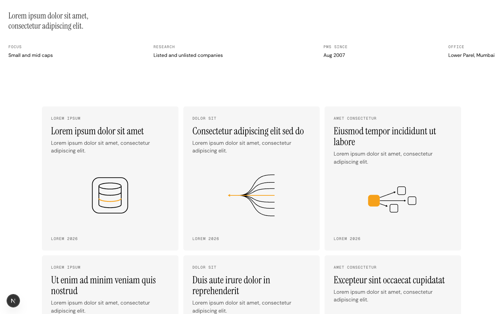

## Nav

Nine bar items fit from 1200px. From 900 to 1199 the bar keeps its old seven; Insights and Investor Centre move to the menu. Bar labels no longer wrap. Below 1000px the link gap drops from 28px to 20px, which leaves 46px between the logo and Home at 900.

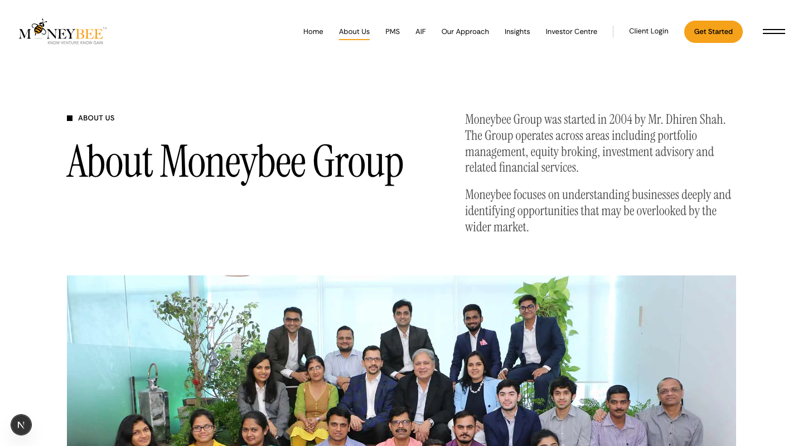

## Files

| File | Change |
|---|---|
| `components/home/get-started-section.tsx` (new), `components/home/home-sections.tsx`, `app/page.tsx` | `GetStartedSection` replaces `LetsTalkSection` on Home (the band stays exported for the unrouted `components/products` pages) |
| `components/about-v3/timeline-section.tsx` (new), `lib/about-v3.ts`, `app/about/page.tsx` | Timeline |
| `components/aif-v3/structure-section.tsx` (new), `app/aif/page.tsx`, `lib/aif-v2.ts` | Structure diagram, `FLYINGBEE.focus` |
| `components/aif-v3/opportunity-section.tsx`, `components/pms-v3/why-sticky.tsx`, `lib/pms-v2.ts` | Intro sentences |
| `components/case-studies/case-study-sections.tsx`, `app/case-studies/page.tsx`; deleted `components/case-studies-v3/case-cards.tsx` | Cards out, lines in |
| `components/careers/careers-sections.tsx` | Second photograph |
| `components/pms-v3/product-hero.tsx`, `lib/pms-v3-hero.ts`, `lib/page-heroes.ts` | Figure icons and links, Insights hero, `insights` mark kind |
| `components/pms-v3/marks.tsx` | Insights cells |
| `app/insights/page.tsx`, `components/insights-page/note-cards.tsx`, `lib/insights-page.ts` (new) | Insights shell |
| `components/ui/site-navigation.tsx`, `components/ui/overlay-menu.tsx`, `app/sitemap.ts` | Nav, 1200px breakpoint, nowrap, sitemap |
