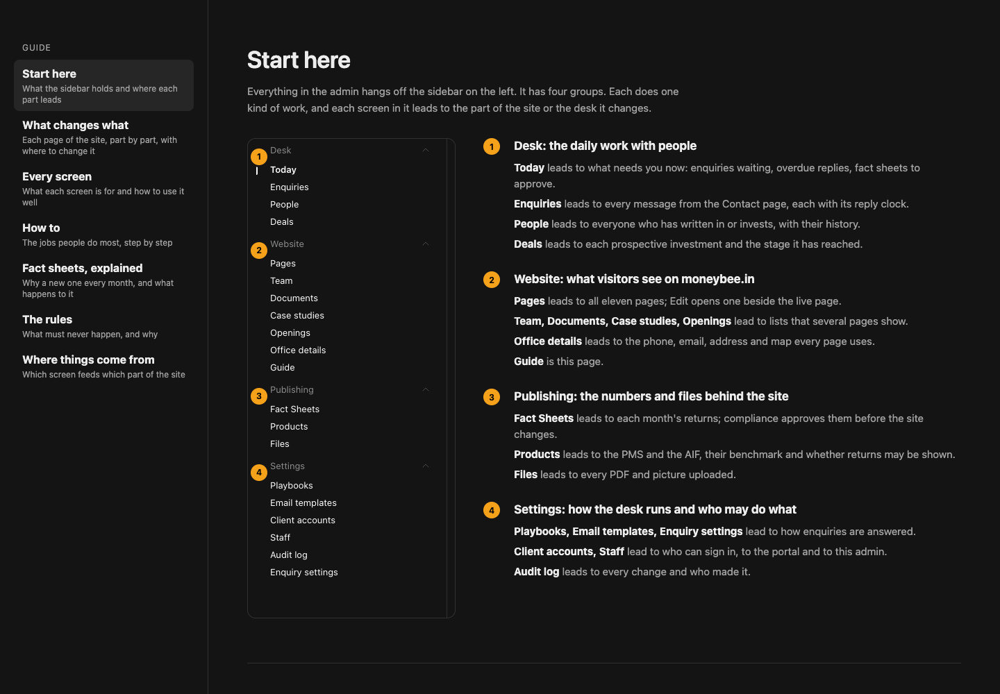
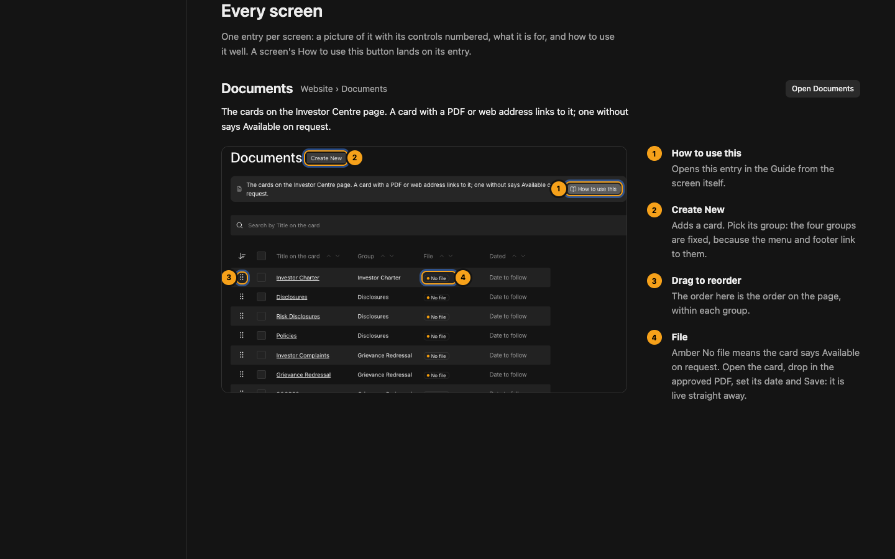

# A Guide that someone new can follow

**Problem.** The Guide is one long dark page of small text. Its parts don't say what they are for. Apart from the page pictures, it describes the admin in words, without showing it. The admin will be shown to Moneybee's people, so the Guide has to teach on its own.

**Result.**
- A contents rail on the left, where every part of the Guide says what it is for.
- A new **Start here**: the real sidebar with its four groups numbered, and where each screen leads.
- Every screen's entry shows a real screenshot, its controls ringed and numbered, and a line for each number.
- The How to tasks get a screenshot per step.
- Larger, readable type throughout.

**Proof.** The two pictures below are mock-ups built from real screenshots of the local admin at 1440 wide. The made-up QA enquiries show in them.

## 1. Start here, and the contents rail

- The rail stays in view and lights the part you are reading. Each entry carries its purpose in one line.
- Start here numbers the sidebar's four groups, and spells out where each screen in them leads.

## 2. Every screen, with its controls numbered

- Each entry shows the screen's name, where it sits in the sidebar, its line and **Open**.
- Then a screenshot cropped to the part that matters, so it reads near full size. The controls are ringed and numbered, with the numbers beside them, never on top.
- The numbered list says what each control does and the right way to use it.
- This replaces the plain steps from yesterday for all 17 screens. A screen's How to use this button still lands here.

## 3. The other parts

| Part | Purpose line | What changes |
|---|---|---|
| **What changes what** | Each page of the site, part by part, with where to change it | Same pictures, larger type, and an Edit this section button per section (as now) |
| **How to** | The jobs people do most, step by step | Each step gets its screenshot with the control ringed: change words, move or hide a section, add a section, put up a document, add a fact sheet, undo |
| **Fact sheets, explained** | Why a new one every month, and what happens to it | A numbered screenshot of the fact sheet screen beside the journey |
| **The rules** | What must never happen, and why | Each rule gets one line saying why |
| **Where things come from** | Which screen feeds which part of the site | As now |

## 4. How it is made

- **Screenshots** are taken from the running admin by a script, and the marker positions are measured from each control's real position. So when a screen changes, rerunning the script redraws the Guide's pictures. They live in `public/admin-guide/`.
- **Type:** body 15px with 24px lines, at most about 70 characters a line; part titles 28px.
- **Files:**
  - `lib/admin/screens.ts` gains each screen's numbered controls;
  - `components/admin/guide/` gets the contents rail and an annotated-screenshot component;
  - `scripts/guide-shots.mjs` retakes the pictures.

## 5. Left out

- The demo data in the pictures is the made-up QA set, not real clients.
- The Guide stays one page with anchors, so How to use this links keep working; the rail is how you move around it.
