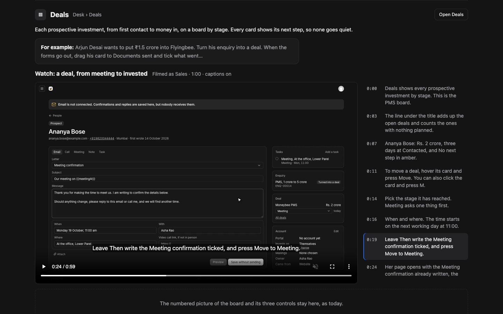

# Guide videos

**Problem.** The Guide teaches on still pictures. A newcomer can read what each control is, but cannot see a piece of work move from start to finish: an enquiry becoming a deal, a deal becoming a client, a CV becoming a hire.

**Result.** Short captioned videos of the real admin, each filmed as the role that does the work, placed where a newcomer looks: a new **Watch first** part near the top of the Guide, plus a video on every screen entry and How to that has one.

**Proof.** One video, *A deal, from meeting to invested*, recorded at full quality with its captions, shown below in the player it would sit in.

## Proposed preview



*Proposed preview, 1440 wide, paused at 0:24.* Open `preview/index.html` for the playable version: the video (`preview/deal-lifecycle.mp4`, 60 seconds, 0.9 MB), captions over it, and the chapter list beside it that follows along and jumps on click. The top of that page shows the Watch first grid with this one poster and five empty slots.

Checked in the preview: the video plays to 0:59, all 14 captions load and show, and the chapter in view follows the playback.

## How a video is made

```
demo reset (known people and deals)
  → sign in as the role (Agent Browser session per role)
  → record with the pointer overlay
  → each step: caption, action, pause to read
  → WebVTT captions from the real step times
  → public/admin-guide/videos/<name>.mp4 + .vtt + poster
```

- **Repeatable.** One script, `scripts/guide-videos.mjs`, holds every video's steps and captions, like `guide-shots.mjs` holds the pictures. After a screen changes, rerun it for that video. `--only deal-lifecycle` retakes one.
- **Demo people.** Each video starts from the same state: realistic demo people (Ananya Bose, and a few more) reset before every take. Test names like "Local PMS test" never appear.
- **Captions are a separate file.** They show over the video and can be switched off. Rewording one does not need a new recording.
- **No sound.** Captions carry it; a voice can come later if you want one.

**webreel.** I tried it first. It records in a fresh browser each time, so every video would have to sign in on camera, and in its recorder the typed email and password never reached Payload's sign-in form (four attempts, logs kept in `.plannotator/guide-videos/`). Agent Browser records the already signed-in session with the same kind of animated pointer, and my script drives each step, so captions land on the exact moment. webreel stays available for public-site clips, where no sign-in is needed.

## The videos

| Video | Filmed as | Length | Goes in |
|---|---|---|---|
| **Watch first** | | | |
| Your first day on the desk: the sidebar, Today, your tasks, T, the Guide | Sales | ~60s | Watch first |
| An enquiry, from the Contact page to a deal: take it, reply with the fact sheet attached, log a call, open the deal | Sales | ~80s | Watch first, Enquiries |
| A deal, from meeting to invested *(proof below)* | Sales | ~70s | Watch first, Deals |
| When a deal is lost: why, and what happens to its tasks | Sales | ~30s | Deals |
| Opening a client's portal account: invite, the email, Client accounts | Operations | ~45s | Watch first, Client accounts |
| A hire, from application to offer | HR | ~75s | Watch first, Hiring, How to hire |
| A month's fact sheet, from the PDF to the site | Editor, then Compliance | ~70s | Watch first, Fact sheets, How to change the returns |
| Changing words on a page and publishing | Editor | ~45s | Pages, How to change words |
| **On each screen** | | | |
| Working your tasks: tabs, doing one from its row, what happened, T | Sales | ~45s | Tasks |
| A person's page: writing, logging a call, the panels | Sales | ~50s | People |
| Sending a file, and seeing where it went | Sales | ~45s | Files |
| Changing an email's words and sending yourself a test | Compliance | ~40s | Emails |
| Recording an HUF or family office | Sales | ~30s | People |
| Putting up a document | Editor | ~35s | Documents, How to put up a document |

Fourteen videos, roughly 13 minutes in all, about 30 MB in the repo at the proof's encoding.

## In the Guide

- **Watch first**, a new part after Start here: the six lifecycle videos as a grid of posters with title, role and length. A poster opens the player in place.
- **Every screen**: a screen with a video shows it above its numbered picture. The picture and the control list stay; the video adds the motion.
- **How to**: a task with a video shows it above its steps.
- The player: captions on by default, the chapter list beside it on wide screens and under it on narrow ones, the current chapter highlighted, a chapter click jumps there. Native controls, so speed and full screen work.

## Files

| File | Change |
|---|---|
| `scripts/guide-videos.mjs` | New. The recorder: reset, sign in per role, record, captions |
| `scripts/guide-demo.ts` | New. Resets the demo people; refuses to run unless `GUIDE_DEMO=1` |
| `lib/admin/guide-videos.ts` | New. Each video's title, role, length, where it shows, chapters (generated) |
| `components/admin/guide/guide-video.tsx` | New. The player with captions and chapters |
| `components/admin/guide/guide-view.tsx` | Watch first part; video slots on screens and How to |
| `public/admin-guide/videos/` | Generated: `.mp4`, `.vtt`, poster `.webp` per video |

## Fixes found by the proof

- **Caption timing.** When a step ends in a click that changes page, the old caption stays up for the page load (about a second at 0:23 in the proof). The recorder will switch captions at the moment of the click.
- **`{{meetingAt}}` in the Meeting confirmation's subject.** The proof shows the raw tag while the letter is open; it is filled in only when sent. A newcomer would read it as broken. Proposed: show the subject with the When field's words in it as you type. This is a small change to the composer, and the video would be retaken after it.

## Left out, and limits

- The proof is a standalone page, not yet in the Guide. Its styling copies the Guide's.
- No voice-over and no burned-in captions.
- Videos show local demo data only. Re-recording needs the local server and the role logins.
- Staff screens change often; a video goes stale like a picture does. The script makes retaking one a single command.
