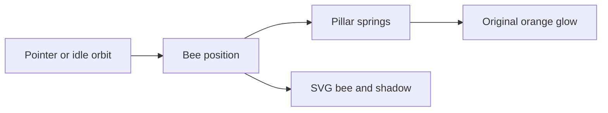

# Moneybee hero terrain and bee

## Goal

The homepage currently uses a rotating pyramid. Replace its hero illustration with Hairline Terrain and the Moneybee bee.
The bee circles at rest, gently lifting nearby pillars. Hover makes it follow the pointer and raise the pillars higher, using the original orange gradient and local glow.
Verify the named interaction on desktop and mobile, reduced motion, pointer exit, the production build, and the recorded result.

## Proposed result

[Open the interactive preview](https://terrain.moneybees.localhost:1355/)

[Play the recording and compare all states](https://terrain.moneybees.localhost:1355/review.html)

[Play the MP4 directly](https://terrain.moneybees.localhost:1355/proposed-bee-hover.mp4)


| Current homepage | Proposed preview at rest |
| --- | --- |
|  |  |

| Current mobile | Proposed mobile |
| --- | --- |
|  |  |

### What moves

1. At rest, the bee flies around an ellipse over the field. The closest pillars rise with a pale orange tint. One circuit takes about 20 seconds.
2. Entering the figure switches the bee to the pointer. Its direction turns gradually as it moves. The bee stays above the raised pillars with a small shadow beneath it.
3. Hover uses a height multiplier of 1.18. Idle flight uses 0.58. The original three-stop orange gradient and 9px local glow remain on the hover peaks.
4. Leaving the figure returns the bee to its orbit through the same spring. It does not jump back to its starting position.
5. Both wings flap in the shared frame loop. Reduced motion holds the idle bee and its wings still. Pointer changes update the field immediately. The illustration remains decorative and adds no keyboard tab stops.

### Source and execution



Current path: `app/page.tsx` renders `HeroSection`, which renders `HeroPyramid`. Its clock drives the shared `PicksFigure`. The lower homepage picks section also uses `PicksFigure` and stays as it is.

Proposed path: `HeroSection` renders `HeroTerrain`. The React component still imports `Terrain` from `@lucasmarkes/hairline/react`. An optional, local dependency patch reads `data-bee="true"` and adds the bee to Terrain's own SVG and frame loop. This avoids a second animation loop or synthetic pointer events. The existing camera, 81 pillar footprints, projection, falloff, occlusion order and spring implementation remain from Hairline 0.2.0.

From wall: [hairline](https://hairline.lucasmarkes.com/), `insp_hairline`. I inspected the published Terrain, stage, motion and projection sources. Their existing shared animation loop and reduced-motion handling determined where the bee runs. Source comparison is saved in [terrain-bee.diff](terrain-bee.diff).

The bee uses the actual paths from `public/moneybee-logo.svg`, pinned in `reference/moneybee-logo.svg`. Only the black contour is split at the wing roots. The orange bands, head and antennae are unchanged. The separated resting bee has zero differing pixels against the original at 550 × 620. There is no external image request.

## Source files

| File | Today | Proposed responsibility |
| --- | --- | --- |
| `components/hero/hero-sections.tsx` | Places the pyramid in the hero | Render `HeroTerrain` in the same container, with accurate comments |
| `components/hero/hero-pyramid.tsx` | Runs the hero's tier clock | Remove after replacing its sole caller |
| `components/hero/hero-terrain.tsx` | Does not exist | Render Terrain, enable the inline bee and supply gradient definitions |
| `components/hero/hero-terrain.module.css` | Does not exist | Original hover tint and glow, softer idle tint, reduced-motion styling |
| `package.json` | No Hairline dependency | Pin Hairline 0.2.0 and register its local patch |
| `pnpm-lock.yaml` | Existing dependency resolution | Generated lockfile for Hairline and the patch |
| `patches/@lucasmarkes__hairline@0.2.0.patch` | Does not exist | Generated dependency patch from the reviewed Terrain source extension |

The readable source extension is already under `.plannotator/hero-terrain/vendor/src/figures/terrain.ts`, beside the untouched published sources and license in `reference/`. The patch affects Terrain only and activates only when `data-bee="true"` is supplied. Other Hairline components keep their behavior.

Preview assets, recordings, source snapshots and the Webreel config remain in `.plannotator/hero-terrain/`. They are review artifacts, separate from production source.

## Decision-bearing edits

```diff
-import HeroPyramid from "./hero-pyramid";
+import HeroTerrain from "./hero-terrain";

-<HeroPyramid />
+<HeroTerrain />
```

The layout, headline, paragraph, buttons and statistics remain the existing homepage's.

```tsx
import { Terrain } from "@lucasmarkes/hairline/react";

<Terrain
  theme="light"
  data-bee="true"
  className={styles.terrain}
  data-active={active}
  onRead={(value) => setActive(value !== "rest")}
/>
```

Hairline's public options do not offer independent idle and hover heights. The local patch keeps its geometry and adds the two height levels inside the native spring loop.

```diff
- c.sp.t = HMAX * falloff(Math.hypot(dx, dy) / R);
+ c.sp.t = HMAX * lift * falloff(Math.hypot(dx, dy) / R);
```

The bee position supplies the falloff centre. `lift` is 0.58 for idle flight and 1.18 for hover. Native pointer handling chooses hover; pointer exit resumes the orbit. This is real behavior in the preview, not a recorded simulation.

The hover CSS still uses the restored treatment:

```css
.terrain[data-active="true"] :global(g:has(> path.sil.hi)) {
  filter: drop-shadow(0 0 9px rgb(246 161 26 / 45%));
}
```

## Scope and verification

- No copy, navigation, data, lower-section illustrations, commits, pushes or deployment changes.
- The preview uses a captured homepage shell from revision `783b0384f95f0a0f7ad85ab2e89a3ea9b2bbb8e9`. Only Terrain and the bee run live there. The menu and surrounding page interactions are outside the preview.
- The bee contains native inline SVG paths and no image elements. Both wing transforms changed across all 24 sampled animation frames. Desktop hover, direction changes, exit and resumed idle flight were exercised with Agent Browser. Webreel recorded the same sequence at 1440 × 900.
- Reduced motion was checked across 27 animation frames. Both the idle bee transform and field geometry stayed unchanged. Pointer input still switched to the hover state.
- At 390px width, the document remained 390px wide and the 342px figure stayed within its 24px gutters. Touch input on a real device remains unverified.
- After approval, install and patch Hairline, connect the component to the real homepage, run focused TypeScript/lint checks and the production build, verify interaction and cleanup, rerun the same Webreel scenario, and compare the implementation to this preview.

## Approval and implementation

The user approved the live logo-bee preview and requested a push to main. The implementation uses the same component, CSS and Terrain engine. TypeScript, focused ESLint and the production build passed. Final browser evidence is recorded against `https://moneybees.localhost:1355` using `webreel.verified.config.json`.
