# Hiring, from a posted role to a hire, inside /admin

**Problem.** HR can post a role, and that is where the software stops. Every Apply and "Send your resume" on /careers is a `mailto:` to info@moneybee.in (`components/careers/careers-job-board.tsx:134`, `careers-page-sections.tsx:16`). Nothing records an application, keeps a resume, moves anyone through interviews, or tells people the outcome. The two hiring switches in Enquiry settings ("Read uploaded resumes", "Score applicants") are read by no code.

**Result.** A person applies on the site in four steps. HR works the application in a Hiring desk built like Enquiries: New, Shortlisted, Interview, Offer, Hired, Closed. Every email goes through the existing email record. When someone is hired, the role comes off the site and the others are told. Applications delete themselves after 12 months.

**Proof.** Clickable previews below (`preview/apply.html`, `preview/hiring.html`), at 1440×900 and 390 wide, built in the live site's and admin's own shells, fonts and colours. They are mock-ups with sample data. After approval every step runs against the local database and is checked in the browser at the same sizes.

## 1. The cycle

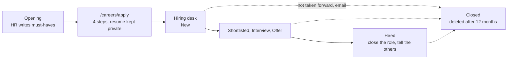

## 2. Applying on the site

Current: the role dialog's button opens the visitor's email app. Nothing reaches /admin.

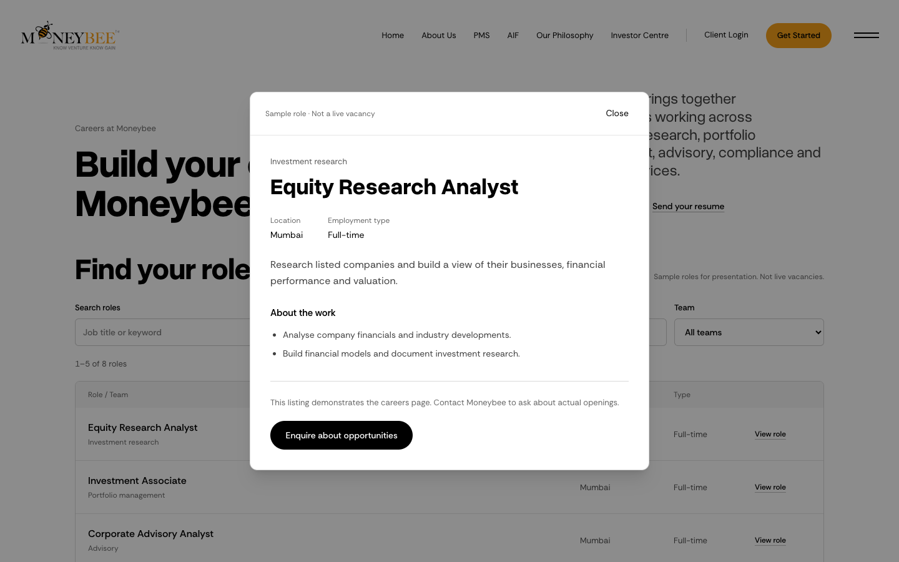

Proposed: a Live role's button reads **Apply for this role** and opens `/careers/apply/<role>`. The page uses the Client Login shell (grey band, one white card, mono eyebrow, bold heading), widened from 460 to 640px. "Send your resume" opens the same form without a role, with a Team question instead of must-haves. Sample roles keep "Enquire about opportunities", which now opens the open-application form too.

| 1 Resume | 3 The role |
| --- | --- |
| 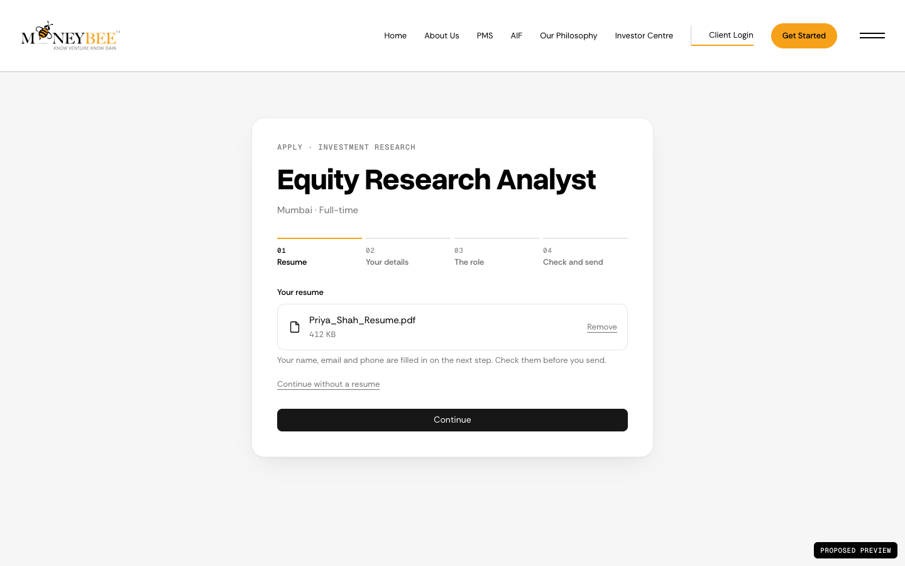 | 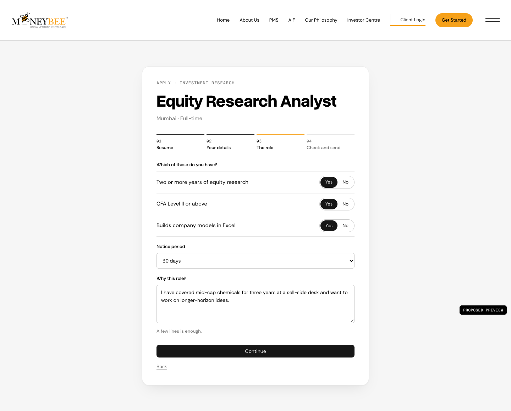 |

| 4 Check and send | Sent |
| --- | --- |
| 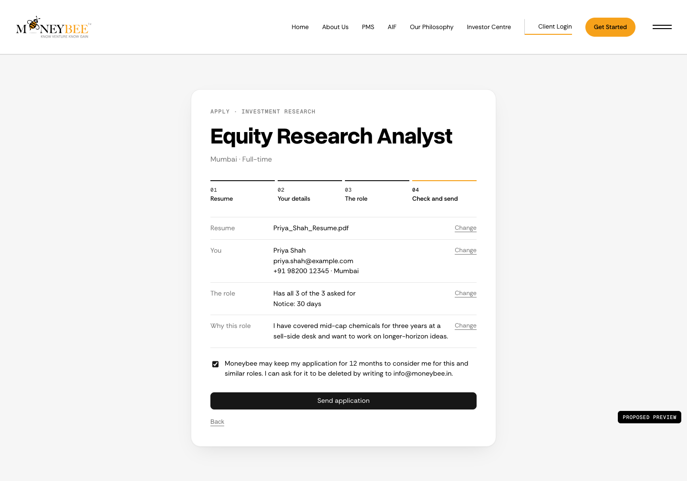 | 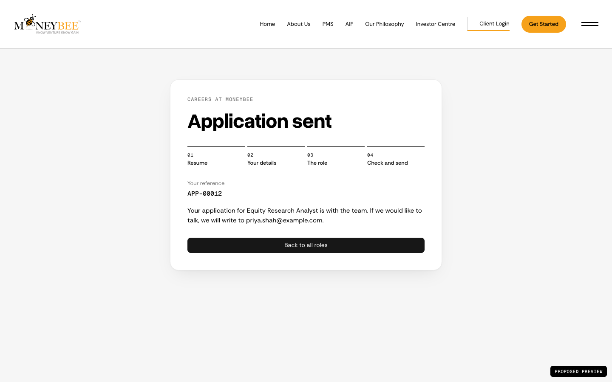 |

Phone, 390 wide: 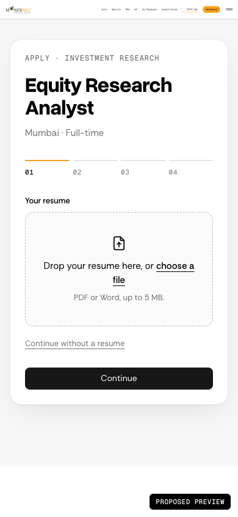 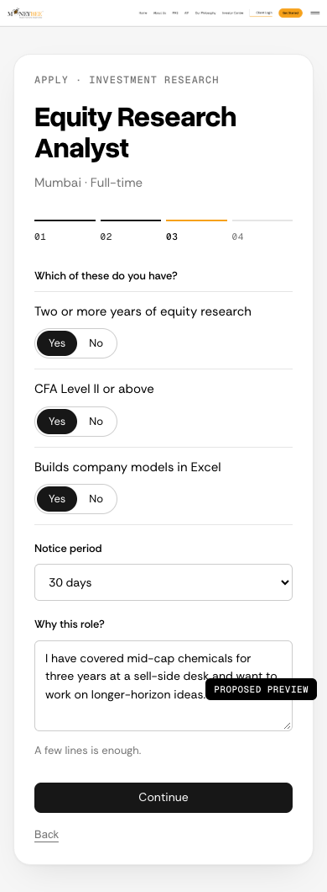

- **Resume first.** PDF or Word, up to 5 MB, checked by its first bytes, not its name. "Continue without a resume" is allowed; the role step then asks for a short note on experience.
- **Filling in from the resume** happens only when the "Read uploaded resumes" switch is on, and the step 1 line saying so appears only then. With it off (today, since AI Gateway is on the free tier), step 2 is typed.
- **Must-haves are yes/no.** HR writes them on the opening; the applicant answers each. HR sees "3 of 3" in the list without opening the resume.
- **Consent** on step 4 states the 12 months and how to ask for deletion. Compliance should read the wording before a role goes Live.
- The sent screen gives a reference and says where we will write. It does not promise a reply time or claim an email was sent when email is not connected.
- Same protection as /contact: hidden honeypot field, five sends per connection per ten minutes.

## 3. The Hiring desk in /admin

A **Hiring** link joins Today, Enquiries, People and Deals under Desk, for the HR and admin roles only.

Current enquiry screen, which the applicant screen copies:

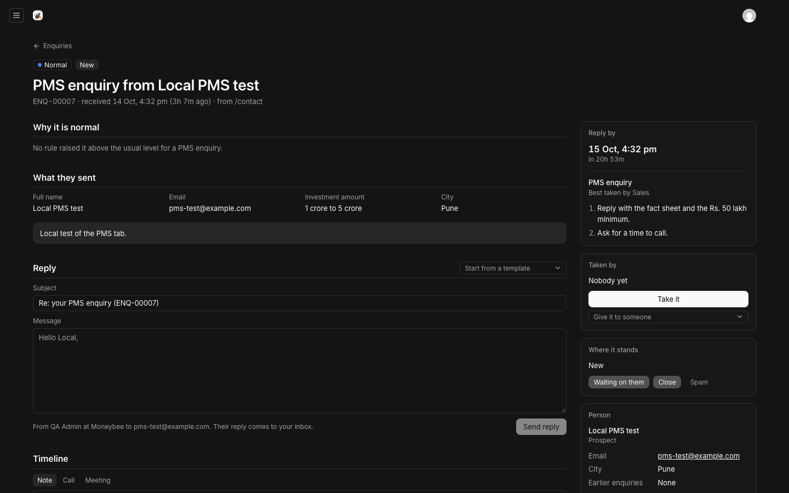

Proposed list (`/admin/hiring`): tabs by stage, a role filter, and the columns HR sorts by. Arrow keys and j/k work as in Enquiries.

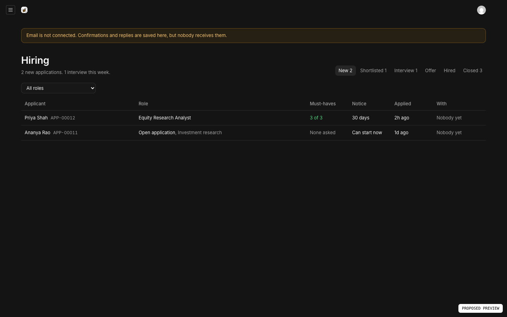

Proposed applicant (`/admin/hiring/:id`): must-haves, the resume shown in the page, what they wrote, interviews, the email composer with the hiring templates, and the timeline. The side column holds the next step, who has it, their details, and the deletion date.

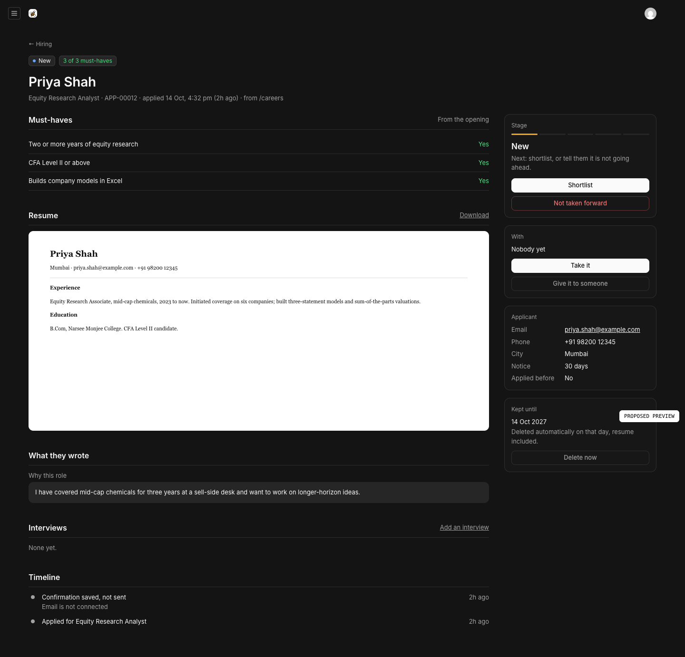

Stage buttons follow one order: **Shortlist**, then **Invite to interview** (date, time, with whom, where; optional invitation email), then **Make an offer** (optional offer email), then **Mark as hired**. **Not taken forward** is on every open stage and asks before emailing:

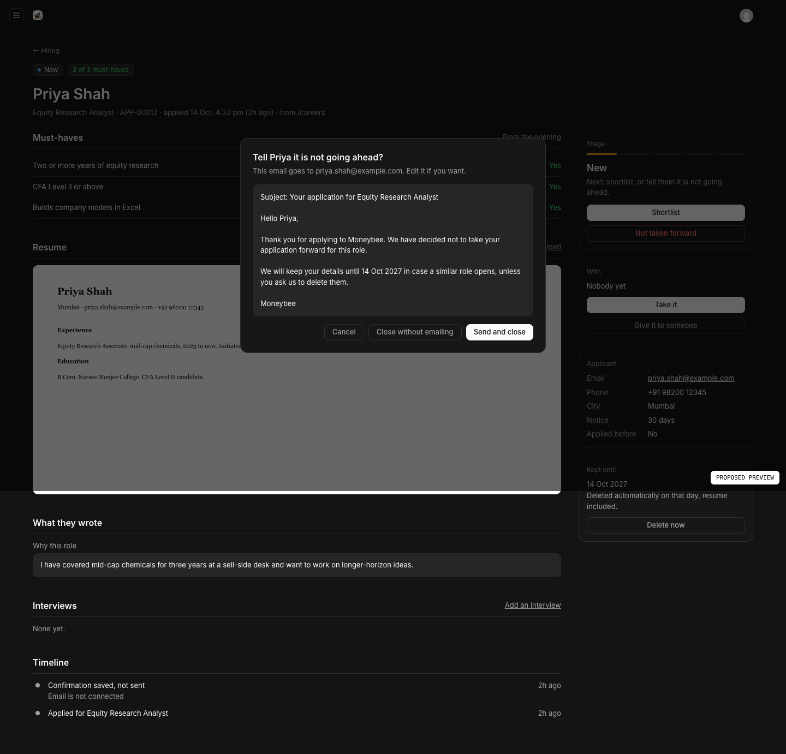

After **Mark as hired**, the side column offers the two jobs that finish the cycle:

| Hired | Tell the others |
| --- | --- |
| 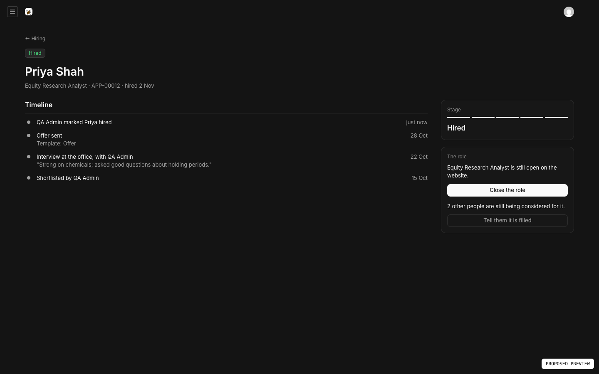 | 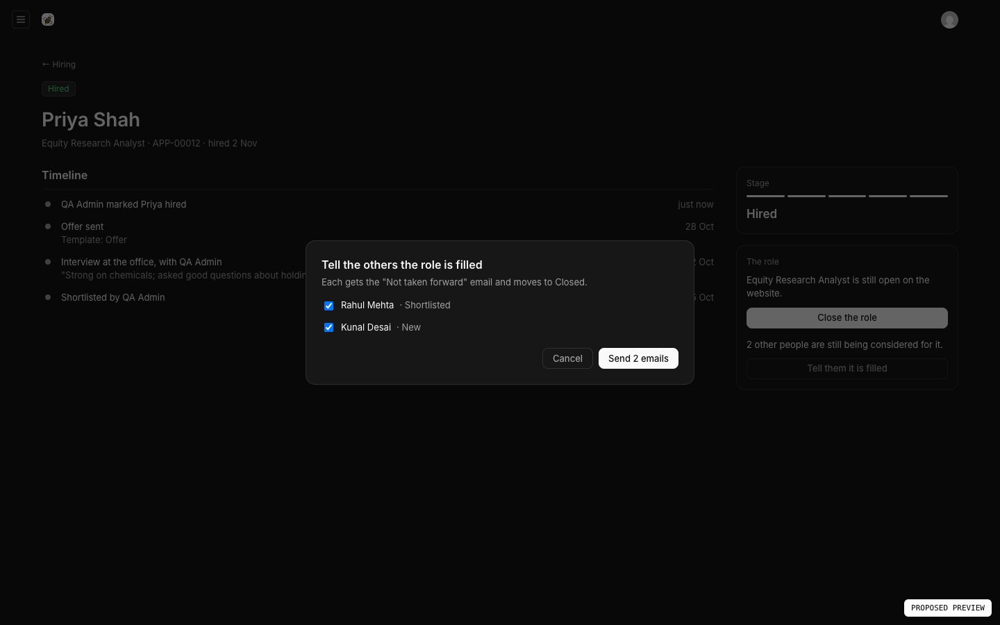 |

**Today** gains "New applications" and "Interviews this week" for HR.

## 4. Email that says when it did not send

This is fix 3 from today's production note, applied to both desks because hiring emails have the same gap. Production has no `RESEND_API_KEY`, so every email is saved with status "logged" and nobody receives it. Proposed:

- The amber banner in the list preview appears on Today, Enquiries and Hiring whenever there is no key.
- Timeline lines say "saved, not sent" instead of "sent".
- The applicant's sent screen and the /contact thank-you never claim a copy was emailed. /contact already checks this; the apply form will too.

Fix 2 comes with it: a migration adds starter templates (enquiry received, application received, not taken forward, interview invitation, offer) and the enquiry playbooks, only where none exist. They contain no names, so production gets them on the next deploy.

## 5. Files

| | Before | After |
| --- | --- | --- |
| `collections/Openings.ts` | Live or Sample | adds **Closed** (kept, off the site), **Must-haves** lines, a web address made from the role name |
| `collections/Applications.ts` | none | one application: role, person, answers, must-have answers, notice, resume key, stage, owner, interviews, history, delete-after date. HR and admin only |
| `lib/hiring/` | none | `apply.ts` (receive, rate limit, after-send work), `apply-actions.ts` (upload, send), `resume-store.ts` (private files), `stages.ts` (order and labels), `desk.ts` (list, counts, detail), `admin-actions.ts` (every button above), `retention.ts` |
| `app/(frontend)/careers/apply/` | none | `page.tsx` (open application) and `[role]/page.tsx` |
| `components/careers/apply-form.tsx` | none | the four steps, Fluid Functionalism inputs and button as on Client Login |
| `components/admin/hiring/` | none | list, applicant screen and side panels, built from the inbox and enquiry screens |
| `app/api/hiring/resume/[id]/route.ts` | none | streams a resume to signed-in HR or admin only |
| `app/api/cron/retention/route.ts`, `vercel.json` | none | daily deletion of expired applications and their files, behind `CRON_SECRET` |
| `collections/Emails.ts`, `lib/crm/mail.ts` | enquiry emails | adds `application`; sales roles stop seeing hiring emails |
| `globals/CrmSettings.ts` | "Enquiry settings" | "Desk settings", with a Hiring group: months to keep (12), send a confirmation (on) |
| `careers-job-board.tsx`, `careers-page-sections.tsx`, `lib/careers.ts` | `mailto:` links, `RESUME_EMAIL`, `applyHref` | links to the apply form; the dead mail helpers removed |
| Today, Enquiries, `nav-links.tsx`, `payload.config.ts` | | Hiring link and views, HR counts, the email banner |
| Guide (`lib/admin/screens.ts`, `guide-how-to.ts`) | | the two new screens and "Hire someone, start to finish", pictures retaken |
| Migration | | applications table, opening fields, emails link, starter templates and playbooks |

Generated: `payload-types.ts`, `app/(payload)/admin/importMap.js`, Guide pictures.

## 6. The decisions that shape it

**Resumes go to a private store, not Media.** Media is public on Vercel Blob, and Payload 3.89's blob plugin only supports public files. `@vercel/blob` 2.3.1 (already installed) supports private stores, which must be created as private:

```ts
// lib/hiring/resume-store.ts
const key = `resumes/${crypto.randomUUID()}${extension}`; // the applicant's file name is never in the path
await put(key, file, { access: "private", contentType, token: process.env.RESUMES_READ_WRITE_TOKEN });
```

HR opens a resume through `/api/hiring/resume/:id`, which checks the role and then streams it. Locally, without the token, files go to `.data/resumes/` (git-ignored). Before go-live this moves to the client's private S3 bucket in Mumbai with the rest of the data.

**Applicants are not People.** Contacts are the sales book, and every sales role can read them. An applicant's details live on the application, so sales never sees a candidate. Email access follows the same rule:

```ts
// collections/Emails.ts
read: ({ req }) => (hasRole(req.user, "hr") ? true : hasRole(req.user, ...CRM_ROLES) ? { application: { exists: false } } : false),
```

**One order of stages, enforced on the server.** A button can only move an application one step forward, or to Closed. Back-steps are allowed for mistakes and land on the timeline.

```ts
// lib/hiring/stages.ts
export const NEXT = { new: "shortlisted", shortlisted: "interview", interview: "offer", offer: "hired" } as const;
```

**The AI switches get wired, and stay suggestions.** "Read uploaded resumes" sends the uploaded PDF to Haiku to fill step 2. "Score applicants" asks Jev each must-have against the resume and shows its answer under the applicant's own, marked as a suggestion. Neither moves a stage or sends anything. Both stay off and cannot be checked end to end until AI Gateway has paid credits.

## 7. Checks after building

1. A visitor applies to a Live role with a PDF. The row appears under New, the resume opens in the admin, and the same resume address returns 401 when signed out.
2. Shortlist, interview with invitation, offer, hired. Close the role: it leaves /careers. Tell the others: both move to Closed with an email row each.
3. Not taken forward with email, and without. With no key, each email row says "saved, not sent" and the banner shows.
4. A sales-only account cannot open Hiring or read hiring emails. An HR-only account can.
5. An application past its date is deleted with its file by the cron route. A call without `CRON_SECRET` gets 401.
6. A 6 MB file, and an `.exe` renamed `.pdf`, are refused with a plain message. The honeypot and rate limit hold.
7. At 390 wide, all four steps fit with no sideways scroll. Keyboard only: every step can be completed.

## 8. Not in this plan

- LinkedIn sign-in. It needs a LinkedIn app registered by Moneybee.
- Calendar invites (.ics) and video links. The invitation email carries the date, time and place.
- Interview scorecards from several interviewers. Notes on the timeline cover one desk for now.
- Offer letters, e-signing, and posting roles to LinkedIn or Naukri.
- Production email itself: it still needs the Resend key and a from-address from you.

## 9. Needs from you

1. **The private file store.** I run `vercel blob create-store moneybee-resumes --access private` and connect it to the `moneybee` project under its own variable (`RESUMES_…`), so the public store's token is untouched. Say go, or create it yourself. Until it exists in production, the apply form skips step 1 and Hiring shows "Resumes are not being kept: private file storage is not connected."
2. **`CRON_SECRET`** on Vercel for the deletion job. I can generate one and add it with `vercel env add`.
3. **Twelve months** as the default for keeping applications. It is a setting, so HR can change it later.
