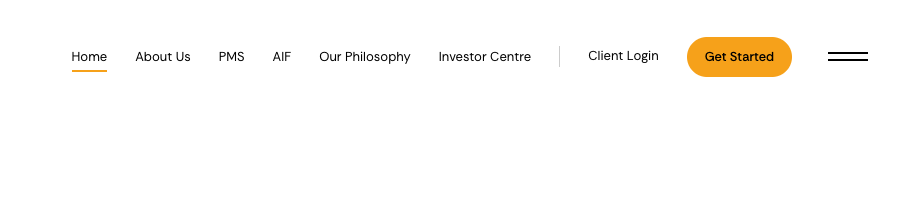
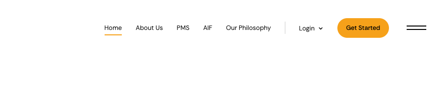
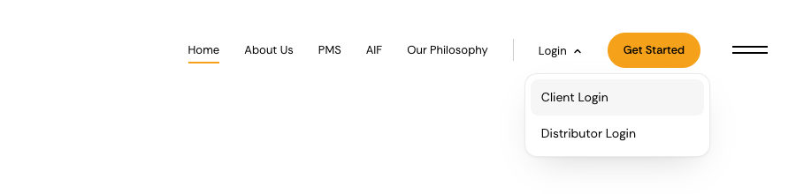
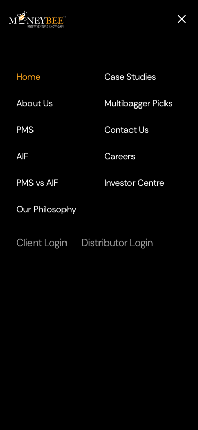

# One Login in the bar

**Problem.** The bar ends with "Investor Centre | Client Login", two links that read as one section. Distributors have no way in from the bar.

**Result.** On every page the bar ends with **Login ⌄**, a small dropdown holding **Client Login** and **Distributor Login**, then Get Started. Investor Centre leaves the bar and stays in the menu and the footer.

**Proof.** The proposed states below were injected into the live page at 1440 and 390 wide (`preview/inject.js`); nothing in the code has changed yet. After approval they are checked again on the real build at the same sizes.

## 1. The bar, 1440 wide

| | |
| --- | --- |
| Current |  |
| Proposed, closed |  |
| Proposed, open, pointer on Client Login |  |

- **Login** keeps Client Login's place behind the hairline, at the same 13px. The chevron turns over when it opens.
- The panel is the Client Login page's white card made small: 14px corners, the same border and shadow. The rows are 14px with the site's #F6F6F6 grey on hover. There are no subtitles in it.
- **Client Login** opens /portal/login. **Distributor Login** opens /investor-centre#logins, the two login cards, where the distributor card says accounts are opened on request and offers Request access.

## 2. How it behaves

- It opens on click or tap, and on hover with a mouse. It closes on Escape, on a click outside, or when the pointer leaves for a moment.
- Keyboard: Enter or Space opens it and moves to Client Login, the arrow keys move between the two, and Escape returns to Login.
- Motion: 160ms, fading in and rising 4px with a strong ease-out, matching the bar's other transitions. With reduced motion it only fades.
- On /portal/login, Login carries the orange underline the bar uses for the page you are on.

## 3. Phones

The bar has no room for Login below 480px, the same point where Client Login leaves today. The menu curtain then gains Client Login and Distributor Login in grey, under the pages:

| Current menu, 390 wide | Proposed |
| --- | --- |
|  |  |

## 4. Files

| File | Change |
| --- | --- |
| `components/ui/site-navigation.tsx` | `barLinks` drops Investor Centre and turns Client Login into a Login entry with two links; the menu gets the same two as its secondary links. Comments updated, including the one calling the menu Investor Centre's only route. |
| `components/ui/overlay-menu.tsx` | `MenuLink` gains `links` for a dropdown; a small `LoginMenu` draws the button and panel; its CSS joins the component's own styles. The unused "Investor login" default goes. |

## 5. Not in this plan

- The footer's Investors column still lists Client Login. Distributor Login could join it, if you want the footer to match.
- No distributor sign-in page. Distributor Login points to the card until distributor accounts exist.
- The Login and Get Started cards at the end of each page are unchanged.
