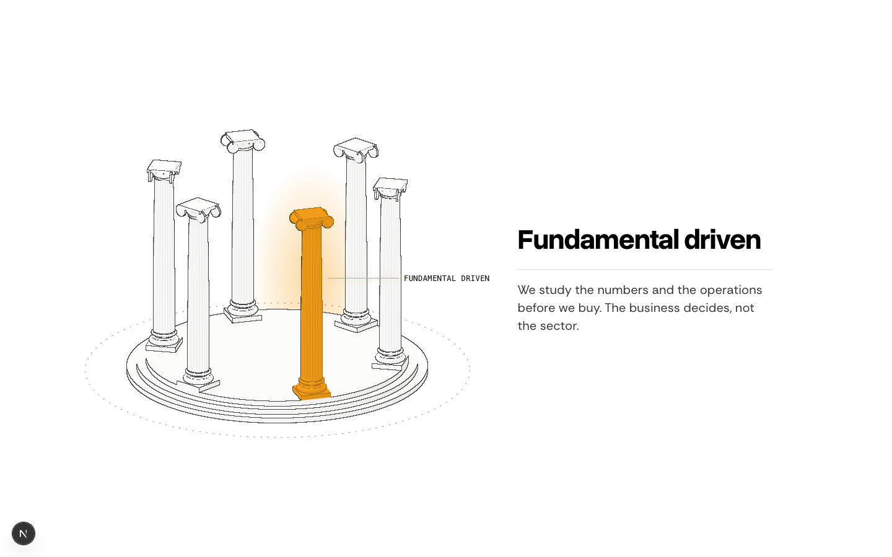
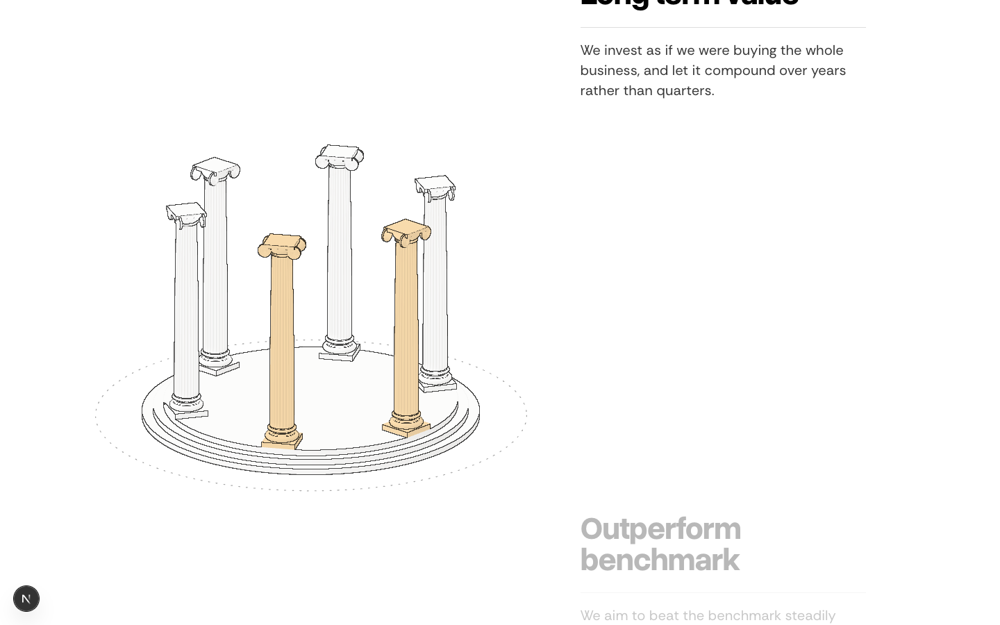
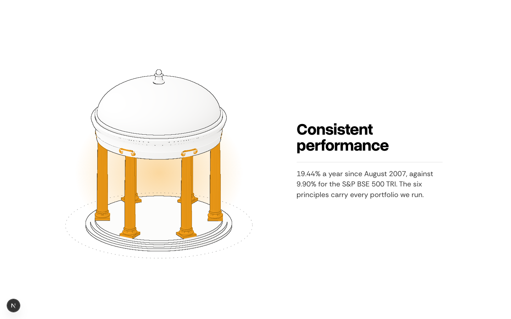
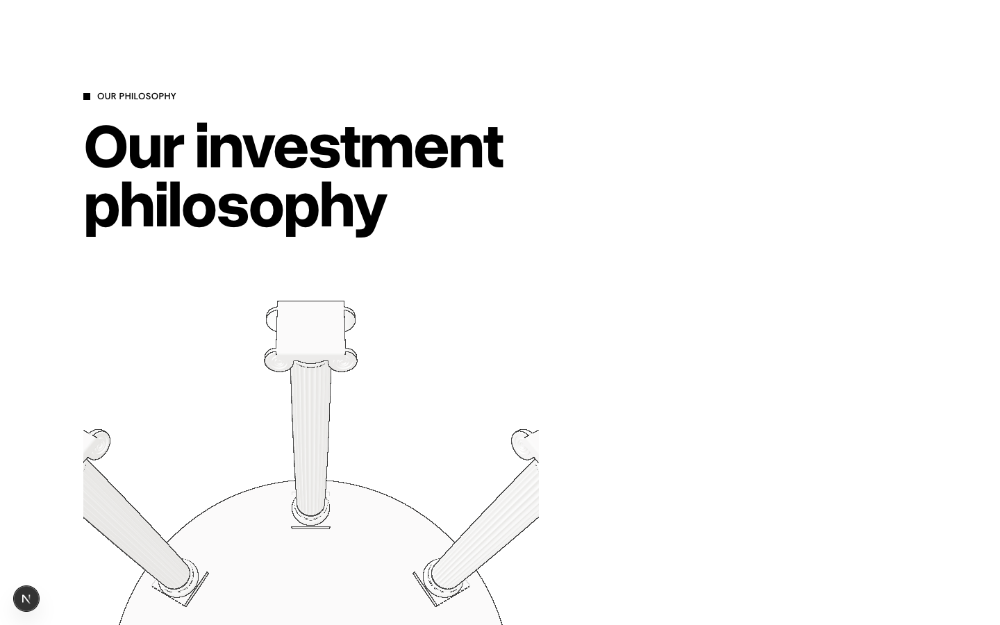
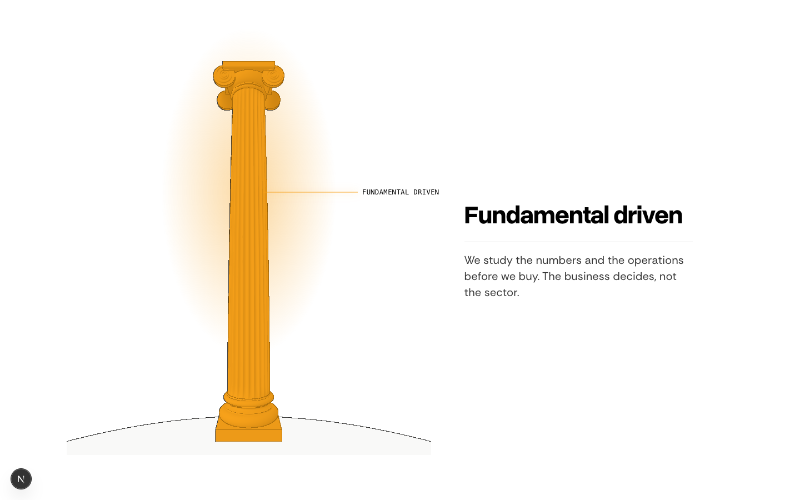
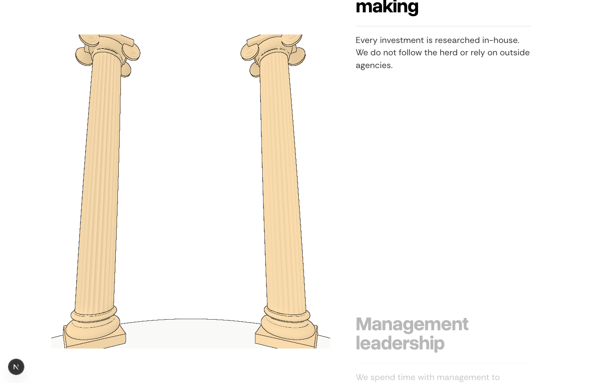
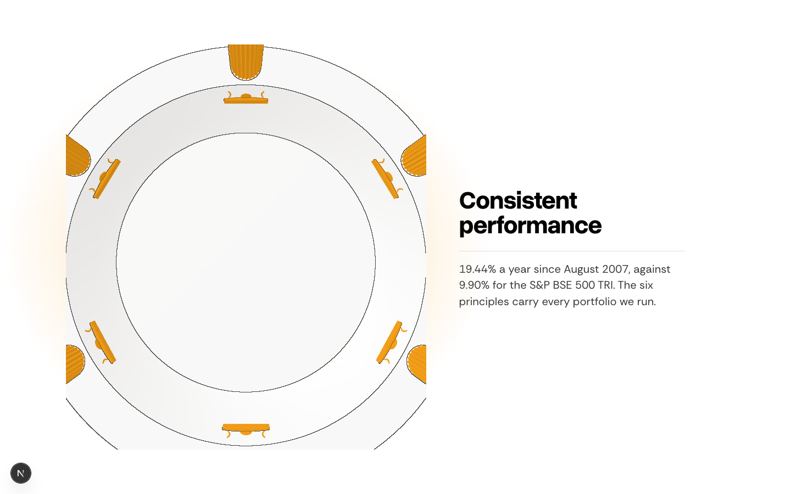

# Pillars: outside or inside?

Both use the same 3D model drawn in the site's 2D style (paper faces, ink hairlines, the orange lit column and its glow), and both move with the scroll. Only the camera differs. Scroll the live previews to feel the motion:

- **A. Outside:** https://moneybees.localhost:1355/preview/philosophy-drawn
- **B. Inside:** https://moneybees.localhost:1355/preview/philosophy-inside

## A. Outside: the temple turns in front of you

No perspective, at the pyramid's tilt, with the dashed ground ellipse. As you scroll, the ring turns to bring each pillar to the front. At the end the roof lands and all six light.

| First pillar | Between pillars | Roof on |
|---|---|---|
|  |  |  |

## B. Inside: you stand among the pillars

The camera comes straight down into the ring from above, then stands inside at head height and turns to face each pillar. The lit one fills the frame and its neighbours sit at the edges. At the end it looks up as the roof lands on all six.

| Arriving from above | First pillar | Turning between pillars | Looking up, roof on |
|---|---|---|---|
|  |  |  |  |

B still needs finishing if you pick it. The floor is cut off at the frame edges, so it needs fading out there. The looking-up shot currently reads as a flat plan of the roof's underside.

**Write A, B, or what to change.**
