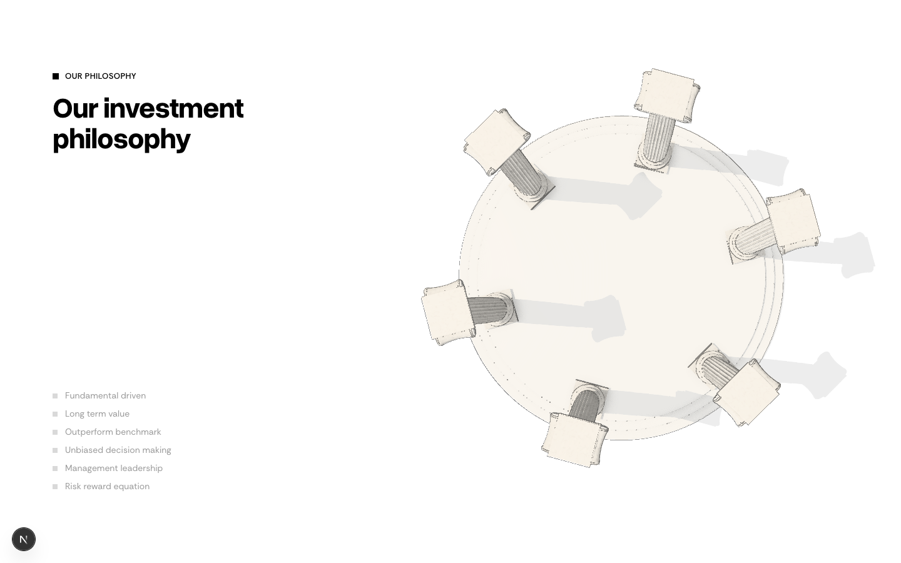
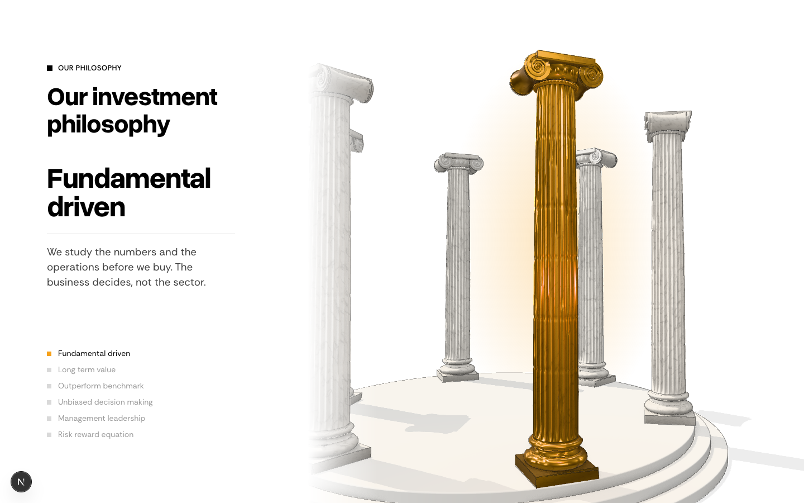
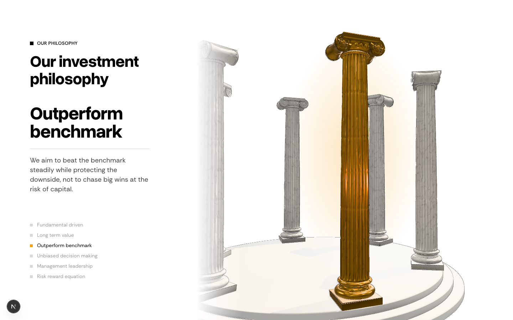
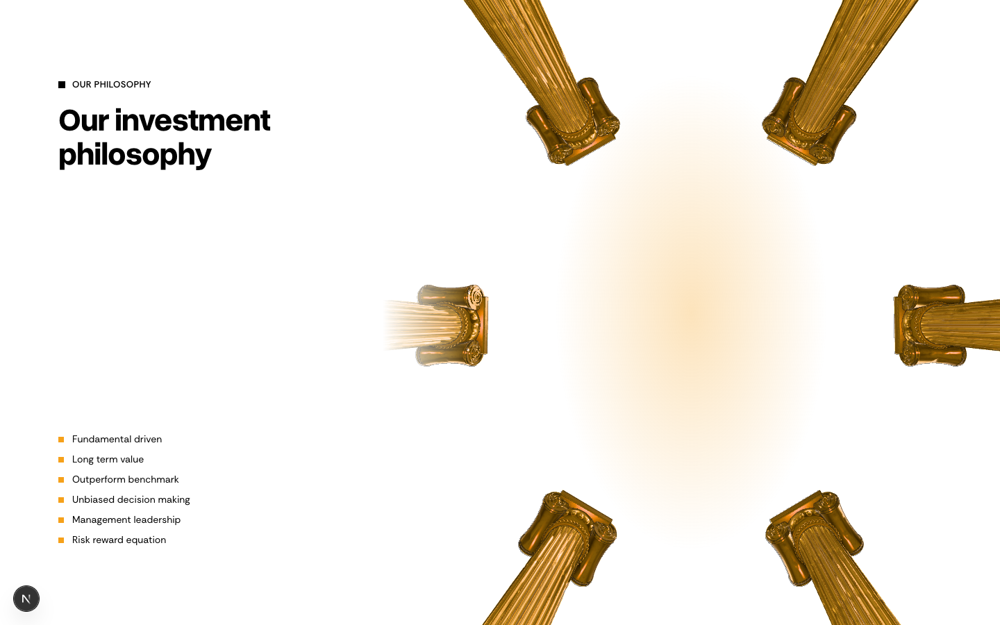
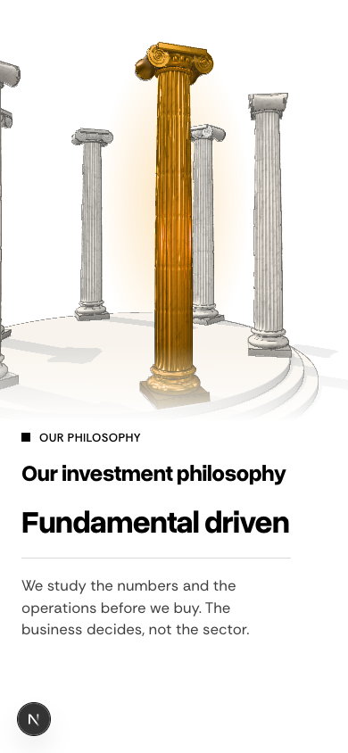

# Philosophy pillars and the team panel

**Problem.** The client liked the philosophy idea, six pillars as six columns. They hated the detailed Roman columns and the layout, and want the section on /our-approach after the returns. Separately, the /about team panel reads as a plain text block with no LinkedIn links.
**Result.** The pillars are redrawn in the pyramid's line style, on the pyramid's pinned layout, after the PMS returns chart on /our-approach, and they come off the homepage. The team panel gets a designed profile with LinkedIn buttons.
**Proof.** The preview runs now: https://moneybees.localhost:1355/preview/philosophy-real

**Revision 5:** revision 4's paper shading made carved stone look like clip-art, and its cracks were noise loops. This version goes back to the real marble and gold you approved in revision 2, and adds what you have asked for since: the same animation, wear and tear, and a hairline tie to the 2D figures.

## 1. Philosophy: what changes

```
/our-approach:  Hero → PMS returns chart → Our investment philosophy (fly-through) → Core philosophy → Process → Criteria → Risk
/ (homepage):   Hero → Record → Two ways → Founder → Get started      (fly-through removed)
```

### Proposed preview (1440 × 900, scroll position through the pinned section)

| 3%: overhead | 20%: first pillar | 44%: third pillar | 99%: all six, looking up |
|---|---|---|---|
|  |  |  |  |

| Phone (390 × 844) |
|---|
|  |

- **Animation:** the original fly-through camera, kept and tuned. It comes down from overhead, goes around the ring with each pillar's column lit as it passes, then goes in and looks up at all six. At each pillar's moment the lit column stands whole near the middle.
- **Stone:** veined statuary marble under a studio environment, with soft shadows and ambient occlusion. The lit column turns to polished gilt.
- **Wear, built into the stone:** each column is different.
  - Uneven drums with visible joints.
  - Chipped flute edges.
  - Worn corners on the abacus and plinth.
  - Grime darkening toward the base, with soft patches and streaks.
  - The carved egg-and-dart, beads and volutes are all modelled.
- **Hairline:** a fine, light ink line on silhouettes and drum joints only, the link to the site's 2D figures. It reads as drawing laid over stone, not a cartoon outline.
- **Layout:** the text holds its own column on the left: the label, the heading "Our investment philosophy" (slide 12 of the group profile deck), the current pillar, and the list of six. The scene runs on the right and fades toward the text. On a phone the scene sits above the text.

## 2. Team panel: what changes

| Current /about | Proposed desktop | Proposed phone |
|---|---|---|
|  |  |  |

- **Name and role:** the name in the bold display font, with the role underneath as a small uppercase mono label.
- **Bio:** after a rule, the first bio line becomes a lead sentence and the remaining lines become ruled rows.
- **Buttons:** "Get in touch" becomes the site's orange button, next to an outlined LinkedIn button with the LinkedIn mark that opens the profile in a new tab.
- **Unchanged:** the carousel layout, portraits, arrows and phone rail.

**LinkedIn, checked 2026-10-09:**

| Person | Profile |
|---|---|
| Shreyam Shah | linkedin.com/in/shreyam-shah-07239559 (headline names Moneybee Group) |
| Ritesh Mistry | linkedin.com/in/ritesh-mistry-a11b4624 (Moneybee Group) |
| Manan Shah | linkedin.com/in/manan-shah-595a0331 (Moneybee Group, diamond trading background matches) |
| Chinmayi Upadhyay | linkedin.com/in/chinmayi-u-0b04a792 ("Chinmayi U.", Senior Associate, Moneybee Group; probable) |
| Anurag Roonwal | linkedin.com/in/anurag-roonwal-50364639, **but MAVIRA AMC announced him as its Director around July 2026** |
| Suprit Shah | none found, so no button until the client sends one |

## 3. Files

| File | Before | After |
|---|---|---|
| `components/philosophy/tholos.ts`, `philosophy-flythrough.tsx` | Homepage fly-through | Replaced by the weathered marble scene and the split pinned section from the preview, used on /our-approach |
| `app/(frontend)/our-approach/page.tsx` | Hero, discs, process, criteria, risk | Adds the PMS returns chart and the pillars after the hero |
| `app/(frontend)/page.tsx` | Includes the fly-through | Removes it |
| `app/(frontend)/page.tsx` | Renders the fly-through | Drops it (three.js now loads only on /our-approach) |
| `components/fact-sections/team-carousel.tsx` | Name, role, clamped bio, outline button | Profile panel and LinkedIn button from the preview |
| `lib/insights.ts` | `TeamMember` has no link | Adds an optional `linkedin` field; the confirmed URLs go on the members |

## 4. Left out, and open questions

- **Anurag Roonwal:** he appears to have left Moneybee. Should he stay on /about until the client confirms?
- **Phone:** the scene sits above the text in the same pinned frame. The empty gap the earlier layout had is gone.
- **Performance:** not measured yet. It's heavier than the drawn version: shadows, ambient occlusion and a hairline pass. It renders only while on screen and while the scroll is moving. I'll profile it on desktop and phone before shipping, and drop ambient occlusion on phones if needed.
- **Previews are static frames:** the camera move is visible on the preview URL.
