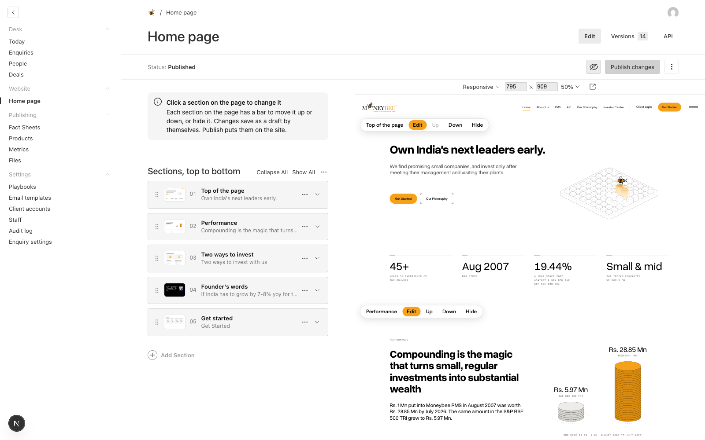
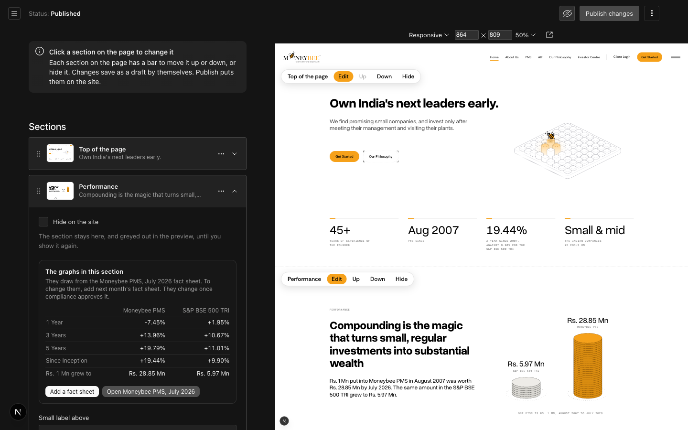
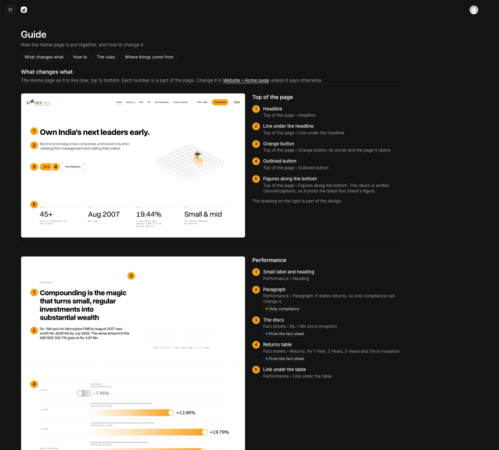
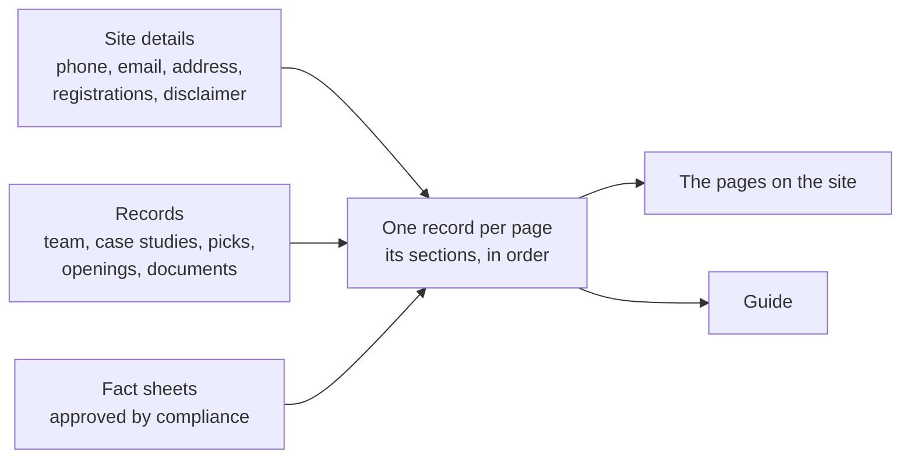
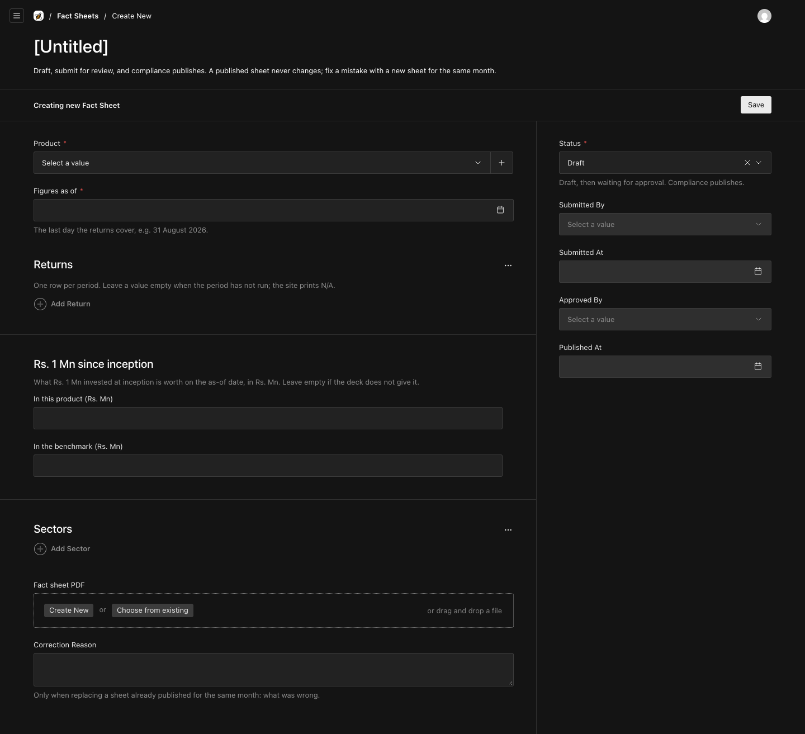
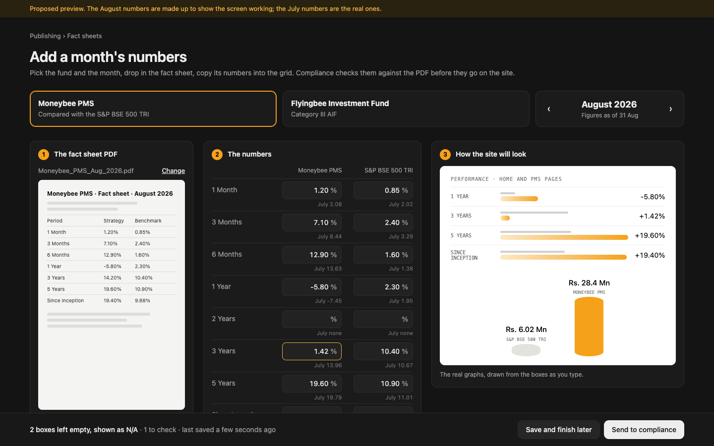

# Every page editable from /admin

## 1. Goal

- **Problem.** Only Home is editable. The other ten pages keep their words, lists and numbers in code. The phone, email and address are typed in three or more places each. /pms and /aif print returns from code, not from fact sheets.
- **Result.** Every page opens in /admin the way Home does: the page on the right, click a section, change it, publish. Lists that are really records (team, case studies, picks, openings, documents) are edited once and show wherever they appear. The office details are edited once. Product pages draw their numbers from fact sheets.
- **Proof, per page.** Its server HTML matches the last commit after the seed migration (Home: 771 lines, 0 differing), and click, move, hide, publish and revert are run on it in the browser. Each page also gets its section of the Guide.

**Verified implementation: the pattern every page will follow.** Home editor, the graphs panel, and the Guide.

## 2. How it fits

## 3. Fact sheets, built for anyone (your note on the first draft)

Every graph of returns depends on this screen, so it has to be hard to get wrong.

**Current.** Payload's raw form. It opens on "[Untitled]". Returns are added one "Add Return" row at a time, each with a period dropdown. "Figures as of" is a bare date picker. Status, Submitted By, Approved By and Published At sit beside the form for anyone to fiddle with.

**Proposed preview.** One guided screen in place of the form. The August numbers in it are made up to show it working. The right-hand panel uses stand-ins; the built screen draws the site's real graph components. The preview is [fact-sheet-preview.html](fact-sheet-preview.html): type in the boxes and the graphs and checks update.

1. **Pick the fund and the month.** Two cards for the funds, and the month with arrows, starting on last month. The "as of" date is the month's last day, set for you.
2. **Drop in the PDF.** It shows on the left while you type, so the numbers are copied from what is in front of you.
3. **Fill a fixed grid that looks like the site's table.** Every period is already there, with last month's number under each box. A whole column can be pasted at once. An empty box prints N/A.
4. **Checks as you type.** A number that moved more than 8 points from last month turns amber with "check it against the PDF". That is how 14.20 typed as 1.42 gets caught. Impossible values are refused.
5. **See the site before sending.** The homepage and /pms graphs redraw from the boxes.
6. **Two buttons.** "Save and finish later" and "Send to compliance". Status, Submitted By and Approved By disappear from view; the system records them.
7. **Compliance gets the same screen, read-only.** Every change from last month is marked. Two buttons: "Approve and publish" and "Send back" with a note. Today already counts sheets waiting for approval.
8. **Fixing a published month.** Open it and press "Correct this month". A copy opens with one extra box: what was wrong.
9. **Later, behind a switch.** "Read the numbers from the PDF" fills the grid for you, using Haiku through AI Gateway once the Gateway has credit. Staff still check each box before sending.

## 4. Decisions, with my recommendation first

1. **One record per page, sharing one set of section types.** The sidebar's Website group lists the eleven pages by name. Each page offers its own sections, plus the shared ones (product hero, page-end doors, questions and answers, heading and paragraph). The other option was one "Pages" list with every section type in it. I recommend against it: each page here is a bespoke build, and a list of all section types on every page invites a team carousel on /contact.
2. **Records become lists of their own.** These are Team members (6), Case studies (3, with FY20 to FY24 figures), Multibagger picks (5 tiers), Openings (8 sample roles) and Documents (11, in 4 groups). Each document gets an uploaded file and a date. That is the fix for "Available on request" on the charter, the Disclosure Document and the complaints data.
3. **Site details, edited once.** These are the phone numbers, emails, office address and map pin, both SEBI registrations, and the market-risk disclaimer. The footer, /contact, Get started and the search data all read it. The menu and the footer's link lists stay in code, so a typo cannot break navigation.
4. **Numbers follow the Home rule.** /pms reads Moneybee PMS fact sheets for its chart, discs and table. The /about rankings become fields only compliance can change. Every return on any page goes through compliance.
5. **Placeholder text is marked.** Today's lorem lines move over as they are. The admin flags each one as "Placeholder: replace before launch", and Today counts them.
6. **Search and sharing per page.** The title and description that Google and link previews show, in a tab on each page.

## 5. Order

| # | What | Why here |
|---|---|---|
| 1 | Site details, read by the footer, /contact, Get started and the search data | Removes the duplicates every later page would otherwise copy |
| 2 | The fact sheet screen above, then /pms | /pms is the hardest page: fact-sheet chart, discs and table, 8 sections. If the pattern holds here, it holds |
| 3 | /about with Team members, the rankings, and the founder | Needs your /about degrees answer; fixes the broken /about#key-members links |
| 4 | /contact, /investor-centre with Documents | Closes the SEBI document gaps |
| 5 | /our-philosophy, /pms-vs-aif | Text and lists only |
| 6 | /aif | After question 1 below |
| 7 | /case-studies, /multi-bagger-picks with Case studies and Picks | After question 2 below |
| 8 | /careers with Openings | Lands with the careers build (real-step apply, resume autofill) |

## 6. Files

| Before | After |
|---|---|
| `globals/HomePage.ts` holds the section types | `lib/pages/blocks/*.ts`, one file per section type, shared |
| `components/site-editor/page-sections.tsx` knows Home's seven sections | A registry from section type to component, for every page |
| Words in `lib/*.ts` constants | `globals/pages/<Page>.ts` per page, seeded from those constants by migration. The constants stay as the fallback without a database |
| Phone, email, address in 3+ files each | `globals/SiteDetails.ts`, plus `lib/site/details.ts` to read it |
| Lists in `lib/insights.ts`, `lib/case-studies.ts`, `lib/career-roles.ts`, `lib/investor-centre.ts` | `collections/TeamMembers.ts`, `CaseStudies.ts`, `Picks.ts`, `Openings.ts`, `Documents.ts` |
| Guide covers Home | `lib/pages/<page>-guide.ts` per page, and the Guide gets a page picker |
| Fact sheets entered in Payload's raw form | `components/admin/fact-sheet/*`, a custom screen for create, review and correct. `collections/FactSheets.ts` keeps its fields and rules; the form view opens the custom screen |

Generated, not written by hand: `payload-types.ts`, the import map, migrations, and the section pictures in `public/site-sections/`.

## 7. Not in this round, and what I need from you

**Questions**
1. **AIF returns on /aif.** SEBI's AIF circular (22.5.1) bars past performance in marketing without the benchmarking agency's report. I recommend hiding the performance section on /aif until that report exists; it stays in the admin, ready to show. The alternative is to keep it public, read from Flyingbee fact sheets that compliance approves.
2. **Multibagger Picks and Case Studies.** Keep both pages as they are, editable, until Moneybee's compliance officer reviews them? Or replace them with monthly investor letters, as peers do?
3. **/about degrees.** /about still shows the founder's degrees as pills. Remove them as on Home?

**Left out**
- New pages at new addresses, and a page template for a new PMS strategy or AIF scheme. Today's /pms and /aif are bespoke.
- The menu and the footer's link lists. Blog.
- Production has no database yet. Until DATABASE_URL is set on Vercel, the live site shows the coded words.
