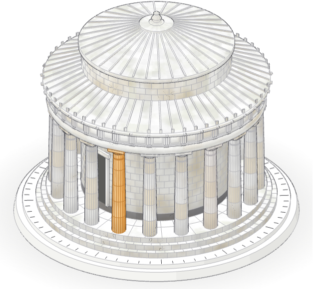
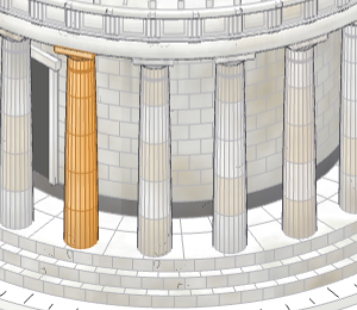
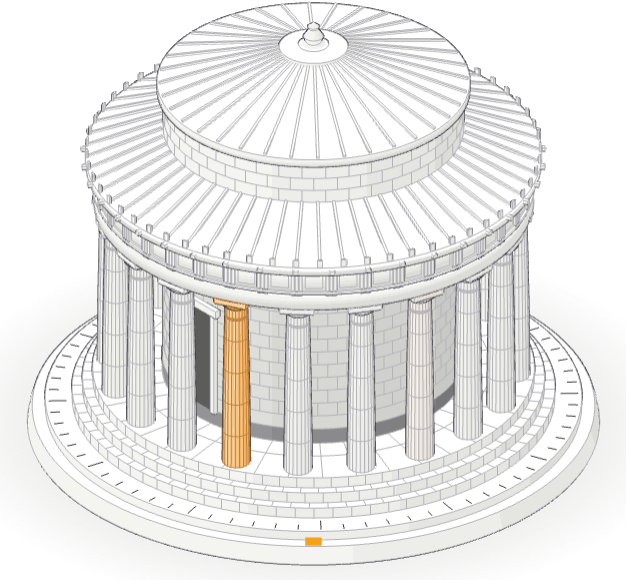
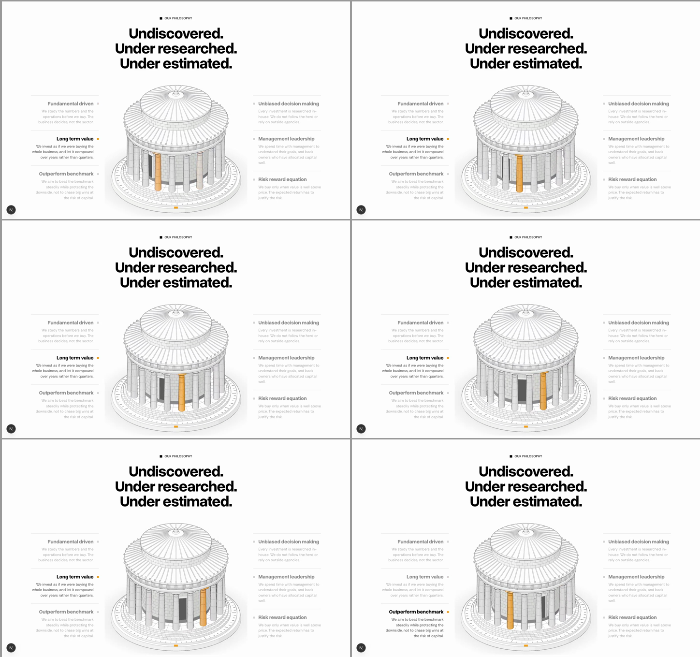
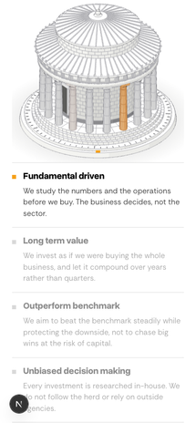

# Our philosophy: the six round a turning tholos (second revision)

## 1. Goal

- **Problem.** The last version sat the drawing beside a list, like any two-column section, and asked you to scroll to make it move.
- **Result.** The section is centred: the heading above, the tholos at Delphi turning on a turntable in the middle, the six principles three a side round it at equal weight. Six of the twenty columns belong to the principles; as each turns through the front it lights orange and its principle comes up in ink.
- **Proof.** Preview at https://moneybees.localhost:1355/preview/philosophy-tholos (1440 × 900 and 390 × 844).

## Changes from your second notes

**Weathered, like the real building.** The stone now ages in the shader, fixed to the stone so it turns with it: every column drum is its own block, warmer old marble or whiter restored stone, banded the way the re-erected columns at Delphi are in your photo; mottling and a warm patina on the walls; rain streaks running down from under the entablature; rising damp at the foot of the walls and columns; sparse hairline cracks; lichen and dirt in patches on the roofs and treads, each run of tiles worn on its own; five antefixes fallen from the eaves. The turntable and its base stay clean, as a stand would.

**The orange mark on the base is gone.** It was the turntable's index mark and meant nothing to a visitor.





Recording: [turn3.mp4](turn3.mp4). Still 60 fps, worst frame 17 ms.

<video src="turn3.mp4" controls loop muted playsinline width="1200"></video>

## Changes from your first notes

More detail, all of it on the real building: block joints on every step and the stylobate's paving; the cella wall in courses and set a step darker behind the colonnade, on its course of dark Eleusinian stone; the upper drum in courses; a framed doorway; the three incised rings under each capital; a metope frame between every triglyph, a regula under each and a lion-head spout over each; antefixes along the eaves; a cap ring and a turned finial on the upper roof.

Flaws removed: the roof ridges crowded into a grey blot at the apex (they now stop on the cap ring) and were drawn with heavy double outlines (now single fine lines); the door read as a grey box; the cella wall was the same white as the columns; nothing grounded the base (a soft shadow now); the model was too small for the page (its column is wider); the heading broke mid-phrase (one sentence a line now); two columns stayed lit too long at a handover (it now takes a quarter second).



## 2. What it shows

```
heading
principle 1  ┐               ┌ principle 4
principle 2  ├─ turning tholos ┤ principle 5
principle 3  ┘               └ principle 6
```

The complete building as reconstructed: three-step crepis 14.76 m across, twenty fluted Doric columns 5.93 m tall in five drums, echinus and abacus, architrave with its taenia, a frieze of forty triglyphs, the cornice, the cella wall with its door, and the two-tier conical roof in tiles, about 13 m to the finial. It stands on a turntable with degree ticks over a fixed base with an orange index mark. Drawn in the anatomy look you pointed at: an orthographic camera 30° up, paper tones banded by facing, an ink silhouette and faint creases.

The principle columns are 0, 3, 7, 10, 13 and 17 of the twenty, about 60° apart, so one turn of 48 s gives each principle about eight seconds.

**Sixteen seconds of the turn, a frame every two seconds:**



Recording: [turn2.mp4](turn2.mp4)

<video src="turn2.mp4" controls loop muted playsinline width="1200"></video>

**Phone:** the model first, then the six.



## 3. Files

| File | What it is |
| --- | --- |
| `components/philosophy-tholos/tholos-turn.ts` | The three.js model, materials and turntable; reports which principle is at the front |
| `components/philosophy-tholos/tholos-section.tsx` | The centred section: heading, the six, the canvas |

three is already a dependency. The model loads with the section and draws only while it is on screen: 60 fps, worst frame 17 ms at 1440.

## 4. Decisions to check

- **Where it goes:** /our-philosophy straight after the hero; "Core Philosophy" (the three discs) stays below it.
- **The building is whole**, not the ruin with three columns: a full ring reads best turning, and every principle gets a column.
- **Speed:** one turn in 48 s.

## 5. Limits

- Without WebGL the canvas stays empty; the six principles still read in full.
- Reduced motion draws the model once, still, with every principle in ink.
