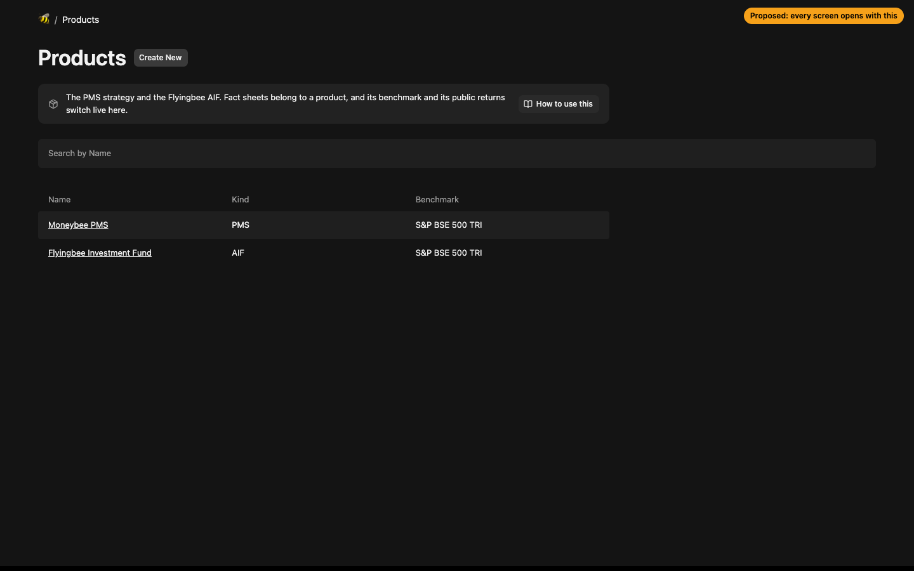
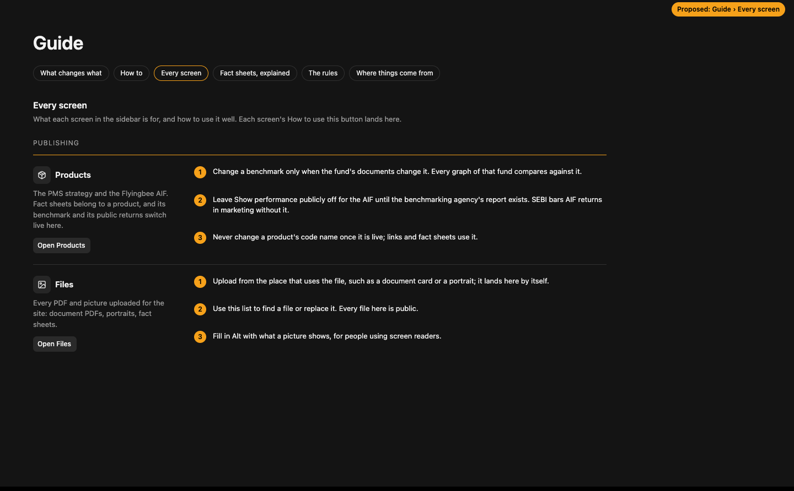

# Every admin screen says what it is for, with a way to learn it

**Problem.** Screens like Metrics open on a list, or on "No Results", with nothing saying what they are for or what changing them does on the site. Staff will not guess.

**Result.** Every screen in the sidebar opens with one line under its title: what it is and what it changes. Beside that line, **How to use this** opens that screen's entry in the Guide, under a new **Every screen** part. Each entry has the same line and three or four steps for using the screen well, plus an **Open** button back to it. One screen, Metrics, is hidden instead, because nothing reads it.

**Proof.** Static mock-ups at 1440×900 below. The words in section 3 are the real proposal.

## 1. On every screen

- One block under the title, in the same style as the "edited elsewhere" notes inside sections: an icon, the line, and the button.
- On lists and on the edit form alike, so it is there whichever way someone arrives.
- It replaces the plain-text descriptions some screens have today (Documents, Team, Case studies, Openings, Office details), so nothing is said twice.
- Today, Enquiries and the Website screen get the same block. The Guide itself does not.

## 2. In the Guide

- A new part, **Every screen**, grouped as the sidebar is (Desk, Website, Publishing, Settings).
- Each entry: icon, name, the line, **Open**, and the numbered steps.
- How to use this lands on the screen's own entry and highlights it.
- The line under "Every screen" in the mock goes: it only describes the page.

## 3. The words

| Screen | Line under the title | How to use it (Guide) |
|---|---|---|
| **Today** | What needs you today: enquiries waiting on Moneybee, ones past their reply time, the ones you took, and fact sheets to approve. | 1. Start each morning here. 2. Work Most urgent from the top; red means the reply time has passed. 3. Any number above zero is work: click it for the list. |
| **Enquiries** | Every message from the Contact page and every call or email staff log. Each one's reply time starts when it arrives. | 1. Take it, so everyone knows it is yours. 2. Read its playbook: how fast, who should answer, the steps. 3. Reply from a template; the reply stops the clock. 4. Close it, or turn it into a deal, when nothing is left to do. |
| **People** | One row per person who has enquired or invests, with every enquiry, email and deal of theirs. | 1. Search by name, email or phone before adding someone; the website adds people by itself. 2. Open a person before replying, to see what they have already been told. 3. Add the family, HUF, company or trust when the money is not the person's own. |
| **Deals** | Each prospective investment, from first contact to money in, and the stage it has reached. | 1. Start one from an enquiry once someone is serious. 2. Move the stage as it happens: Contacted, Meeting, Documents sent, Onboarding, Invested, or Lost with the reason. 3. Fill in the product and amount, so the totals add up. |
| **Pages** | Every page of the site. Edit opens it beside the live page; nothing changes on the site until you publish. | 1. Press Edit on the page. 2. Click the section you want to change on the page; its fields open. 3. Type, check it on the right, then Publish changes. Picture by picture: Guide › What changes what. |
| **Team** | The people in the Our Team carousel on the About page, in this order. | 1. Add a person with their role and a portrait 3 wide by 4 tall. 2. Drag rows to change the order. 3. Leave LinkedIn empty until the address is confirmed. Save puts it live. |
| **Documents** | The cards on the Investor Centre page. A card with a PDF or web address links to it; one without says Available on request. | 1. Open the card. 2. Drop in the approved PDF, or the web address for SEBI's SCORES or ODR. 3. Set the date it carries and Save; it is live straight away. Upload only what compliance has approved. |
| **Case studies** | The companies on the Case Studies page, one section each, with five years of figures. | 1. Write the three lines in plain words. 2. Enter five years of revenue, EBITDA and PAT, oldest first; the charts redraw. 3. Check with compliance before saving: a named stock reads as a recommendation. |
| **Openings** | The roles on the Careers page. A Sample role is labelled as not a live vacancy; a Live one offers Apply. | 1. Add the role, its team, location and type. 2. Set Kind to Live only for a real vacancy. 3. Delete it, or set it back to Sample, once filled. |
| **Office details** | Phone, email, address and map pin, used by the footer of every page, the Contact page and Get started. | 1. Change it here once; every page follows. 2. To move the pin, paste a Google Maps link to the office. 3. Save puts it live. |
| **Fact sheets** | Each month's returns from a fund's fact sheet. Once compliance approves, the graphs and returns on the site change. | 1. Create New, pick the fund and the month, drop in the PDF. 2. Copy the numbers in; amber means a big move, check it against the PDF. 3. Send to compliance; someone else approves it. Why monthly: Guide › Fact sheets, explained. |
| **Products** | The PMS strategy and the Flyingbee AIF. Fact sheets belong to a product, and its benchmark and its public returns switch live here. | 1. Change a benchmark only when the fund's documents do. 2. Leave Show performance publicly off for the AIF until the benchmarking agency's report exists. 3. Never change a code name once live. |
| **Files** | Every PDF and picture uploaded for the site: document PDFs, portraits, fact sheets. | 1. Upload from the place that uses the file; it lands here by itself. 2. Use this list to find or replace a file. Every file here is public. 3. Fill in Alt with what a picture shows, for screen readers. |
| **Playbooks** | What to do with each kind of enquiry: how fast to answer, who should take it, the steps, and the reply to start from. | 1. Write one for each kind and severity that needs its own approach. 2. The first match from the top is the one shown, so order matters. 3. Keep the steps short enough to follow on a call. |
| **Email templates** | The emails staff send from an enquiry and the automatic ones. Words in double braces, like {{firstName}}, fill in when it sends. | 1. Build it from the blocks on the left; the preview shows computer and phone. 2. Send a test to yourself before using it. 3. Never promise returns: SEBI's advertising rules apply to every email. |
| **Client accounts** | Investor logins to the client portal. Moneybee creates each account; a disabled one cannot sign in. | 1. Create the account with the client codes from the back office. 2. Statements named with those codes reach this investor. 3. Disable rather than delete when someone leaves. |
| **Staff** | Everyone who signs in to this admin, and what each may do. Only an admin changes roles. | 1. Give each person only the roles their job needs. 2. Whoever enters numbers should not also approve them; that is compliance's role. 3. Remove people the day they leave. |
| **Audit log** | Every change made here: who, when, and what moved. Nobody can edit or delete it. | 1. Filter by screen or by person to find a change. 2. Use it to answer who changed something, and when, for compliance or a correction. |
| **Enquiry settings** | The reply times the enquiry desk runs on, the acknowledgement email, and the AI settings. A playbook's own reply time wins. | 1. Set reply times the team can keep. 2. Leave the acknowledgement on, so visitors know their message arrived. 3. The AI settings only matter once their switch is on. |

**Metrics** is hidden from the sidebar rather than described. Nothing reads it: the numbers it was meant to hold, like the founder's 45 years, are now fields in the page records. The table stays; it can be shown again in one line.

## 4. Files

| Area | After |
|---|---|
| The words | `lib/admin/screens.ts`: one entry per screen (name, icon, line, steps), the single source for the block and the Guide |
| The block | `components/admin/screen-intro.tsx`, set as each collection's and global's `admin.components.Description`; Today, Enquiries and Website render it themselves |
| The Guide | `components/admin/guide/guide-view.tsx`: the Every screen part with anchors `#screen-<key>` |
| Config | Each collection and global points at its entry; plain `admin.description` strings removed; Metrics `admin.hidden` |

## 5. Left out

- Records reached only from a person or an enquiry (activities, emails, tasks, entities) are not in the sidebar and get no block.
- The block cannot be dismissed. It is one line, and a new member of staff should always find it.
