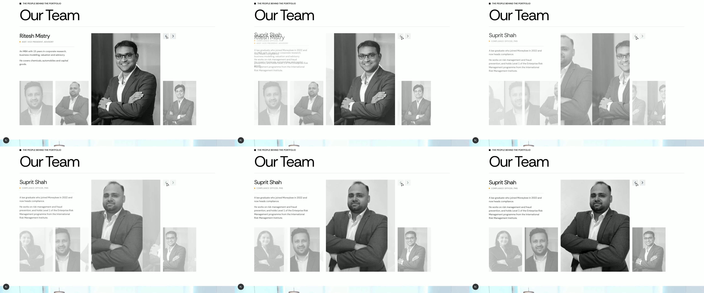
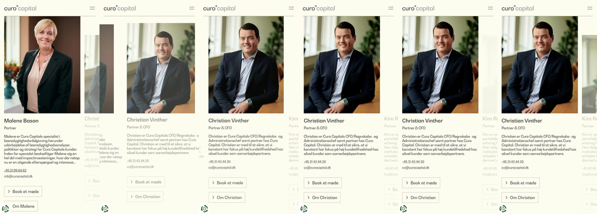
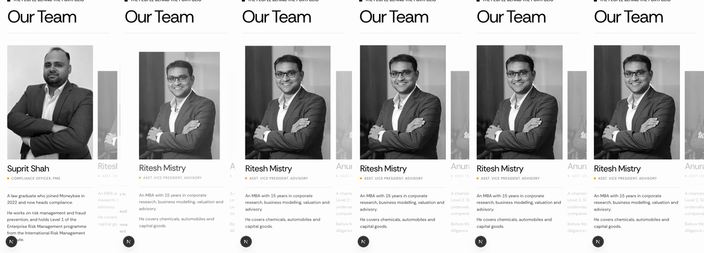
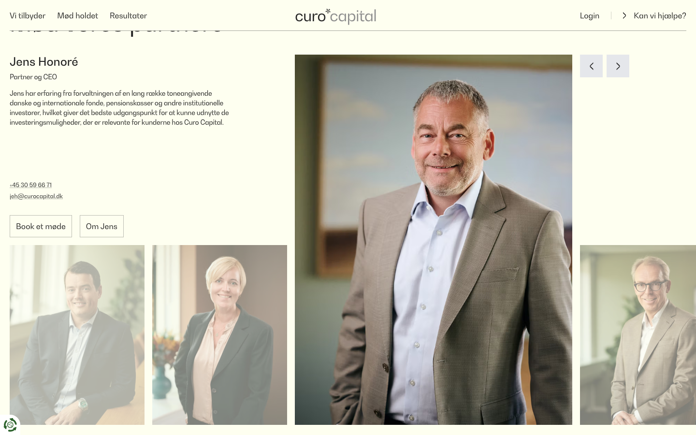
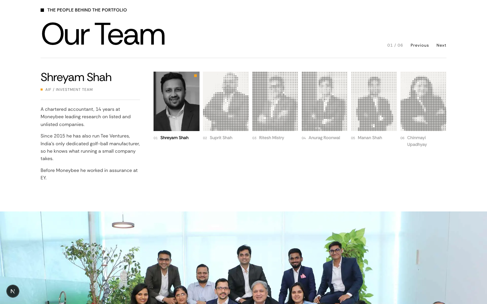
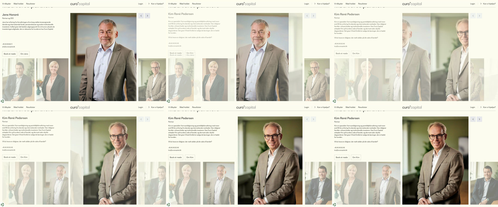
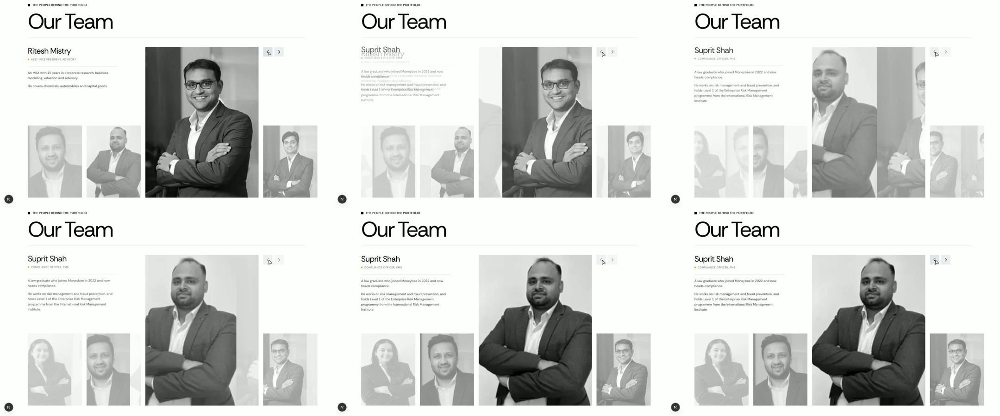

# Homepage "Our Team": rebuilt as curocapital.dk's partner carousel

**Now:** a row of six small halftone cards with a text "Previous / Next" and a 01 / 06 counter.
**After:** curocapital.dk's layout and motion. The active person's bio and portrait sit large, with faded neighbours either side and two square arrows beside the portrait. Every portrait window slides at once when you step.
**Proof:** a working preview at `https://moneybees.localhost:1355/preview/team-carousel` (proposed on top, current below the grey bar). The homepage is unchanged until you approve.

## Revision 2, from your note ("choose best photo size but effect stays, copy effect 1:1")

**Photo size.** The main portrait is now **424px** wide at every desktop width (it was 491px at 1440 and 520px at 1512). That's the smallest the row can be while Shreyam's bio, the longest, still fits above the thumbnails (35px clear). Shreyam's 388px photo now shows at 1.09× and the 270px photos at 1.6× (they were 1.27× and 1.87×). The photos are also served as the original files. Next's image optimiser was re-compressing Shreyam's 18KB JPEG down to 11KB.

**Effect, now 1:1.** I re-read the reference's script and stylesheet and fixed everything that differed:

| | Revision 1 | Now (same as the reference) |
| --- | --- | --- |
| Desktop gutter | 20px | 16px |
| Heading | static | rises 2rem and fades in over 700ms the first time it enters view |
| Portraits | appear at once | fade in over 500ms when loaded |
| Each step | no scroll | scrolls the row into view (smooth, nearest edge) |
| Arrows | added a hover colour | no hover, only the 50% dim while locked |
| Far-left click | ignored while locked | always takes two steps, 700ms apart |
| Phone | native swipe row, no loop | **Embla** (the library the reference runs): loops, autoplays every 4s, the portrait in view grows from 4 columns to the full slide over 600ms, and its bio settles 0.5rem into place |

Desktop step, revision 2 ([recording](proposed-v2/team-step.mp4)):

Phone, reference then ours (both autoplay at 4.0s intervals, measured from the recordings: [reference](reference/curo-mobile-autoplay.webm), [ours](proposed-v2/mobile-autoplay.webm)):

At 390px the reference's slide is 315px with a 299px active portrait and 232px inactive ones. Ours is 302 / 286 / 221, the same grid maths on our 24px side margin instead of its 16px.

**New dependency:** `embla-carousel-react` and `embla-carousel-autoplay`, 8.6.0, pinned. The lockfile was written with the pinned pnpm 10.34.6. One side effect: `node_modules` had been installed with pnpm 12, so it was reinstalled from the lockfile with 10.34.6 (the version Vercel uses).

**Where it still differs from the reference, on purpose:**
- Reduced motion: the reference ignores it. Ours crossfades without sliding and turns autoplay off.
- The row is left-aligned in the site's 120px margins, so the right thumbnail doesn't run off-screen.
- Arrow squares use the site's grey `#EDEEEF`, not Tailwind's `gray-200`.
- No phone, email, "Book a meeting" or "About" buttons, because we have none per person. The reference also cuts bios at 7 lines on phones; ours shows them in full.

---

*Revision 1 follows, kept for reference.*

## Reference, then proposed (1440 × 900)

| curocapital.dk | Proposed preview |
| --- | --- |
|  |  |

Current, for comparison:

## How it moves

The mechanism comes from the reference's own script and stylesheet, pinned in `reference/curocapital/` (values in `NOTES.md` there). Nothing below was eyeballed.

- Four windows (far left, near left, main, right). Each one holds every portrait and clips it. On a step, every window pushes its portrait sideways over **700ms, cubic-bezier(.4,0,.2,1)**, fading as it goes. The right arrow brings the right-hand person into the main window, so new portraits enter from the right.
- The bio drops in from 1rem above over **600ms** (ease-out) while the old one drops 1rem and fades over **200ms** (ease-in).
- Input locks for 700ms per step, and the arrows dim to 50% while locked, as in the reference.
- Clicking the far-left portrait takes two steps, 700ms apart. Near-left takes one back, right takes one forward. ← and → keys work when the row has focus.
- With reduced motion on, the windows crossfade without moving.

Frame strip, reference stepping forward:

Frame strip, proposed stepping back (Ritesh to Suprit):

Recordings: [proposed/team-step.mp4](proposed/team-step.mp4) (next, next, back, far-left) and [reference/curo-step.webm](reference/curo-step.webm).

## Phone (390px)

Below 1280px the reference switches to a swipe row, and so does this. The portrait in view is at full strength with its bio under it, and the neighbours are faded. No sideways page scroll (scrollWidth 390).

## The decision I need from you: photo size

The headshots are small. Five are 270 × 350 and Shreyam's is 388 × 436. I checked both decks: they embed the same files, nothing larger. The main window is 488px wide at 1440, so on a Retina screen the 270px photos are stretched about 3.6×. They go soft, with visible JPEG blocking:

| Shreyam (388px source), 2x screen | Suprit (270px source), 2x screen |
| --- | --- |
|  |  |

Shreyam's is also a tight head shot while the other five are half-length, so the main window changes scale when you step onto him.

Options:
1. **Ask the client for the original headshots (recommended).** Ship the layout now with these files and swap the photos in when they arrive. No code change needed.
2. Make the main window smaller (4 columns instead of 5, about 390px). That's less stretch, but it no longer matches the reference's proportions.
3. Upscale the photos locally with an AI upscaler. I'd rather not do this to real people's faces without the client agreeing.

## Files

| File | Before | After |
| --- | --- | --- |
| `components/fact-sections/team-carousel.tsx` | none | New. Heading, desktop row, phone rail, team photograph. |
| `components/fact-sections/team-section.tsx` | Homepage team section | Deleted after approval (only the homepage imports it). |
| `app/page.tsx` | Imports `TeamSection` | Imports `TeamCarousel`. |
| `app/preview/team-carousel/page.tsx` | none | Preview only, deleted after approval. |
| `lib/insights.ts` | `TEAM` | Unchanged. Same six people, same bios. |

## What I kept and what I left out

- **Kept:** the heading ("The people behind the portfolio" / "Our Team"), the bio type and orange role mark, grayscale photos (the site's people are grey everywhere), the full-width team photograph at the end.
- **Dropped:** the 01 / 06 counter and the text Previous / Next. The reference has neither. Its arrows replace them.
- **Not copied:** the reference's phone number, email, "Book a meeting" and "About X" buttons under each bio. We have no per-person contact details or pages.
- **Differs from the reference:** the row sits inside the site's 120px margins, so the right-hand portrait stays on screen. On curocapital.dk it runs 39px off the edge. The phone swipe row stops at the ends instead of looping. I left out the reference's scroll-into-view on each step.

## Not yet verified

- Checked in Chrome only, at 1440 × 900 (1x and 2x), 1280 × 800 and 390 × 844. At 1280, the narrowest width that gets the row, the longest bio (Shreyam) ends 40px above the thumbnails ([screenshot](proposed/desktop-1280.png)).
- Screen-reader announcement of the bio change (`aria-live`) is not tested.
