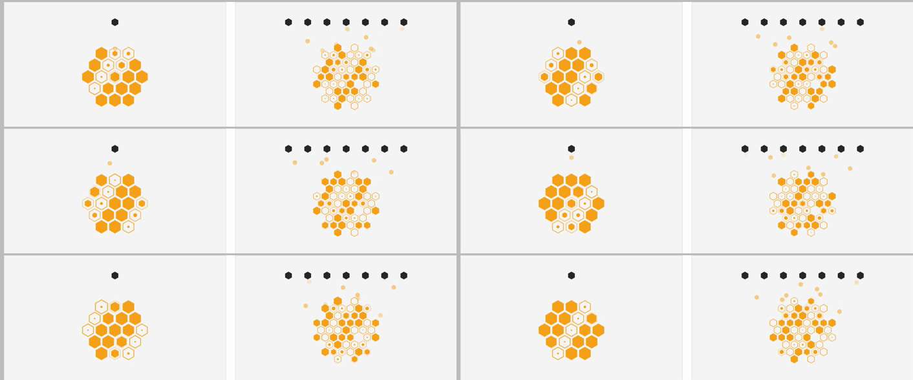
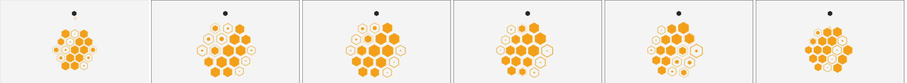
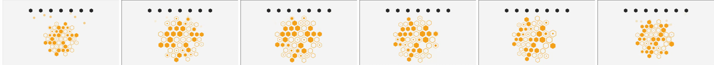

# Two ways to invest: card figures, second version

## 1. Goal

- **Problem.** The first version told one story for both cards (picks from a market) and moved in steps: cells popped in, colours switched, scenes cut. You asked for Whitespace's smoothness and for each card to carry its own concept.
- **Result.** Each figure shows what the product is, in one continuous motion. PMS: one investor drips money into one portfolio of 19 listed stocks. AIF: seven investors drip into one pooled fund of 25 listed and 24 unlisted companies, and the unlisted cells keep filling as companies go public.
- **Proof.** Preview at https://moneybees.localhost:1355/preview/two-ways (1440 × 900), recording and frames below.

## 2. What it does

```
investors (ink) ──drops──▶ holdings (orange)
PMS:  1 investor  ──▶ 19 cells, all listed         one portfolio of your own
AIF:  7 investors ──▶ 49 cells, 25 solid 24 hollow  one fund, pooled
```

| | Moneybee PMS | Flyingbee AIF |
| --- | --- | --- |
| Investors | one | seven |
| Holdings | 19 cells. Deck: 15 to 20 stocks | 49 cells: 25 listed (solid), 24 unlisted (hollow). Deck: at least 51% listed, up to 49% unlisted |
| The wave | listed cells open briefly to a ring and close | the same, and unlisted cells fill briefly: going public |
| Shape | a hexagon, one cell made of cells | the AIF mark's outline |

The motion is Whitespace Pattern Cards' code, read from its deployed source (pinned in `reference/whitespace-pattern-cards/`, values in NOTES.md there), not eyeballed:

- **Morph.** Every cell is always on one sine wave, `sin(t · 0.16 · 2π + phase · 2.25)`, eased by Whitespace's power-3 curve. The solid shrinks inside a ring that fades in, and the wave travels diagonally (`phase = 0.45 · row + 0.7 · col`). Nothing pops.
- **Drops.** Drops leave each investor about every 1.7 s (Whitespace's 0.6 a second, same jitter), fall at a constant speed, fade in and out, and the cell they reach swells slightly.
- **Pointer.** Cells near the pointer grow on Whitespace's curve and the rest make room. Every change eases toward its target (200 ms position, 260 ms scale), and the drops fade while the pointer is in, as Whitespace does.

Both cards use the same timing, cell look, drop size and pointer behaviour, and both glyphs cover the same area.

**Current**, the live homepage:


**Proposed preview**, six moments one second apart at rest (top to bottom, left then right):



**Pointer**, PMS then AIF, from the pointer entering to after it leaves:





Recording: 8 s at rest, then the pointer across PMS, then across AIF: [figures.mp4](figures.mp4)

<video src="figures.mp4" controls loop muted playsinline width="1198"></video>

### States checked

- **Phone (390 wide):** cards stack, figures run at their width.

  

- **Reduced motion:** the glyphs at rest, no drops, no pointer response. Two captures 1.5 s apart differ in 0 pixels.

  

- **Cost:** one canvas per card, running only while in view. 60 fps, worst frame 17 ms, both running.

## 3. Files

| File | Now | After approval |
| --- | --- | --- |
| `components/home/two-ways-section.tsx` | `ProductMark` with a CSS hover close (`MARK_CSS`, `tw-half`) | `FundFigure` in the same box; `MARK_CSS` and `tw-half` go; stays a server component |
| `components/home/fund-figure.tsx` | none | the canvas figure, moved from the preview without the `?t=` seek |
| `app/(frontend)/preview/two-ways/` | the preview | deleted once the homepage has it |

`components/pms-v3/marks.tsx` is untouched. The /pms and /aif heroes keep their marks.

## 4. The parts that carry the decision

Listed and unlisted sit on opposite sides of the same wave, so at any moment the AIF reads as mostly solid plus mostly hollow:

```ts
const LISTED_BIAS = -0.6;   // mostly solid, opening to a ring as the wave passes
const UNLISTED_BIAS = 0.6;  // mostly hollow, filling as the wave passes
```

Whitespace packs 13 dots by relaxation. With 49 cells that either blew the pool apart or left overlaps (both seen in recordings), so the pointer moves each cell out to `d' = ∫₀ᵈ s(u) du` of its scale curve. Spacing then grows exactly as fast as the cells, so none can overlap:

```ts
const scale = 1 + (S - 1) * inside ** e;
const reach = d + ((S - 1) * R * (1 - inside ** (e + 1))) / (e + 1);
```

## 5. Left out and limits

- The card hover no longer closes a split mark; the figure answers the pointer instead. The /pms and /aif heroes still open on their split marks.
- No cell stands for a real company.
- Whitespace also moves the glyph to the card centre on hover and fades the other cards to 12%. Both are left out: the second would put one product over the other.
- Sources that changed this: Whitespace Pattern Cards' source (morph, drop, pointer curve and smoothing values, used as read). Earlier version's market idea dropped.
